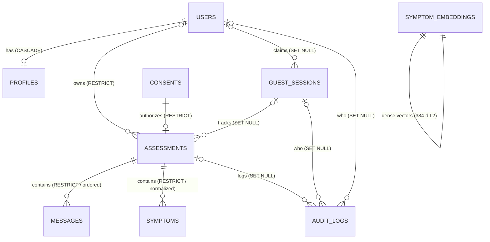

# Data Integrity & Verification Report

Owner: Kavya · Task: S2-KAV-6 · Issue: #200 · Requirement: NFR-08

---

## 1. Executive Summary

This report establishes the final data integrity and relational invariant baseline for the AI-Based Symptom Checker database tier across all nine PostgreSQL 16 schema tables. In accordance with **NFR-08 (Quality, Standards, Documentation)**, **FR-17 (Consent Recording)**, **FR-18 (Audit Logging)**, **DR-02 (Deterministic Clinical Rules)**, and the **Digital Personal Data Protection (DPDP) Act 2023**, all data integrity rules are formally specified and validated through an automated test suite.

The test suite (`server/tests/unit/db/test_data_integrity.py`) executes 24 automated unit tests verifying foreign key cascades, restrict protections, check constraint bounds, domain enforcements, medical safety invariants, and transactional rollback atomicity.

---

## 2. Nine-Table Schema Scope

The database schema comprises nine tables across migrations `0001_database_foundation` through `0008_query_perf_indexes`:



| # | Table | Purpose | Primary Key | Key Invariants |
|---|---|---|---|---|
| 1 | `users` | Registered user credentials & identity | UUID | Unique nonblank lowercase email, nullable opaque hash |
| 2 | `consents` | Affirmative medical triage consent (DPDP) | UUID | Nonblank policy version, affirmative record |
| 3 | `guest_sessions` | Anonymous guest triage sessions | UUID | Unique 64-char SHA-256 token hash, `expires_at > created_at` |
| 4 | `profiles` | Optional coarse demographic & clinical context | UUID | Unique 1-to-1 `user_id`, coarse age band, biological sex |
| 5 | `assessments` | Clinical assessment session state machine | UUID | Valid consent FK, state domain, user or guest ownership |
| 6 | `messages` | Ordered conversation turns | UUID | Nonnegative position, unique per assessment, role check |
| 7 | `symptoms` | Extracted & confirmed clinical symptoms | UUID | Unique name per assessment, structured JSONB details |
| 8 | `audit_logs` | Immutable operational & clinical audit trail | UUID | Nonblank action, model revisions, zero PII |
| 9 | `symptom_embeddings` | Dense 384-d vectors for semantic search | BIGSERIAL | Unique `(model_revision, phrase)`, exact linear scan |

---

## 3. Relational Invariants & Foreign Key Actions

The database establishes explicit foreign key delete behaviors to balance data lifecycle automation with medical safety and legal compliance:

### 3.1 Cascading Deletions (`ON DELETE CASCADE`)
- **`profiles.user_id` → `users.id`**: When a registered user invokes their Right to Erasure under the DPDP Act 2023, their profile data (coarse age band, biological sex, chronic conditions) is immediately and automatically deleted.

### 3.2 Nullification on Delete (`ON DELETE SET NULL`)
- **`guest_sessions.claimed_by_user_id` → `users.id`**: Deleting a user account clears the `claimed_by_user_id` pointer, preserving anonymous session history without dangling references.
- **`assessments.guest_session_id` → `guest_sessions.id`**: Purging expired guest sessions (24-hour TTL) clears the guest link from assessments while preserving triage results and consent integrity.
- **`audit_logs.user_id` → `users.id`**: Deleting a user account anonymizes the audit trail by setting `user_id = NULL`.
- **`audit_logs.guest_session_id` → `guest_sessions.id`**: Purging a guest session sets `guest_session_id = NULL` on audit entries.
- **`audit_logs.assessment_id` → `assessments.id`**: Deleting an assessment clears `assessment_id` on audit logs while preserving operational telemetry and model lineage.

### 3.3 Deletion Restrictions (`ON DELETE RESTRICT`)
- **`assessments.user_id` → `users.id`**: Prevents accidental raw deletion of a user if associated assessments have not been cleaned up through authorized repository erasure workflows (`delete_assessments_for_user`).
- **`assessments.consent_id` → `consents.id`**: Under DPDP Act 2023, consent records cannot be deleted while dependent clinical assessments exist.
- **`messages.assessment_id` → `assessments.id`**: Prevents deleting an assessment row directly if conversation messages exist, ensuring message deletion is explicit and audited.
- **`symptoms.assessment_id` → `assessments.id`**: Prevents deleting an assessment row directly if confirmed symptoms exist.

---

## 4. Constraint & Domain Enforcement Matrix

| Table | Constraint Name | Type | Expression / Rule | Rationale |
|---|---|---|---|---|
| `users` | `uq_users_email` | UNIQUE | `email` | Unique account identity |
| `users` | `ck_users_email_nonblank` | CHECK | `length(trim(email)) > 0` | Rejects empty or whitespace-only emails |
| `users` | `ck_users_password_hash_nonblank` | CHECK | `password_hash IS NULL OR length(trim(password_hash)) > 0` | Rejects empty string passwords |
| `consents` | `ck_consents_policy_version_nonblank` | CHECK | `length(trim(policy_version)) > 0` | Requires explicit policy version |
| `guest_sessions` | `uq_guest_sessions_token_hash` | UNIQUE | `token_hash` | Rejects duplicate bearer tokens |
| `guest_sessions` | `ck_guest_sessions_token_hash_length` | CHECK | `length(token_hash) = 64` | Guarantees SHA-256 hex format |
| `guest_sessions` | `ck_guest_sessions_expires_after_created` | CHECK | `expires_at > created_at` | Guarantees valid TTL window |
| `profiles` | `uq_profiles_user_id` | UNIQUE | `user_id` | Enforces 1-to-1 profile per user |
| `profiles` | `ck_profiles_age_band` | CHECK | `age_band IN ('child','teen','young_adult','adult','senior')` | DPDP coarse age minimization |
| `profiles` | `ck_profiles_biological_sex` | CHECK | `biological_sex IN ('female','male','other','prefer_not_to_say')` | Clinical risk calibration |
| `assessments` | `uq_assessments_consent_id` | UNIQUE | `consent_id` | Enforces 1-to-1 consent per assessment |
| `assessments` | `ck_assessments_state` | CHECK | `state IN ('START','SYMPTOM_COLLECTION','CLARIFYING','CONFIRMING','READY','ANALYZING','COMPLETED')` | Restricts state machine values |
| `messages` | `uq_messages_assessment_id_position` | UNIQUE | `(assessment_id, position)` | Prevents duplicate turn indices |
| `messages` | `ck_messages_position_nonnegative` | CHECK | `position >= 0` | Guarantees 0-indexed turn sequence |
| `messages` | `ck_messages_role` | CHECK | `role IN ('user', 'assistant')` | Enforces authorized speaker roles |
| `messages` | `ck_messages_content_nonblank` | CHECK | `length(trim(content)) > 0` | Rejects empty chat turns |
| `symptoms` | `uq_symptoms_assessment_id_name` | UNIQUE | `(assessment_id, name)` | Prevents duplicate symptoms in assessment |
| `symptoms` | `ck_symptoms_name_nonblank` | CHECK | `length(trim(name)) > 0` | Rejects blank symptom identifiers |
| `audit_logs` | `ck_audit_logs_action_nonblank` | CHECK | `length(trim(action)) > 0` | Rejects untyped audit records |
| `symptom_embeddings` | `uq_symptom_embeddings_revision_phrase` | UNIQUE | `(model_revision, phrase)` | Prevents duplicate embeddings per model |

---

## 5. DPDP Act 2023 & Medical Privacy Guarantees

1. **Zero Image / Binary Storage:**
   - No image column, binary payload, or BLOB is defined in any table.
   - User skin condition images are analyzed transiently in-memory and discarded. Only the model commit (`cv_model_version`) is logged.
2. **Bearer Token Cryptographic Protection:**
   - Guest bearer tokens are generated with 32 bytes of secure entropy (`secrets.token_urlsafe(32)`).
   - Only the SHA-256 hex digest (`CHAR(64)`) is persisted in `guest_sessions.token_hash`.
3. **Anonymized Clinical Audit Preservation (NFR-10):**
   - When an account is erased under DPDP Right to Erasure, audit rows preserve the action, model lineages, deterministic rule tier, and rules fired with `user_id = NULL`.
   - This satisfies clinical traceability and adverse-event reporting requirements without retaining personal data.
4. **Data Minimization:**
   - Coarse age bands replace date of birth.
   - Freeform conversation messages pass through PII scrubbing before storage.

---

## 6. Automated Verification Matrix (`test_data_integrity.py`)

The test suite in `server/tests/unit/db/test_data_integrity.py` validates all schema invariants:

| # | Test Name | Invariant Under Test | Result |
|---|---|---|---|
| 1 | `test_user_profile_cascade_delete` | Profile deleted on user account deletion (`CASCADE`) | PASSED |
| 2 | `test_guest_session_user_set_null_on_delete` | Claimed user FK set to NULL on user deletion | PASSED |
| 3 | `test_assessment_guest_session_set_null_on_delete` | Guest session FK set to NULL on session purge | PASSED |
| 4 | `test_audit_log_set_null_on_user_delete` | User FK set to NULL on user deletion | PASSED |
| 5 | `test_audit_log_set_null_on_guest_session_delete` | Guest session FK set to NULL on session purge | PASSED |
| 6 | `test_audit_log_set_null_on_assessment_delete` | Assessment FK set to NULL on assessment deletion | PASSED |
| 7 | `test_assessment_consent_restrict_delete` | Consent deletion blocked while assessment exists (`RESTRICT`) | PASSED |
| 8 | `test_message_assessment_restrict_delete` | Assessment direct deletion blocked while messages exist (`RESTRICT`) | PASSED |
| 9 | `test_symptom_assessment_restrict_delete` | Assessment direct deletion blocked while symptoms exist (`RESTRICT`) | PASSED |
| 10 | `test_user_email_unique_constraint` | Duplicate email insertion rejected | PASSED |
| 11 | `test_user_blank_email_rejected` | Blank or whitespace email rejected by check constraint | PASSED |
| 12 | `test_user_empty_password_hash_rejected` | Empty string password hash rejected | PASSED |
| 13 | `test_guest_session_token_hash_length_constraint` | Token hashes != 64 characters rejected | PASSED |
| 14 | `test_guest_session_expires_after_created_constraint` | Expiration <= creation timestamp rejected | PASSED |
| 15 | `test_profile_age_band_domain_constraint` | Age band outside allowed set rejected | PASSED |
| 16 | `test_profile_biological_sex_domain_constraint` | Biological sex outside allowed set rejected | PASSED |
| 17 | `test_assessment_state_domain_constraint` | Assessment state outside 7 allowed values rejected | PASSED |
| 18 | `test_message_position_unique_per_assessment` | Duplicate turn position rejected | PASSED |
| 19 | `test_message_position_nonnegative_constraint` | Negative turn position rejected | PASSED |
| 20 | `test_message_role_domain_constraint` | Role outside `'user'` / `'assistant'` rejected | PASSED |
| 21 | `test_message_blank_content_rejected` | Blank message text rejected | PASSED |
| 22 | `test_symptom_name_unique_per_assessment` | Duplicate symptom name within assessment rejected | PASSED |
| 23 | `test_symptom_embeddings_revision_phrase_unique` | Duplicate `(model_revision, phrase)` rejected | PASSED |
| 24 | `test_transaction_rollback_prevents_orphan_records` | Mid-transaction failure rolls back all uncommitted rows | PASSED |

---

## 7. Execution & Verification Runbook

Run the test suite from the `server/` directory:

```powershell
# 1. Run data integrity test suite
python -m pytest tests/unit/db/test_data_integrity.py -v

# 2. Run all database unit tests
python -m pytest tests/unit/db/ -v

# 3. Static analysis & linting
python -m ruff check tests/unit/db/test_data_integrity.py
python -m ruff format --check tests/unit/db/test_data_integrity.py
python -m mypy tests/unit/db/test_data_integrity.py
```
