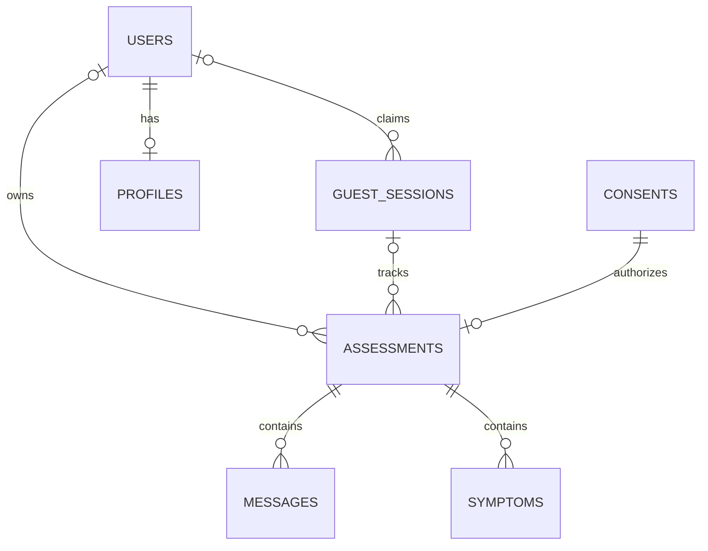
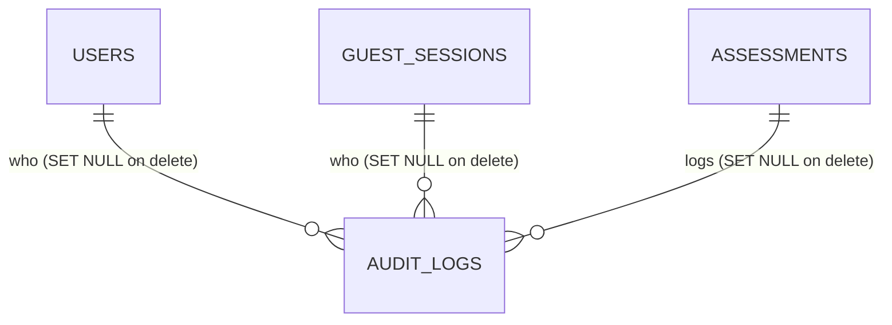

# Database foundation

Owner: Harsh, Dimple, Kavya, Nishith · Tasks: S0-HAR-1, S1-DIM-4, S1-KAV-4, S1-NIT-4, S2-KAV-3, S2-NIT-3, S2-NIT-4 · Issues: #9, #38, #37, #36, #161, #159, #160 · Requirements: FR-01, FR-02, FR-03, FR-17, FR-18, NFR-01, NFR-10, DR-02, idea § 10

This change supplies PostgreSQL-oriented SQLAlchemy 2 models, session factories,
Alembic migrations (revisions `0001_database_foundation` through `0007_history_indexes_and_pgvector`),
repositories, fictional seed data, and isolated unit tests.

## Current status and team handoff

Local code is ready to exercise against PostgreSQL 16. Neon staging/main have
not been provisioned or verified by this change. Complete these items before
claiming issue #9 is done:

- **Harsh:** run the PostgreSQL test mode below and verify the local tables.
- **Rutva (S0-RUT-1):** merge the pinned dependencies from
  `server/app/db/requirements-local.txt` and `requirements-test.txt` into the
  shared server dependency files. Add the normal `app/__init__.py` in the
  scaffold, or configure mypy with `explicit_package_bases = true`.
- **Rutva + Harsh:** agree the public settings accessor in `app/core/config.py`.
  Inject its validated `DATABASE_URL` into `create_db_engine`. Wire the
  repository transaction dependency and engine disposal on application shutdown.
  Synchronous sessions must run in sync routes or a worker thread, never block
  an async request loop. Do not share a Session across requests/threads.
- **Rutva + Harsh:** wire standard online `alembic upgrade head` in `env.py` to
  that settings accessor, retaining the injected-connection branch used by
  tests. At present, that bare online command deliberately fails with the
  local runner instructions. The Docker migration entrypoint is therefore
  **not yet integrated**; offline SQL generation already works.
- **Kavya + Dimple:** review the state values and one-acceptance-per-assessment
  consent design before merge. No Pydantic/API contract files are changed.
  Dimple's service must record affirmative consent before persisting health data.
- **Nisarg + Harsh:** provision the Neon project with `staging` and `main`, obtain
  environment-specific TLS connection strings through approved secret storage,
  and verify migrations on staging. No Neon access or deployment is claimed.
- **Nisarg:** confirm issue assignment and Sprint 0 milestone before the PR.

All runtime environment reads stay in `app/core/config.py`. The temporary
local runner uses explicit local arguments and a hidden password prompt;
it reads no `.env` and refuses remote hosts. Do not put connection strings in
`alembic.ini` or commit credentials. Once the shared scaffold is available,
replace this bootstrap workflow with the agreed application configuration.

## Entity relationships



Every table has a UUID primary key generated by the ORM and a database-generated
`created_at` timestamp with time zone in PostgreSQL. Direct SQL inserts must
provide the UUID. The only server state default is `START`.

| Table | Fields beyond ID and creation time | Constraints |
| --- | --- | --- |
| `users` | `email`, nullable `password_hash` | Unique, nonblank lowercase/trimmed email. Non-null hash cannot be blank. |
| `consents` | `policy_version` | Nonblank version; existence represents affirmative acceptance. |
| `guest_sessions` | `token_hash`, `expires_at`, nullable `claimed_at`, nullable `claimed_by_user_id` | Unique 64-char hash; expires after created; nullable FK to `users` with `SET NULL`. |
| `profiles` | `user_id`, nullable `age_band`, nullable `biological_sex`, `chronic_conditions`, `updated_at` | Unique FK to `users` (ON DELETE CASCADE); coarse `age_band` check; `biological_sex` check. |
| `assessments` | nullable `user_id`, nullable `guest_session_id`, `consent_id`, `state` | Valid FKs (`user_id` RESTRICT, `guest_session_id` SET NULL); required unique consent; allowed state check. |
| `messages` | `assessment_id`, `position`, `role`, `content` | Valid FK; unique position per assessment; nonnegative position; user/assistant role; nonblank text. |
| `symptoms` | `assessment_id`, `name`, `details` | Valid FK; unique normalized nonblank name per assessment; structured JSONB details. |

State values follow the sprint plan: `START`, `SYMPTOM_COLLECTION`, `CLARIFYING`,
`CONFIRMING`, `READY`, `ANALYZING`, `COMPLETED`. The database checks membership;
the service layer enforces legal transitions. Message ordering is supplied by
the writer and checked for duplicates by the database. Concurrent/retry handling
belongs to later repository and orchestration tasks.

## Guest sessions and anonymous ownership (S1-KAV-4, idea § 10)

Per idea § 10, guest mode enables immediate triage without requiring sign-up:
- **Bearer Token Security:** When an anonymous session begins, `create_guest_session`
  generates a 32-byte URL-safe cryptographic token (`secrets.token_urlsafe(32)`).
  Raw tokens are returned directly to the client and **never** stored in the database.
  Only the 64-character SHA-256 hex digest is persisted in `guest_sessions.token_hash`.
- **Expiration:** Guest sessions expire after a configurable TTL (default 24 hours).
  The database enforces `expires_at > created_at`.
- **Assessment Ownership:** Assessments link to guest sessions via `guest_session_id`.
  An unauthenticated assessment possesses a `guest_session_id` and `consent_id`,
  with `user_id` set to `None`.
- **Account Claiming & History Transfer:** When an anonymous guest signs up or logs
  in after triage, `claim_guest_session(session, guest_session_id, user_id)`:
  1. Sets `guest_sessions.claimed_at` and `guest_sessions.claimed_by_user_id`.
  2. Reassigns ownership of all assessments in that guest session to the user (`assessment.user_id = user_id`).
  3. Prevents re-claiming an already-claimed guest session.
- **Deletions:** Foreign keys for `guest_sessions.claimed_by_user_id` and
  `assessments.guest_session_id` use `ON DELETE SET NULL`. If a user account is deleted,
  the session claim pointer clears; if an expired guest session is purged, assessments
  retain their historical consent integrity without hard cascades.

Password hashes are opaque and nullable. Auth must reject password login for a
NULL hash; seed accounts deliberately have no login credential. Hashing and
validation belong to the auth module. Never store plaintext passwords.

## History queries, pagination, and ownership filters (S2-KAV-4, FR-02)

Per FR-02, authenticated users can review their assessment history with efficient,
paginated querying and strict data ownership isolation:
- **Covering Index Optimization:** Queries on `user_id` ordered by `created_at` DESC
  are covered by the composite index `ix_assessments_user_id_created_at`.
- **Query-Level IDOR Protection:** Ownership filters operate directly in SQL
  `WHERE` clauses (`WHERE assessments.id = :id AND assessments.user_id = :user_id`),
  ensuring cross-user assessment records are never leaked or loaded into memory.
- **Unified Ownership Resolver:** `get_assessment_by_ownership` verifies access for
  either registered accounts or unclaimed guest sessions.
- **Rich Filtering & Lookahead:** `query_assessment_history` provides filtering by
  single or multiple states, timestamp bounds (`created_after`, `created_before`),
  configurable ordering direction, and optional relation eager loading (`selectinload`
  for messages, symptoms, and consent) to eliminate N+1 queries.
- **Accurate Pagination:** `count_assessments_by_user` enables exact page calculations
  matching active state and date filters.
- **Safe Account Erasure:** `delete_assessment_for_user` and `delete_assessments_for_user`
  enforce strict user boundaries during individual or bulk data deletion (DR-06).

No image column, doctor directory, prediction scores, or medical
recommendations are introduced. Structured symptom JSONB is S1-HAR-2.

## Windows local setup (existing Docker database)

Start from the repository root. These commands
use the Python 3.12/3.13 `.venv` already created there; activation is unnecessary.

```powershell
.\.venv\Scripts\python.exe -m pip install -r .\server\app\db\requirements-test.txt
cd server
..\.venv\Scripts\python.exe -m app.db.manage upgrade
..\.venv\Scripts\python.exe -m app.db.manage seed
```

Each maintenance command prompts for the password configured when creating
`harsh-symptom-db`. Typing is hidden. The runner defaults match that container:
`127.0.0.1:5433`, user `symptom_dev`, database `symptom_checker`. Optional local
flags: `--host`, `--port`, `--username`, `--database`. No environment change or
PowerShell execution-policy change is needed. A zero exit code means success.

Verify the migration and seed using Docker (works from any directory):

```powershell
docker exec harsh-symptom-db psql -U symptom_dev -d symptom_checker -c "SELECT version_num FROM alembic_version;"
docker exec harsh-symptom-db psql -U symptom_dev -d symptom_checker -c "SELECT 'users' AS table_name, count(*) FROM users UNION ALL SELECT 'consents', count(*) FROM consents UNION ALL SELECT 'guest_sessions', count(*) FROM guest_sessions UNION ALL SELECT 'assessments', count(*) FROM assessments UNION ALL SELECT 'messages', count(*) FROM messages UNION ALL SELECT 'symptoms', count(*) FROM symptoms;"
```

Expect revision `0003_guest_sessions`. Running seed again adds nothing and never overwrites records.
If an identity conflicts, the transaction fails and rolls back instead of
modifying existing data. The seed uses reserved `.invalid` email addresses,
fixed UUIDs, and text explicitly marked fictional. Use it only for local testing.

## Checks

Run these from `server/`:

```powershell
python -m ruff check .
python -m ruff format --check .
python -m mypy app
python -m pytest tests/unit/db -q
python -m pytest tests/unit/db --db-postgres -s -q
```

The default tests use SQLite with foreign keys enabled. They verify migration
round trips, metadata parity, constraints, relationships, rollback, repeatable
seeding, and PostgreSQL offline SQL compilation. SQLite does **not** establish
PostgreSQL compatibility. PostgreSQL mode runs the same checks against fresh,
randomly named local schemas and removes those schemas after each test; it
leaves the application's public tables intact. Use `-s` for the hidden password
prompt. No real user data or external AI service is involved.

## Migration and session interfaces

The migration is an explicit immutable table definition. Do not replace it with
`Base.metadata.create_all()`. Future schema changes require a new reviewed
revision. `downgrade` drops these tables and data; use only disposable databases.

The engine factory validates the psycopg driver and enables pool pre-ping and
hidden SQL parameters. Creating an engine does not connect immediately. Caller
code owns shutdown disposal. Repositories can use:

```python
factory = create_session_factory(engine)
with factory.begin() as session:
    # Repository operations: commit on success, rollback on failure, always close.
    guest_session, raw_token = create_guest_session(session)
```

`upgrade_database(engine)` passes a live connection to Alembic using
`Config.attributes["connection"]`. These patterns follow the official
[SQLAlchemy transaction documentation](https://docs.sqlalchemy.org/en/20/orm/session_basics.html)
and [Alembic connection-sharing cookbook](https://alembic.sqlalchemy.org/en/latest/cookbook.html).

## Hot-query indexes and demo seed data (S1-DIM-4)

Owner: Dimple · Task: S1-DIM-4 · Issue: #38 · Requirement: NFR-01

Revision `0002_hot_query_indexes` introduces B-tree indexes for all hot query patterns identified in the assessment lifecycle and data retention flows:

| Table | Index Name | Columns | Query Pattern / Rationale |
|---|---|---|---|
| `assessments` | `ix_assessments_user_id` | `user_id` | Fetching past assessments for registered users (`WHERE user_id = :uid`). |
| `assessments` | `ix_assessments_created_at` | `created_at` | Guest assessment TTL purge job (`WHERE user_id IS NULL AND created_at < :cutoff`). |
| `assessments` | `ix_assessments_state` | `state` | Filtering active assessments by state machine state. |
| `assessments` | `ix_assessments_user_id_created_at` | `user_id, created_at` | Composite covering index for user history ordered by recency. |
| `messages` | `ix_messages_assessment_id` | `assessment_id` | Fast retrieval of conversation turns for an active assessment. |
| `symptoms` | `ix_symptoms_assessment_id` | `assessment_id` | Fast retrieval of extracted/confirmed symptoms for an active assessment. |

### Migration execution

To generate offline SQL to inspect DDL before applying:
```powershell
alembic upgrade head --sql
```

To apply the migration online:
```powershell
alembic upgrade head
```

### Realistic demo seed data

`server/app/repositories/seed_repository.py` provides `seed_realistic_demo_data(session)` with three realistic, non-diagnostic triage scenarios:
1. **Registered Patient (Completed):** User with multi-turn chat messages, normalized symptoms ("headache", "fatigue"), and `COMPLETED` state.
2. **Anonymous Guest (Active):** Guest session with no user account, in `SYMPTOM_COLLECTION` state with active symptoms ("cough", "runny nose").
3. **Registered Patient (Clarifying):** Assessment in `CLARIFYING` state with targeted follow-up dialogue.

All demo data uses reserved `.invalid` emails (`demo-patient@example.invalid`, `demo-patient2@example.invalid`), fixed deterministic UUIDs, and explicitly fictional text. Seeding is idempotent and safe to run repeatedly.

---

## User Profiles & Clinical Context (S2-KAV-3, FR-02, idea § 10)

Per idea § 10 and FR-02, users may optionally save minimal clinical context to inform triage analysis without compiling an expansive medical dossier:
- **Data Minimization:** Coarse age bands (`child`, `teen`, `young_adult`, `adult`, `senior`) are used instead of exact dates of birth, strictly limiting personal identifying data per the DPDP Act 2023.
- **Clinical Sex:** Biological sex is captured solely for clinical risk calibration (`female`, `male`, `other`, `prefer_not_to_say`) with an optional `sex` alias.
- **Chronic Conditions:** Self-reported conditions (e.g. `["Diabetes", "Asthma"]`) are stored as structured JSON/JSONB text arrays.
- **Cascading Lifecycle:** The `profiles` table maintains a 1-to-1 foreign key to `users.id` with `ON DELETE CASCADE`. If an account is deleted, the health profile is purged immediately.

---

## Audit Logs & System Traceability (S2-NIT-3, NFR-10)

Owner: Nishith · Task: S2-NIT-3 · Issue: #159 · Requirement: NFR-10

Revision `0006_audit_log` establishes the `audit_logs` table for tracking clinical triage evaluations, risk assessments, and model reproducibility:



### Privacy & Compliance Invariants (DPDP Act 2023, DR-06, S2-HAR-7)
- **Zero PII Leakage:** The audit table strictly records operational metadata, model/engine lineages, and non-identifying telemetry. Freeform text, dialogue turns, patient names, and phone numbers are forbidden.
- **Graceful Anonymization on Erasure:** Foreign keys for `user_id`, `guest_session_id`, and `assessment_id` configure `ON DELETE SET NULL`. If a patient invokes "Delete my data" or a guest session expires, personal linkages clear while historical clinical audit records are preserved for medical compliance and accuracy audits.

### Schema & Indexing

| Column | Type | Nullable | Rationale / Constraint |
|---|---|---|---|
| `id` | `UUID` | No | Primary key. |
| `created_at` | `TIMESTAMPTZ` | No | Immutable audit event timestamp ("when"). Indexed. |
| `user_id` | `UUID` | Yes | Foreign key to `users.id` (`ON DELETE SET NULL`). Indexed. |
| `guest_session_id` | `UUID` | Yes | Foreign key to `guest_sessions.id` (`ON DELETE SET NULL`). Indexed. |
| `assessment_id` | `UUID` | Yes | Foreign key to `assessments.id` (`ON DELETE SET NULL`). Indexed. |
| `action` | `VARCHAR(64)` | No | Audit action category (`ANALYSIS`, `RECOMMENDATION`, `TRIAGE`). Check: nonblank. Indexed. |
| `risk_level` | `VARCHAR(32)` | Yes | Triage severity tier (`SELF_CARE`, `CONSULT_DOCTOR`, `URGENT`). Indexed. |
| `risk_engine_version` | `VARCHAR(32)` | Yes | Pinned deterministic rule version (e.g. `1.1.0`). |
| `condition_model_version` | `VARCHAR(64)` | Yes | Model version (e.g. `baseline_v1`). |
| `cv_model_version` | `VARCHAR(64)` | Yes | CV image classifier revision if image was analyzed. |
| `ai_model` | `VARCHAR(64)` | Yes | AI Gateway LLM model identifier. |
| `details` | `JSONB` / `JSON` | No | Structured non-PII operational context (rules fired, driving conditions, telemetry). Default `{}`. |

---

## History Query Optimization & pgvector Embeddings (S2-NIT-4, S2-NIS-7)

Owner: Nishith · Task: S2-NIT-4 · Issue: #160 · Requirements: NFR-01, FR-02, FR-03, FR-18, DR-02

Revision `0007_history_indexes_and_pgvector` delivers two major database tier capabilities:

### 1. History Query Indexing (FR-02, NFR-01)
- Adds composite covering index `ix_assessments_user_id_state_created_at` on `(user_id, state, created_at)`.
- Accelerates filtered queries in `query_assessment_history` and `list_assessments_by_user` (e.g. `WHERE user_id = :uid AND state = 'COMPLETED' ORDER BY created_at DESC`), enabling index-only scans for assessment history pagination.

### 2. Dense Semantic Vector Retrieval with pgvector (S2-NIS-7, DR-02)
- Provisions PostgreSQL `vector` extension (`CREATE EXTENSION IF NOT EXISTS vector;`).
- Adds `symptom_embeddings` table to store 384-dimensional dense sentence embeddings (`all-MiniLM-L6-v2`, L2-normalized) for ~700 items (100 canonical symptoms + 602 lay terms).
- **Strict Determinism (DR-02):** **No HNSW or IVFFlat index is created.** An exact linear scan over 700 rows executes in < 2 ms and guarantees that repeated nearest-neighbor queries return identical clinical symptom candidates.
- Pinned model revision tracking via `model_revision` and unique constraint `uq_symptom_embeddings_revision_phrase` on `(model_revision, phrase)`.
- Index `ix_symptom_embeddings_model_revision` on `(model_revision)` enables instant scoping to the active model commit.

| Column | Type | Nullable | Rationale / Constraint |
|---|---|---|---|
| `id` | `BIGSERIAL` | No | Autoincrementing primary key. |
| `symptom_id` | `VARCHAR(64)` | No | Canonical symptom ID (e.g. `chest_pain`). Check: non-blank. |
| `phrase` | `VARCHAR(256)` | No | Natural-language lay term or symptom name. Check: non-blank. |
| `model_revision` | `VARCHAR(64)` | No | Pinned Hugging Face commit hash of embedding model. |
| `embedding` | `vector(384)` | No | L2-normalized 384-dimensional dense embedding vector. |
| `created_at` | `TIMESTAMPTZ` | No | Server default `CURRENT_TIMESTAMP`. |

### 3. Neon Staging Migration Review Runbook
1. **Offline SQL Generation:** Inspect generated DDL without database credentials:
   ```powershell
   alembic upgrade head --sql
   ```
2. **Online Staging Migration:** On Neon PostgreSQL 16 staging branch:
   ```powershell
   alembic upgrade head
   ```
3. **Verification:** Confirm `vector` extension and table creation:
   ```sql
   SELECT extname, extversion FROM pg_extension WHERE extname = 'vector';
   SELECT COUNT(*) FROM symptom_embeddings;
   ```


