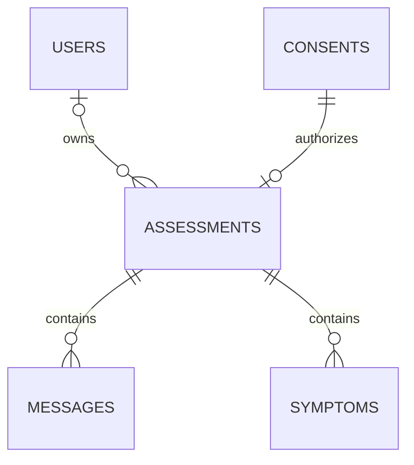

# Database foundation

Owner: Harsh · Task: S0-HAR-1 · Issue: #9 · Requirement: FR-01

This change supplies PostgreSQL-oriented SQLAlchemy 2 models, session factories,
Alembic's initial revision, fictional seed data, and isolated tests. It does not
create the API, authenticate users, authorize guest access, or compute results.

## Current status and team handoff

Local code is ready to exercise against PostgreSQL 16. Neon staging/main have
not been provisioned or verified by this change. Complete these items before
claiming issue #9 is done:

- **Harsh:** run the PostgreSQL test mode below and verify the five local tables.
- **Rutva (S0-RUT-1):** merge the pinned dependencies from
  `server/app/db/requirements-local.txt` and `requirements-test.txt` into the
  shared server dependency files. Add the normal `app/__init__.py` in the
  scaffold, or configure mypy with `explicit_package_bases = true`.
- **Rutva + Harsh:** agree the public settings accessor in `app/core/config.py`.
  Inject its validated `DATABASE_URL` into `create_db_engine`. Wire the
  repository transaction dependency and engine disposal on application shutdown.
  Synchronous sessions must run in sync routes or a worker thread, never block
  an async request loop. Do not share a Session across requests/threads.
- **Rutva + Harsh:** wire standard online `alembic upgrade head` in `env.py` to
  that settings accessor, retaining the injected-connection branch used by
  tests. At present, that bare online command deliberately fails with the
  local runner instructions. The Docker migration entrypoint is therefore
  **not yet integrated**; offline SQL generation already works.
- **Kavya + Dimple:** review the state values and one-acceptance-per-assessment
  consent design before merge. No Pydantic/API contract files are changed.
  Dimple's service must record affirmative consent before persisting health data.
- **Nisarg + Harsh:** provision the Neon project with `staging` and `main`, obtain
  environment-specific TLS connection strings through approved secret storage,
  and verify migrations on staging. No Neon access or deployment is claimed.
- **Nisarg:** confirm issue assignment and Sprint 0 milestone before the PR.

All runtime environment reads stay in `app/core/config.py`. The temporary
local runner uses explicit local arguments and a hidden password prompt;
it reads no `.env` and refuses remote hosts. Do not put connection strings in
`alembic.ini` or commit credentials. Once the shared scaffold is available,
replace this bootstrap workflow with the agreed application configuration.

## Entity relationships



Every table has a UUID primary key generated by the ORM and a database-generated
`created_at` timestamp with time zone in PostgreSQL. Direct SQL inserts must
provide the UUID. The only server state default is `START`.

| Table | Fields beyond ID and creation time | Constraints |
| --- | --- | --- |
| `users` | `email`, nullable `password_hash` | Unique, nonblank lowercase/trimmed email. Non-null hash cannot be blank. |
| `consents` | `policy_version` | Nonblank version; existence represents affirmative acceptance. |
| `assessments` | nullable `user_id`, `consent_id`, `state` | Valid FKs; required unique consent; allowed state check. |
| `messages` | `assessment_id`, `position`, `role`, `content` | Valid FK; unique position per assessment; nonnegative position; user/assistant role; nonblank text. |
| `symptoms` | `assessment_id`, `name` | Valid FK; unique normalized nonblank name per assessment. |

State values follow the sprint plan: `START`, `SYMPTOM_COLLECTION`, `CLARIFYING`,
`CONFIRMING`, `READY`, `ANALYZING`, `COMPLETED`. The database checks membership;
Kavya's service will enforce legal transitions. Message ordering is supplied by
the writer and checked for duplicates by the database. Concurrent/retry handling
belongs to later repository and orchestration tasks.

An assessment without `user_id` supports the future guest flow; a missing user
ID is **not authorization**. Guest token ownership arrives in S1-HAR-3.
Consent records carry no health text and may be created before the assessment.
This is a proposed persistence interface, not the completed consent UX.

All foreign keys use `ON DELETE RESTRICT`, with matching ORM passive-deletion
behavior, to prevent accidental orphaning/removal. The explicit account deletion
workflow is S2-HAR-4. That workflow must also remove associated consent records
when appropriate; no purge or retention policy is implemented in this task.

Password hashes are opaque and nullable. Auth must reject password login for a
NULL hash; seed accounts deliberately have no login credential. Hashing and
validation belong to the auth module. Never store plaintext passwords.

No image column, doctor directory, profile fields, prediction scores, or medical
recommendations are introduced. Structured symptom JSONB is S1-HAR-2.

## Sprint 1: Database Optimization (Issue #38 · Task: S1-DIM-4)

Owner: Dimple · Requirements: NFR-01

Revision `0002_hot_query_indexes` introduces B-tree indexes for all hot query patterns identified in the assessment lifecycle and data retention flows:

| Table | Index Name | Columns | Query Pattern / Rationale |
|---|---|---|---|
| `assessments` | `ix_assessments_user_id` | `user_id` | Fetching past assessments for registered users (`WHERE user_id = :uid`). |
| `assessments` | `ix_assessments_created_at` | `created_at` | Guest assessment TTL purge job (`WHERE user_id IS NULL AND created_at < :cutoff`). |
| `assessments` | `ix_assessments_state` | `state` | Filtering active assessments by state machine state. |
| `assessments` | `ix_assessments_user_id_created_at` | `user_id, created_at` | Composite covering index for user history ordered by recency. |
| `messages` | `ix_messages_assessment_id` | `assessment_id` | Fast retrieval of conversation turns for an active assessment. |
| `symptoms` | `ix_symptoms_assessment_id` | `assessment_id` | Fast retrieval of extracted/confirmed symptoms for an active assessment. |

### Realistic Demo Seed Data
`server/app/repositories/seed_repository.py` provides `seed_realistic_demo_data(session)` with three realistic, non-diagnostic triage scenarios:
1. **Registered Patient (Completed):** User with multi-turn chat messages, normalized symptoms ("headache", "fatigue"), and `COMPLETED` state.
2. **Anonymous Guest (Active):** Guest session with no user account, in `SYMPTOM_COLLECTION` state with active symptoms ("cough", "runny nose").
3. **Registered Patient (Clarifying):** Assessment in `CLARIFYING` state with targeted follow-up dialogue.

All demo data uses reserved `.invalid` emails, fixed deterministic UUIDs, and explicitly fictional text. Seeding is idempotent and safe to run repeatedly.

### Staging Verification on Neon
To verify migration 0002 on Neon staging:
```powershell
# 1. Generate offline SQL to inspect DDL before applying:
alembic upgrade head --sql

# 2. Apply online migration against Neon staging database:
DATABASE_URL="<neon-staging-connection-string>" alembic upgrade head
```

## Windows local setup (existing Docker database)

Start from the repository root on `harsh/9-database-foundation`. These commands
use the Python 3.12 `.venv` already created there; activation is unnecessary.

```powershell
.\.venv\Scripts\python.exe -m pip install -r .\server\app\db\requirements-test.txt
cd server
..\.venv\Scripts\python.exe -m app.db.manage upgrade
..\.venv\Scripts\python.exe -m app.db.manage seed
```

Each maintenance command prompts for the password configured when creating
`harsh-symptom-db`. Typing is hidden. The runner defaults match that container:
`127.0.0.1:5433`, user `symptom_dev`, database `symptom_checker`. Optional local
flags: `--host`, `--port`, `--username`, `--database`. No environment change or
PowerShell execution-policy change is needed. A zero exit code means success.

Verify the migration and seed using Docker (works from any directory):

```powershell
docker exec harsh-symptom-db psql -U symptom_dev -d symptom_checker -c "SELECT version_num FROM alembic_version;"
docker exec harsh-symptom-db psql -U symptom_dev -d symptom_checker -c "SELECT 'users' AS table_name, count(*) FROM users UNION ALL SELECT 'consents', count(*) FROM consents UNION ALL SELECT 'assessments', count(*) FROM assessments UNION ALL SELECT 'messages', count(*) FROM messages UNION ALL SELECT 'symptoms', count(*) FROM symptoms;"
```

Expect revision `0001_database_foundation` and one row in each table on a fresh
seeded database. Running seed again adds nothing and never overwrites records.
If an identity conflicts, the transaction fails and rolls back instead of
modifying existing data. The seed uses reserved `.invalid` email addresses,
fixed UUIDs, and text explicitly marked fictional. Use it only for local testing.

## Checks

Run these from `server/`:

```powershell
..\.venv\Scripts\python.exe -m ruff check .
..\.venv\Scripts\python.exe -m ruff format --check .
..\.venv\Scripts\python.exe -m mypy --explicit-package-bases app
..\.venv\Scripts\python.exe -m pytest tests/unit/db -q
..\.venv\Scripts\python.exe -m pytest tests/unit/db --db-postgres -s -q
```

The explicit mypy flag is temporary until the shared scaffold defines the app
package or mypy configuration. Bare `mypy app` currently reports duplicate
module paths in this unscaffolded namespace layout.

The default tests use SQLite with foreign keys enabled. They verify migration
round trips, metadata parity, constraints, relationships, rollback, repeatable
seeding, and PostgreSQL offline SQL compilation. SQLite does **not** establish
PostgreSQL compatibility. PostgreSQL mode runs the same checks against fresh,
randomly named local schemas and removes those schemas after each test; it
leaves the application's public tables intact. Use `-s` for the hidden password
prompt. No real user data or external AI service is involved.

## Migration and session interfaces

The migration is an explicit immutable table definition. Do not replace it with
`Base.metadata.create_all()`. Future schema changes require a new reviewed
revision. `downgrade` drops these tables and data; use only disposable databases.

The engine factory validates the psycopg driver and enables pool pre-ping and
hidden SQL parameters. Creating an engine does not connect immediately. Caller
code owns shutdown disposal. Repositories can use:

```python
factory = create_session_factory(engine)
with factory.begin() as session:
    # Repository operations: commit on success, rollback on failure, always close.
    seed_fictional_data(session)  # Local maintenance example only.
```

`upgrade_database(engine)` passes a live connection to Alembic using
`Config.attributes["connection"]`. These patterns follow the official
[SQLAlchemy transaction documentation](https://docs.sqlalchemy.org/en/20/orm/session_basics.html)
and [Alembic connection-sharing cookbook](https://alembic.sqlalchemy.org/en/latest/cookbook.html).
