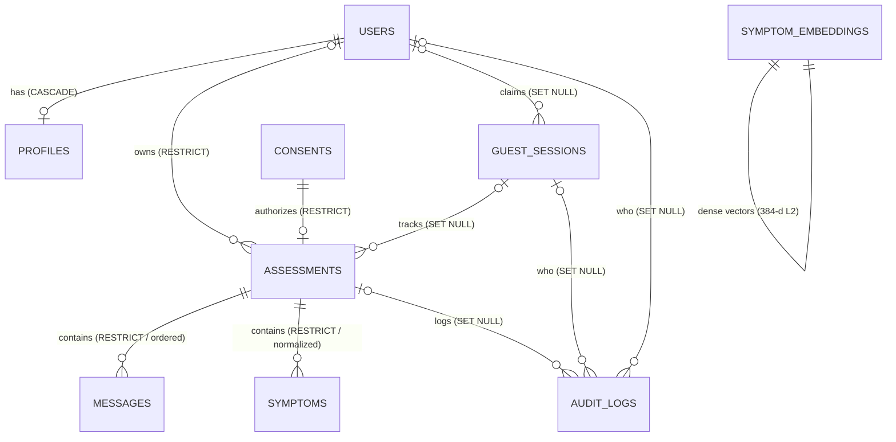
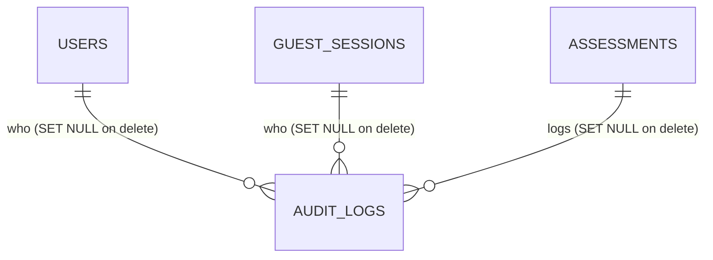

# Database foundation

Owner: Harsh, Dimple, Kavya, Nishith · Tasks: S0-HAR-1, S1-DIM-4, S1-KAV-4, S1-NIT-4, S2-KAV-3, S2-NIT-3, S2-NIT-4, S2-NIT-6, S2-NIT-7, S2-KAV-6 · Issues: #9, #38, #37, #36, #161, #159, #160, #198, #199, #200 · Requirements: FR-01, FR-02, FR-03, FR-17, FR-18, NFR-01, NFR-05, NFR-08, NFR-10, DR-02, DR-06, idea § 10

This change supplies PostgreSQL-oriented SQLAlchemy 2 models, session factories,
Alembic migrations (revisions `0001_database_foundation` through `0008_query_perf_indexes`),
repositories, fictional seed data, and isolated unit tests.

## Current status and team handoff

Local code is ready to exercise against PostgreSQL 16. Neon staging/main have
not been provisioned or verified by this change. Complete these items before
claiming issue #9 is done:

- **Harsh:** run the PostgreSQL test mode below and verify the local tables.
- **Rutva (S0-RUT-1):** merge the pinned dependencies from
  `server/app/db/requirements-local.txt` and `requirements-test.txt` into the
  shared server dependency files. Add the normal `app/__init__.py` in the
  scaffold, or configure mypy with `explicit_package_bases = true`.
- **Rutva + Harsh:** agree the public settings accessor in `app/core/config.py`.
  Inject its validated `DATABASE_URL` into `create_db_engine`. Wire the
  repository transaction dependency and engine disposal on application shutdown.
  Synchronous sessions must run in sync routes or a worker thread, never block
  an async request loop. Do not share a Session across requests/threads.
- **Rutva + Harsh:** wire standard online `alembic upgrade head` in `env.py` to
  that settings accessor, retaining the injected-connection branch used by
  tests. At present, that bare online command deliberately fails with the
  local runner instructions. The Docker migration entrypoint is therefore
  **not yet integrated**; offline SQL generation already works.
- **Kavya + Dimple:** review the state values and one-acceptance-per-assessment
  consent design before merge. No Pydantic/API contract files are changed.
  Dimple's service must record affirmative consent before persisting health data.
- **Nisarg + Harsh:** provision the Neon project with `staging` and `main`, obtain
  environment-specific TLS connection strings through approved secret storage,
  and verify migrations on staging. No Neon access or deployment is claimed.
- **Nisarg:** confirm issue assignment and Sprint 0 milestone before the PR.

All runtime environment reads stay in `app/core/config.py`. The temporary
local runner uses explicit local arguments and a hidden password prompt;
it reads no `.env` and refuses remote hosts. Do not put connection strings in
`alembic.ini` or commit credentials. Once the shared scaffold is available,
replace this bootstrap workflow with the agreed application configuration.

## Entity relationships



Every table has a UUID primary key generated by the ORM and a database-generated
`created_at` timestamp with time zone in PostgreSQL. Direct SQL inserts must
provide the UUID. The only server state default is `START`.

| Table | Fields beyond ID and creation time | Constraints |
| --- | --- | --- |
| `users` | `email`, nullable `password_hash` | Unique, nonblank lowercase/trimmed email. Non-null hash cannot be blank. |
| `consents` | `policy_version` | Nonblank version; existence represents affirmative acceptance. |
| `guest_sessions` | `token_hash`, `expires_at`, nullable `claimed_at`, nullable `claimed_by_user_id` | Unique 64-char hash; expires after created; nullable FK to `users` with `SET NULL`. |
| `profiles` | `user_id`, nullable `age_band`, nullable `biological_sex`, `chronic_conditions`, `updated_at` | Unique FK to `users` (ON DELETE CASCADE); coarse `age_band` check; `biological_sex` check. |
| `assessments` | nullable `user_id`, nullable `guest_session_id`, `consent_id`, `state` | Valid FKs (`user_id` RESTRICT, `guest_session_id` SET NULL); required unique consent; allowed state check. |
| `messages` | `assessment_id`, `position`, `role`, `content` | Valid FK; unique position per assessment; nonnegative position; user/assistant role; nonblank text. |
| `symptoms` | `assessment_id`, `name`, `details` | Valid FK; unique normalized nonblank name per assessment; structured JSONB details. |

State values follow the sprint plan: `START`, `SYMPTOM_COLLECTION`, `CLARIFYING`,
`CONFIRMING`, `READY`, `ANALYZING`, `COMPLETED`. The database checks membership;
the service layer enforces legal transitions. Message ordering is supplied by
the writer and checked for duplicates by the database. Concurrent/retry handling
belongs to later repository and orchestration tasks.

## Guest sessions and anonymous ownership (S1-KAV-4, idea § 10)

Per idea § 10, guest mode enables immediate triage without requiring sign-up:
- **Bearer Token Security:** When an anonymous session begins, `create_guest_session`
  generates a 32-byte URL-safe cryptographic token (`secrets.token_urlsafe(32)`).
  Raw tokens are returned directly to the client and **never** stored in the database.
  Only the 64-character SHA-256 hex digest is persisted in `guest_sessions.token_hash`.
- **Expiration:** Guest sessions expire after a configurable TTL (default 24 hours).
  The database enforces `expires_at > created_at`.
- **Assessment Ownership:** Assessments link to guest sessions via `guest_session_id`.
  An unauthenticated assessment possesses a `guest_session_id` and `consent_id`,
  with `user_id` set to `None`.
- **Account Claiming & History Transfer:** When an anonymous guest signs up or logs
  in after triage, `claim_guest_session(session, guest_session_id, user_id)`:
  1. Sets `guest_sessions.claimed_at` and `guest_sessions.claimed_by_user_id`.
  2. Reassigns ownership of all assessments in that guest session to the user (`assessment.user_id = user_id`).
  3. Prevents re-claiming an already-claimed guest session.
- **Deletions:** Foreign keys for `guest_sessions.claimed_by_user_id` and
  `assessments.guest_session_id` use `ON DELETE SET NULL`. If a user account is deleted,
  the session claim pointer clears; if an expired guest session is purged, assessments
  retain their historical consent integrity without hard cascades.

Password hashes are opaque and nullable. Auth must reject password login for a
NULL hash; seed accounts deliberately have no login credential. Hashing and
validation belong to the auth module. Never store plaintext passwords.

## History queries, pagination, and ownership filters (S2-KAV-4, FR-02)

Per FR-02, authenticated users can review their assessment history with efficient,
paginated querying and strict data ownership isolation:
- **Covering Index Optimization:** Queries on `user_id` ordered by `created_at` DESC
  are covered by the composite index `ix_assessments_user_id_created_at`.
- **Query-Level IDOR Protection:** Ownership filters operate directly in SQL
  `WHERE` clauses (`WHERE assessments.id = :id AND assessments.user_id = :user_id`),
  ensuring cross-user assessment records are never leaked or loaded into memory.
- **Unified Ownership Resolver:** `get_assessment_by_ownership` verifies access for
  either registered accounts or unclaimed guest sessions.
- **Rich Filtering & Lookahead:** `query_assessment_history` provides filtering by
  single or multiple states, timestamp bounds (`created_after`, `created_before`),
  configurable ordering direction, and optional relation eager loading (`selectinload`
  for messages, symptoms, and consent) to eliminate N+1 queries.
- **Accurate Pagination:** `count_assessments_by_user` enables exact page calculations
  matching active state and date filters.
- **Safe Account Erasure:** `delete_assessment_for_user` and `delete_assessments_for_user`
  enforce strict user boundaries during individual or bulk data deletion (DR-06).

No image column, doctor directory, prediction scores, or medical
recommendations are introduced. Structured symptom JSONB is S1-HAR-2.

## Windows local setup (existing Docker database)

Start from the repository root. These commands
use the Python 3.12/3.13 `.venv` already created there; activation is unnecessary.

```powershell
.\.venv\Scripts\python.exe -m pip install -r .\server\app\db\requirements-test.txt
cd server
..\.venv\Scripts\python.exe -m app.db.manage upgrade
..\.venv\Scripts\python.exe -m app.db.manage seed
```

Each maintenance command prompts for the password configured when creating
`harsh-symptom-db`. Typing is hidden. The runner defaults match that container:
`127.0.0.1:5433`, user `symptom_dev`, database `symptom_checker`. Optional local
flags: `--host`, `--port`, `--username`, `--database`. No environment change or
PowerShell execution-policy change is needed. A zero exit code means success.

Verify the migration and seed using Docker (works from any directory):

```powershell
docker exec harsh-symptom-db psql -U symptom_dev -d symptom_checker -c "SELECT version_num FROM alembic_version;"
docker exec harsh-symptom-db psql -U symptom_dev -d symptom_checker -c "SELECT 'users' AS table_name, count(*) FROM users UNION ALL SELECT 'consents', count(*) FROM consents UNION ALL SELECT 'guest_sessions', count(*) FROM guest_sessions UNION ALL SELECT 'assessments', count(*) FROM assessments UNION ALL SELECT 'messages', count(*) FROM messages UNION ALL SELECT 'symptoms', count(*) FROM symptoms;"
```

Expect revision `0003_guest_sessions`. Running seed again adds nothing and never overwrites records.
If an identity conflicts, the transaction fails and rolls back instead of
modifying existing data. The seed uses reserved `.invalid` email addresses,
fixed UUIDs, and text explicitly marked fictional. Use it only for local testing.

## Checks

Run these from `server/`:

```powershell
python -m ruff check .
python -m ruff format --check .
python -m mypy app
python -m pytest tests/unit/db -q
python -m pytest tests/unit/db --db-postgres -s -q
```

The default tests use SQLite with foreign keys enabled. They verify migration
round trips, metadata parity, constraints, relationships, rollback, repeatable
seeding, and PostgreSQL offline SQL compilation. SQLite does **not** establish
PostgreSQL compatibility. PostgreSQL mode runs the same checks against fresh,
randomly named local schemas and removes those schemas after each test; it
leaves the application's public tables intact. Use `-s` for the hidden password
prompt. No real user data or external AI service is involved.

## Migration and session interfaces

The migration is an explicit immutable table definition. Do not replace it with
`Base.metadata.create_all()`. Future schema changes require a new reviewed
revision. `downgrade` drops these tables and data; use only disposable databases.

The engine factory validates the psycopg driver and enables pool pre-ping and
hidden SQL parameters. Creating an engine does not connect immediately. Caller
code owns shutdown disposal. Repositories can use:

```python
factory = create_session_factory(engine)
with factory.begin() as session:
    # Repository operations: commit on success, rollback on failure, always close.
    guest_session, raw_token = create_guest_session(session)
```

`upgrade_database(engine)` passes a live connection to Alembic using
`Config.attributes["connection"]`. These patterns follow the official
[SQLAlchemy transaction documentation](https://docs.sqlalchemy.org/en/20/orm/session_basics.html)
and [Alembic connection-sharing cookbook](https://alembic.sqlalchemy.org/en/latest/cookbook.html).

## Hot-query indexes and demo seed data (S1-DIM-4)

Owner: Dimple · Task: S1-DIM-4 · Issue: #38 · Requirement: NFR-01

Revision `0002_hot_query_indexes` introduces B-tree indexes for all hot query patterns identified in the assessment lifecycle and data retention flows:

| Table | Index Name | Columns | Query Pattern / Rationale |
|---|---|---|---|
| `assessments` | `ix_assessments_user_id` | `user_id` | Fetching past assessments for registered users (`WHERE user_id = :uid`). |
| `assessments` | `ix_assessments_created_at` | `created_at` | Guest assessment TTL purge job (`WHERE user_id IS NULL AND created_at < :cutoff`). |
| `assessments` | `ix_assessments_state` | `state` | Filtering active assessments by state machine state. |
| `assessments` | `ix_assessments_user_id_created_at` | `user_id, created_at` | Composite covering index for user history ordered by recency. |
| `messages` | `ix_messages_assessment_id` | `assessment_id` | Fast retrieval of conversation turns for an active assessment. |
| `symptoms` | `ix_symptoms_assessment_id` | `assessment_id` | Fast retrieval of extracted/confirmed symptoms for an active assessment. |

### Migration execution

To generate offline SQL to inspect DDL before applying:
```powershell
alembic upgrade head --sql
```

To apply the migration online:
```powershell
alembic upgrade head
```

### Realistic demo seed data

`server/app/repositories/seed_repository.py` provides `seed_realistic_demo_data(session)` with three realistic, non-diagnostic triage scenarios:
1. **Registered Patient (Completed):** User with multi-turn chat messages, normalized symptoms ("headache", "fatigue"), and `COMPLETED` state.
2. **Anonymous Guest (Active):** Guest session with no user account, in `SYMPTOM_COLLECTION` state with active symptoms ("cough", "runny nose").
3. **Registered Patient (Clarifying):** Assessment in `CLARIFYING` state with targeted follow-up dialogue.

All demo data uses reserved `.invalid` emails (`demo-patient@example.invalid`, `demo-patient2@example.invalid`), fixed deterministic UUIDs, and explicitly fictional text. Seeding is idempotent and safe to run repeatedly.

---

## User Profiles & Clinical Context (S2-KAV-3, FR-02, idea § 10)

Per idea § 10 and FR-02, users may optionally save minimal clinical context to inform triage analysis without compiling an expansive medical dossier:
- **Data Minimization:** Coarse age bands (`child`, `teen`, `young_adult`, `adult`, `senior`) are used instead of exact dates of birth, strictly limiting personal identifying data per the DPDP Act 2023.
- **Clinical Sex:** Biological sex is captured solely for clinical risk calibration (`female`, `male`, `other`, `prefer_not_to_say`) with an optional `sex` alias.
- **Chronic Conditions:** Self-reported conditions (e.g. `["Diabetes", "Asthma"]`) are stored as structured JSON/JSONB text arrays.
- **Cascading Lifecycle:** The `profiles` table maintains a 1-to-1 foreign key to `users.id` with `ON DELETE CASCADE`. If an account is deleted, the health profile is purged immediately.

---

## Audit Logs & System Traceability (S2-NIT-3, NFR-10)

Owner: Nishith · Task: S2-NIT-3 · Issue: #159 · Requirement: NFR-10

Revision `0006_audit_log` establishes the `audit_logs` table for tracking clinical triage evaluations, risk assessments, and model reproducibility:



### Privacy & Compliance Invariants (DPDP Act 2023, DR-06, S2-HAR-7)
- **Zero PII Leakage:** The audit table strictly records operational metadata, model/engine lineages, and non-identifying telemetry. Freeform text, dialogue turns, patient names, and phone numbers are forbidden.
- **Graceful Anonymization on Erasure:** Foreign keys for `user_id`, `guest_session_id`, and `assessment_id` configure `ON DELETE SET NULL`. If a patient invokes "Delete my data" or a guest session expires, personal linkages clear while historical clinical audit records are preserved for medical compliance and accuracy audits.

### Schema & Indexing

| Column | Type | Nullable | Rationale / Constraint |
|---|---|---|---|
| `id` | `UUID` | No | Primary key. |
| `created_at` | `TIMESTAMPTZ` | No | Immutable audit event timestamp ("when"). Indexed. |
| `user_id` | `UUID` | Yes | Foreign key to `users.id` (`ON DELETE SET NULL`). Indexed. |
| `guest_session_id` | `UUID` | Yes | Foreign key to `guest_sessions.id` (`ON DELETE SET NULL`). Indexed. |
| `assessment_id` | `UUID` | Yes | Foreign key to `assessments.id` (`ON DELETE SET NULL`). Indexed. |
| `action` | `VARCHAR(64)` | No | Audit action category (`ANALYSIS`, `RECOMMENDATION`, `TRIAGE`). Check: nonblank. Indexed. |
| `risk_level` | `VARCHAR(32)` | Yes | Triage severity tier (`SELF_CARE`, `CONSULT_DOCTOR`, `URGENT`). Indexed. |
| `risk_engine_version` | `VARCHAR(32)` | Yes | Pinned deterministic rule version (e.g. `1.1.0`). |
| `condition_model_version` | `VARCHAR(64)` | Yes | Model version (e.g. `baseline_v1`). |
| `cv_model_version` | `VARCHAR(64)` | Yes | CV image classifier revision if image was analyzed. |
| `ai_model` | `VARCHAR(64)` | Yes | AI Gateway LLM model identifier. |
| `details` | `JSONB` / `JSON` | No | Structured non-PII operational context (rules fired, driving conditions, telemetry). Default `{}`. |

---

## History Query Optimization & pgvector Embeddings (S2-NIT-4, S2-NIS-7)

Owner: Nishith · Task: S2-NIT-4 · Issue: #160 · Requirements: NFR-01, FR-02, FR-03, FR-18, DR-02

Revision `0007_history_indexes_pgvector` delivers two major database tier capabilities:

### 1. History Query Indexing (FR-02, NFR-01)
- Adds composite covering index `ix_assessments_user_id_state_created_at` on `(user_id, state, created_at)`.
- Accelerates filtered queries in `query_assessment_history` and `list_assessments_by_user` (e.g. `WHERE user_id = :uid AND state = 'COMPLETED' ORDER BY created_at DESC`), enabling index-only scans for assessment history pagination.

### 2. Dense Semantic Vector Retrieval with pgvector (S2-NIS-7, DR-02)
- Provisions PostgreSQL `vector` extension (`CREATE EXTENSION IF NOT EXISTS vector;`).
- Adds `symptom_embeddings` table to store 384-dimensional dense sentence embeddings (`all-MiniLM-L6-v2`, L2-normalized) for ~700 items (100 canonical symptoms + 602 lay terms).
- **Strict Determinism (DR-02):** **No HNSW or IVFFlat index is created.** An exact linear scan over 700 rows executes in < 2 ms and guarantees that repeated nearest-neighbor queries return identical clinical symptom candidates.
- Pinned model revision tracking via `model_revision` and unique constraint `uq_symptom_embeddings_revision_phrase` on `(model_revision, phrase)`.
- Index `ix_symptom_embeddings_model_revision` on `(model_revision)` enables instant scoping to the active model commit.

| Column | Type | Nullable | Rationale / Constraint |
|---|---|---|---|
| `id` | `BIGSERIAL` | No | Autoincrementing primary key. |
| `symptom_id` | `VARCHAR(64)` | No | Canonical symptom ID (e.g. `chest_pain`). Check: non-blank. |
| `phrase` | `VARCHAR(256)` | No | Natural-language lay term or symptom name. Check: non-blank. |
| `model_revision` | `VARCHAR(64)` | No | Pinned Hugging Face commit hash of embedding model. |
| `embedding` | `vector(384)` | No | L2-normalized 384-dimensional dense embedding vector. |
| `created_at` | `TIMESTAMPTZ` | No | Server default `CURRENT_TIMESTAMP`. |

### 3. Neon Staging Migration Review Runbook
1. **Offline SQL Generation:** Inspect generated DDL without database credentials:
   ```powershell
   alembic upgrade head --sql
   ```
2. **Online Staging Migration:** On Neon PostgreSQL 16 staging branch:
   ```powershell
   alembic upgrade head
   ```
3. **Verification:** Confirm `vector` extension and table creation:
   ```sql
   SELECT extname, extversion FROM pg_extension WHERE extname = 'vector';
   SELECT COUNT(*) FROM symptom_embeddings;
   ```

---

## Query Performance Review & Index Fixes (S2-NIT-6)

Owner: Nishith · Task: S2-NIT-6 · Issue: #198 · Requirement: NFR-01

Revision `0008_query_perf_indexes` adds 5 backward-compatible composite and foreign-key indexes identified during the `EXPLAIN ANALYZE` review across all 12 hot-path queries (full report in [query-performance-review.md](query-performance-review.md)):

- `ix_assessments_guest_session_id_created_at` on `assessments (guest_session_id, created_at)` — eliminates `Sort` on guest history pagination.
- `ix_guest_sessions_claimed_by_user_id` on `guest_sessions (claimed_by_user_id)` — eliminates full `Seq Scan` during DPDP `delete_user_account` (`ON DELETE SET NULL`).
- `ix_audit_logs_assessment_id_created_at` on `audit_logs (assessment_id, created_at)` — eliminates `Sort` on assessment audit listings.
- `ix_audit_logs_user_id_created_at` on `audit_logs (user_id, created_at)` — eliminates `Sort` on user audit listings.
- `ix_audit_logs_action_created_at` on `audit_logs (action, created_at)` — eliminates `Sort` / filter discard on time-windowed compliance queries.

Reproduce `EXPLAIN (ANALYZE, BUFFERS)` on Neon staging or local PostgreSQL:

```powershell
python -m app.db.query_perf --database-url "$env:DATABASE_URL"
```

---

## Backup & Restore Procedure on Neon (S2-NIT-7)

Owner: Nishith · Task: S2-NIT-7 · Issue: #199 · Requirements: NFR-05, DR-06

The full Neon PITR branching, encrypted `pg_dump`/`pg_restore`, DPDP post-restore erasure hygiene, and verified restore drill documentation lives in [backup-and-restore.md](backup-and-restore.md).

Verify Alembic revision, row counts, and SHA-256 table digests (PII-free) before and after any restore:

```powershell
python -m app.db.backup_restore verify --database-url "$env:DATABASE_URL"
```

---

## Final Database Architecture & Data Integrity Invariants (S2-KAV-6, NFR-08)

Owner: Kavya · Task: S2-KAV-6 · Issue: #200 · Requirement: NFR-08

This section consolidates the complete, production-ready PostgreSQL 16 schema across all 9 database tables, documenting the data dictionary, full index catalog, relational constraints, DPDP Act 2023 lifecycle behaviors, and automated verification procedures.

### 1. Complete 9-Table Data Dictionary

All primary keys use UUIDv4 (ORM-generated, native PostgreSQL `UUID`) except for `symptom_embeddings` which utilizes an autoincrementing 64-bit integer (`BIGSERIAL` / `BIGINT`) for performance in vector retrieval scans. Every table maintains an immutable `created_at` timestamp with time zone (`TIMESTAMPTZ`, default `CURRENT_TIMESTAMP`).

#### Table 1: `users`
Registered user accounts.

| Column | Type | Nullable | Default | Constraints & Foreign Keys | Description |
|---|---|---|---|---|---|
| `id` | `UUID` | No | ORM UUID | `PRIMARY KEY` | Globally unique user identifier. |
| `created_at` | `TIMESTAMPTZ` | No | `now()` | `NOT NULL` | Account registration timestamp. |
| `email` | `VARCHAR(255)` | No | — | `UNIQUE`, `CHECK (length(trim(email)) > 0)` | Lowercase, trimmed unique user email. |
| `password_hash` | `VARCHAR(255)` | Yes | `NULL` | `CHECK (password_hash IS NULL OR length(trim(password_hash)) > 0)` | Opaque password hash; rejected if blank when present. |

#### Table 2: `consents`
Affirmative medical triage and privacy consent records (DPDP Act 2023 / FR-17).

| Column | Type | Nullable | Default | Constraints & Foreign Keys | Description |
|---|---|---|---|---|---|
| `id` | `UUID` | No | ORM UUID | `PRIMARY KEY` | Unique consent event identifier. |
| `created_at` | `TIMESTAMPTZ` | No | `now()` | `NOT NULL` | Consent acceptance timestamp. |
| `policy_version` | `VARCHAR(32)` | No | — | `CHECK (length(trim(policy_version)) > 0)` | Version of triage policy agreed to (e.g. `v1.0`). |

#### Table 3: `guest_sessions`
Anonymous triage sessions enabling immediate use without sign-up (idea § 10).

| Column | Type | Nullable | Default | Constraints & Foreign Keys | Description |
|---|---|---|---|---|---|
| `id` | `UUID` | No | ORM UUID | `PRIMARY KEY` | Unique anonymous session identifier. |
| `created_at` | `TIMESTAMPTZ` | No | `now()` | `NOT NULL` | Session initiation timestamp. |
| `token_hash` | `VARCHAR(64)` | No | — | `UNIQUE`, `CHECK (length(token_hash) = 64)` | SHA-256 hex digest of client bearer token. |
| `expires_at` | `TIMESTAMPTZ` | No | — | `CHECK (expires_at > created_at)` | Expiration timestamp (default: `created_at + 24h`). |
| `claimed_at` | `TIMESTAMPTZ` | Yes | `NULL` | — | Timestamp when anonymous session was claimed by user. |
| `claimed_by_user_id` | `UUID` | Yes | `NULL` | `FK users(id) ON DELETE SET NULL` | Linked registered user who claimed this session. |

#### Table 4: `profiles`
Optional clinical profile context for registered users (FR-02, S2-KAV-3).

| Column | Type | Nullable | Default | Constraints & Foreign Keys | Description |
|---|---|---|---|---|---|
| `id` | `UUID` | No | ORM UUID | `PRIMARY KEY` | Unique profile identifier. |
| `created_at` | `TIMESTAMPTZ` | No | `now()` | `NOT NULL` | Profile creation timestamp. |
| `updated_at` | `TIMESTAMPTZ` | No | `now()` | `NOT NULL` | Profile last update timestamp. |
| `user_id` | `UUID` | No | — | `UNIQUE`, `FK users(id) ON DELETE CASCADE` | 1-to-1 link to user; purged when user deleted. |
| `age_band` | `VARCHAR(32)` | Yes | `NULL` | `CHECK (age_band IN ('child','teen','young_adult','adult','senior'))` | Coarse DPDP-minimizing age category. |
| `biological_sex` | `VARCHAR(32)` | Yes | `NULL` | `CHECK (biological_sex IN ('female','male','other','prefer_not_to_say'))` | Biological sex for clinical risk calibration. |
| `chronic_conditions` | `JSONB` | No | `'[]'` | `NOT NULL` | JSON array of self-reported chronic condition strings. |

#### Table 5: `assessments`
Clinical triage assessment sessions and state lifecycle.

| Column | Type | Nullable | Default | Constraints & Foreign Keys | Description |
|---|---|---|---|---|---|
| `id` | `UUID` | No | ORM UUID | `PRIMARY KEY` | Unique assessment session identifier. |
| `created_at` | `TIMESTAMPTZ` | No | `now()` | `NOT NULL` | Assessment start timestamp. |
| `user_id` | `UUID` | Yes | `NULL` | `FK users(id) ON DELETE RESTRICT` | Owning registered user (null for guest assessments). |
| `guest_session_id` | `UUID` | Yes | `NULL` | `FK guest_sessions(id) ON DELETE SET NULL` | Owning guest session (set to null on purge or claim). |
| `consent_id` | `UUID` | No | — | `UNIQUE`, `FK consents(id) ON DELETE RESTRICT` | Affirmative triage consent; 1-to-1 per assessment. |
| `state` | `VARCHAR(32)` | No | `'START'` | `CHECK (state IN ('START','SYMPTOM_COLLECTION','CLARIFYING','CONFIRMING','READY','ANALYZING','COMPLETED'))` | Finite state machine triage stage. |

#### Table 6: `messages`
Ordered dialogue turns between patient and symptom checker.

| Column | Type | Nullable | Default | Constraints & Foreign Keys | Description |
|---|---|---|---|---|---|
| `id` | `UUID` | No | ORM UUID | `PRIMARY KEY` | Unique message identifier. |
| `created_at` | `TIMESTAMPTZ` | No | `now()` | `NOT NULL` | Message generation timestamp. |
| `assessment_id` | `UUID` | No | — | `FK assessments(id) ON DELETE RESTRICT` | Parent assessment session. |
| `position` | `INTEGER` | No | — | `CHECK (position >= 0)`, `UNIQUE (assessment_id, position)` | 0-indexed turn position within assessment. |
| `role` | `VARCHAR(16)` | No | — | `CHECK (role IN ('user', 'assistant'))` | Speaker identity. |
| `content` | `TEXT` | No | — | `CHECK (length(trim(content)) > 0)` | Message body text (nonblank, PII-scrubbed). |

#### Table 7: `symptoms`
Extracted and patient-confirmed symptoms attached to an assessment.

| Column | Type | Nullable | Default | Constraints & Foreign Keys | Description |
|---|---|---|---|---|---|
| `id` | `UUID` | No | ORM UUID | `PRIMARY KEY` | Unique symptom record identifier. |
| `created_at` | `TIMESTAMPTZ` | No | `now()` | `NOT NULL` | Symptom attachment timestamp. |
| `assessment_id` | `UUID` | No | — | `FK assessments(id) ON DELETE RESTRICT` | Parent assessment session. |
| `name` | `VARCHAR(64)` | No | — | `CHECK (length(trim(name)) > 0)`, `UNIQUE (assessment_id, name)` | Canonical normalized symptom ID. |
| `details` | `JSONB` | No | `'{}'` | `NOT NULL` | Structured clinical attributes (severity, duration, etc.). |

#### Table 8: `audit_logs`
Immutable operational audit trail for clinical reproducibility (NFR-10, S2-NIT-3).

| Column | Type | Nullable | Default | Constraints & Foreign Keys | Description |
|---|---|---|---|---|---|
| `id` | `UUID` | No | ORM UUID | `PRIMARY KEY` | Unique audit log entry identifier. |
| `created_at` | `TIMESTAMPTZ` | No | `now()` | `NOT NULL` | Event timestamp (indexed for time-window queries). |
| `user_id` | `UUID` | Yes | `NULL` | `FK users(id) ON DELETE SET NULL` | User identifier (cleared upon user deletion). |
| `guest_session_id` | `UUID` | Yes | `NULL` | `FK guest_sessions(id) ON DELETE SET NULL` | Guest session identifier (cleared upon session purge). |
| `assessment_id` | `UUID` | Yes | `NULL` | `FK assessments(id) ON DELETE SET NULL` | Assessment identifier (cleared upon assessment purge). |
| `action` | `VARCHAR(64)` | No | — | `CHECK (length(trim(action)) > 0)` | Operational action category (`TRIAGE`, `RECOMMENDATION`). |
| `risk_level` | `VARCHAR(32)` | Yes | `NULL` | — | Resulting risk tier (`SELF_CARE`, `CONSULT_DOCTOR`, `URGENT`). |
| `risk_engine_version` | `VARCHAR(32)` | Yes | `NULL` | — | Deterministic rule engine revision (e.g. `1.1.0`). |
| `condition_model_version` | `VARCHAR(64)` | Yes | `NULL` | — | Condition classification model commit hash. |
| `cv_model_version` | `VARCHAR(64)` | Yes | `NULL` | — | Computer vision model commit hash if image analyzed. |
| `ai_model` | `VARCHAR(64)` | Yes | `NULL` | — | AI Gateway LLM model identifier. |
| `details` | `JSONB` | No | `'{}'` | `NOT NULL` | Non-PII telemetry (rules fired, duration, token usage). |

#### Table 9: `symptom_embeddings`
Dense semantic vector embeddings for symptom phrase matching (S2-NIT-4, DR-02).

| Column | Type | Nullable | Default | Constraints & Foreign Keys | Description |
|---|---|---|---|---|---|
| `id` | `BIGSERIAL` / `BIGINT` | No | Auto | `PRIMARY KEY` | Sequential 64-bit integer identifier. |
| `created_at` | `TIMESTAMPTZ` | No | `now()` | `NOT NULL` | Ingestion timestamp. |
| `symptom_id` | `VARCHAR(64)` | No | — | `CHECK (length(trim(symptom_id)) > 0)` | Canonical symptom ID (e.g. `cough`). |
| `phrase` | `VARCHAR(256)` | No | — | `CHECK (length(trim(phrase)) > 0)` | Natural language lay term or clinical synonym. |
| `model_revision` | `VARCHAR(64)` | No | — | `CHECK (length(trim(model_revision)) > 0)` | Pinned Hugging Face model commit hash. |
| `embedding` | `vector(384)` | No | — | `NOT NULL` | 384-dimensional L2-normalized sentence embedding. |
| — | — | — | — | `UNIQUE (model_revision, phrase)` | Uniqueness per model revision and phrase. |

---

### 2. Full Index Catalog

The database utilizes 15 indexes to achieve optimal query performance, eliminate sorting bottlenecks, and satisfy NFR-01 latency objectives:

| Table | Index Name | Columns / Expressions | Type | Migration | Purpose & Query Pattern |
|---|---|---|---|---|---|
| `users` | `users_pkey` | `id` | B-tree (PK) | 0001 | Primary key point lookups. |
| `users` | `uq_users_email` | `email` | B-tree (Unique) | 0001 | Account authentication by email. |
| `consents` | `consents_pkey` | `id` | B-tree (PK) | 0001 | Primary key point lookups. |
| `guest_sessions` | `guest_sessions_pkey` | `id` | B-tree (PK) | 0001 | Primary key point lookups. |
| `guest_sessions` | `uq_guest_sessions_token_hash` | `token_hash` | B-tree (Unique) | 0003 | Bearer token authentication (`WHERE token_hash = :hash`). |
| `guest_sessions` | `ix_guest_sessions_claimed_by_user_id` | `claimed_by_user_id` | B-tree | 0008 | Eliminates full Seq Scan on user deletion (`SET NULL`). |
| `profiles` | `profiles_pkey` | `id` | B-tree (PK) | 0004 | Primary key point lookups. |
| `profiles` | `uq_profiles_user_id` | `user_id` | B-tree (Unique) | 0004 | 1-to-1 profile retrieval (`WHERE user_id = :uid`). |
| `assessments` | `assessments_pkey` | `id` | B-tree (PK) | 0001 | Primary key point lookups. |
| `assessments` | `uq_assessments_consent_id` | `consent_id` | B-tree (Unique) | 0001 | Mandatory 1-to-1 consent enforcement. |
| `assessments` | `ix_assessments_user_id` | `user_id` | B-tree | 0002 | Assessment retrieval by user ID. |
| `assessments` | `ix_assessments_created_at` | `created_at` | B-tree | 0002 | Assessment retention and purge queries. |
| `assessments` | `ix_assessments_state` | `state` | B-tree | 0002 | State machine active assessment filtering. |
| `assessments` | `ix_assessments_user_id_created_at` | `user_id, created_at` | B-tree (Covering) | 0002 | User assessment history ordered by recency. |
| `assessments` | `ix_assessments_user_id_state_created_at` | `user_id, state, created_at` | B-tree (Covering) | 0007 | Filtered user history index-only scan (`WHERE user_id = :uid AND state = :st ORDER BY created_at DESC`). |
| `assessments` | `ix_assessments_guest_session_id_created_at` | `guest_session_id, created_at` | B-tree (Covering) | 0008 | Guest assessment history ordered by recency. |
| `messages` | `messages_pkey` | `id` | B-tree (PK) | 0001 | Primary key point lookups. |
| `messages` | `uq_messages_assessment_id_position` | `assessment_id, position` | B-tree (Unique) | 0001 | Enforces distinct turn ordering per assessment. |
| `messages` | `ix_messages_assessment_id` | `assessment_id` | B-tree | 0002 | Conversation turn loading for active assessment. |
| `symptoms` | `symptoms_pkey` | `id` | B-tree (PK) | 0001 | Primary key point lookups. |
| `symptoms` | `uq_symptoms_assessment_id_name` | `assessment_id, name` | B-tree (Unique) | 0001 | Prevents duplicate symptoms within an assessment. |
| `symptoms` | `ix_symptoms_assessment_id` | `assessment_id` | B-tree | 0002 | Confirmed symptom loading for active assessment. |
| `audit_logs` | `audit_logs_pkey` | `id` | B-tree (PK) | 0006 | Primary key point lookups. |
| `audit_logs` | `ix_audit_logs_action_created_at` | `action, created_at` | B-tree (Covering) | 0008 | Compliance audit queries filtered by action and date. |
| `audit_logs` | `ix_audit_logs_assessment_id_created_at` | `assessment_id, created_at` | B-tree (Covering) | 0008 | Audit trail loading for assessment lifecycle. |
| `audit_logs` | `ix_audit_logs_user_id_created_at` | `user_id, created_at` | B-tree (Covering) | 0008 | Audit trail loading for user lifecycle. |
| `audit_logs` | `ix_audit_logs_created_at` | `created_at` | B-tree | 0006 | Time-windowed audit log retrieval. |
| `symptom_embeddings` | `symptom_embeddings_pkey` | `id` | B-tree (PK) | 0007 | Sequential primary key lookups. |
| `symptom_embeddings` | `uq_symptom_embeddings_revision_phrase` | `model_revision, phrase` | B-tree (Unique) | 0007 | Prevents duplicate phrase embeddings per model. |
| `symptom_embeddings` | `ix_symptom_embeddings_model_revision` | `model_revision` | B-tree | 0007 | Rapid scoping of dense embeddings to active model. |

> [!NOTE]
> **Deterministic Vector Scanning (DR-02):** `symptom_embeddings` deliberately avoids approximate indexing (HNSW or IVFFlat). With ~700 rows, an exact linear scan executes in `< 2 ms` in PostgreSQL 16 and guarantees that nearest-neighbor semantic search is completely deterministic without approximation drift.

---

### 3. Data Integrity & Constraint Matrix

The system enforces data integrity through a layered approach: database-level constraints guarantee structural validity, while application-level guards enforce business logic and state machine transitions.

| Entity / Invariant | Enforcement Level | Mechanism | Failure Behavior |
|---|---|---|---|
| User Email | Database | `UNIQUE`, `CHECK (length(trim(email)) > 0)` | `IntegrityError` on duplicate or blank email. |
| Password Hash | Database | `CHECK (password_hash IS NULL OR length(trim(password_hash)) > 0)` | `IntegrityError` if empty string is supplied. |
| Consent Association | Database | `FOREIGN KEY ... ON DELETE RESTRICT`, `UNIQUE` | Cannot create assessment without consent; cannot delete consent while assessment exists. |
| Guest Session Expiration | Database | `CHECK (expires_at > created_at)` | `IntegrityError` if expiration is past or equal to creation time. |
| Guest Token Hash | Database | `CHECK (length(token_hash) = 64)`, `UNIQUE` | `IntegrityError` if token hash length != 64 chars. |
| Age Band Domain | Database | `CHECK (age_band IN ('child','teen','young_adult','adult','senior'))` | `IntegrityError` on invalid age category. |
| Biological Sex Domain | Database | `CHECK (biological_sex IN ('female','male','other','prefer_not_to_say'))` | `IntegrityError` on invalid biological sex value. |
| Assessment State Domain | Database | `CHECK (state IN ('START', ... 'COMPLETED'))` | `IntegrityError` on unauthorized state string. |
| Legal State Transitions | Application / Service | `AssessmentStateMachine` in `server/app/services/` | `InvalidStateTransitionError` (HTTP 400/409). |
| Message Turn Sequence | Database | `CHECK (position >= 0)`, `UNIQUE (assessment_id, position)` | `IntegrityError` on duplicate position or negative index. |
| Message Content Nonblank | Database | `CHECK (length(trim(content)) > 0)` | `IntegrityError` on empty or whitespace-only messages. |
| Message Role Domain | Database | `CHECK (role IN ('user', 'assistant'))` | `IntegrityError` on unauthorized role. |
| Symptom Uniqueness | Database | `UNIQUE (assessment_id, name)` | `IntegrityError` on duplicate symptom within assessment. |
| Symptom Name Nonblank | Database | `CHECK (length(trim(name)) > 0)` | `IntegrityError` on blank symptom name. |
| Audit Log Action Nonblank | Database | `CHECK (length(trim(action)) > 0)` | `IntegrityError` on blank audit action. |
| Embedding Revision Scoping | Database | `UNIQUE (model_revision, phrase)` | `IntegrityError` on duplicate phrase in same model revision. |

---

### 4. DPDP Act 2023 & Lifecycle Policies

In compliance with India's Digital Personal Data Protection (DPDP) Act 2023, data retention (DR-06), and medical privacy principles:

1. **Anonymous Guest Session Purge (24h TTL):**
   - Guest sessions have a strict 24-hour expiration (`expires_at = created_at + 24h`).
   - A scheduled cleanup job removes expired guest sessions (`WHERE expires_at < now()`).
   - `assessments.guest_session_id` uses `ON DELETE SET NULL`: clearing expired guest sessions detaches ownership without violating historical consent or triage integrity.
2. **Right to Erasure (User Account Deletion, DR-06):**
   - User account deletion triggers `profiles` deletion immediately via `ON DELETE CASCADE`.
   - `guest_sessions.claimed_by_user_id` is automatically set to `NULL` via `ON DELETE SET NULL`, preserving guest session metadata without user linkage.
   - User assessments require deliberate repository cleanup via `delete_assessments_for_user(session, user_id)`: child records (`messages` and `symptoms`) are deleted transactionally prior to the parent assessment due to `ON DELETE RESTRICT` safeguards.
3. **Audit Log Preservation & Clinical Reproducibility (NFR-10):**
   - `audit_logs` maintains foreign keys (`user_id`, `guest_session_id`, `assessment_id`) with `ON DELETE SET NULL`.
   - When a patient requests account erasure, all direct links to their identity in audit records are cleared (`SET NULL`), while the clinical triage decision, model versions, deterministic risk engine tier, and rules fired are preserved for medical compliance and safety reviews.
4. **Zero Image / Binary Storage Invariant:**
   - No table in the database contains image columns, BLOBs, or binary media payloads.
   - Skin condition images uploaded for triage analysis are evaluated in-memory and discarded immediately; only the non-identifying CV model version (`cv_model_version`) is logged in `audit_logs`.
5. **Bearer Token Security Invariant:**
   - Raw bearer tokens are never persisted in plain text.
   - The database stores only the 64-character SHA-256 cryptographic hex digest (`token_hash`), preventing session hijacking even in the event of an offline database compromise.

---

### 5. Automated Verification & Testing

Data integrity invariants are continuously verified by the automated test suite in `server/tests/unit/db/test_data_integrity.py`:

```powershell
# Run the complete data-integrity test suite (24 tests)
cd server
python -m pytest tests/unit/db/test_data_integrity.py -v

# Run the complete database unit test suite (35+ tests)
python -m pytest tests/unit/db/ -v
```

The test suite validates:
- **Foreign Key Actions:** `CASCADE` on `profiles`, `SET NULL` on `guest_sessions` and `audit_logs`, and `RESTRICT` on `assessments`, `messages`, and `symptoms`.
- **Constraint Boundaries:** Check constraints for emails, password hashes, age bands, biological sex, state names, roles, positions, nonblank strings, and token hash lengths.
- **Transactional Rollback:** Guarantees that mid-transaction constraint violations leave zero orphan records and preserve ACID atomicity.
- **Compliance Rules:** Verification of zero binary image storage, SHA-256 token hashing, and DPDP anonymization.


