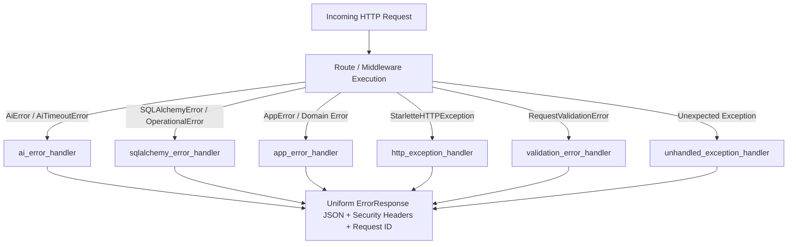

# Graceful-Degradation Audit & Fault-Tolerance Matrix

> **Document Version:** 1.0.0  
> **Author / Owner:** Vivek (`@panchotiyavivek18`)  
> **Task:** `S2-VIV-6` (Sprint 2)  
> **Requirements:** `NFR-05` (Reliability & Graceful Degradation), `NFR-03` (Security & Zero-PII), `NFR-08` (API Standards), `DR-01`, `DR-02`, `DR-06`  
> **Target System:** FastAPI Backend API & Domain Services

---

## 1. Executive Summary

This document reports the comprehensive fault-tolerance and graceful-degradation audit performed on the AI-Based Symptom Checker backend (`server/`). The purpose of this audit is to ensure that catastrophic upstream failures across external AI models, Computer Vision (CV) inference pipelines, and PostgreSQL/SQLite databases are intercepted and translated into **safe, typed, structured error responses** rather than crashing the application process, dropping connections, or leaking internal architectural details, connection strings, API keys, or raw stack traces.

### Core Architectural Principles (`NFR-05`):
1. **No Application Crashes:** Unhandled exceptions from third-party SDKs, network timeouts, or database connection drops are captured centrally by FastAPI exception handlers.
2. **Standardized Wire Format:** Every failure returns a uniform JSON envelope matching `ErrorResponse`:
   ```json
   {
     "code": "TYPED_ERROR_CODE",
     "message": "Safe human-readable explanation",
     "details": null,
     "requestId": "req_1234567890abcdef"
   }
   ```
3. **Medical Safety Invariant (`AI_RULES.md §2`):** A system, AI, or CV failure must **never** fabricate a diagnosis, lower a clinical risk tier, or bypass urgent emergency referrals. Uncertainty always escalates or preserves safety.
4. **Zero-PII & Secret Protection (`DR-06`, `NFR-03`):** Internal SQL queries, table structures, connection strings, prompt templates, and uploaded binary image data are strictly stripped from logs and client responses.

---

## 2. Failure Domain 1: AI Services (`OpenAI`, `Gemini`, `AiGateway`)

The AI subsystem (`server/app/services/ai/`) handles natural language symptom extraction, clinical attribute parsing, and conversational clarification.

| Failure Mode | Root Trigger / Exception | Central Handling & Error Code | HTTP Status | Medical Safety & Privacy Behavior |
|---|---|---|---|---|
| **AI Timeout** | Upstream provider call exceeds per-call latency budget or timeout (`AiTimeoutError`) | `ai_error_handler` -> `AI_TIMEOUT` | `504 Gateway Timeout` | The assessment dialogue preserves conversational history and allows user to retry without loss of session state. |
| **Invalid Schema / Malformed JSON** | LLM outputs non-JSON, markdown-fenced text, or Pydantic validation failure (`AiValidationError`) | `ai_error_handler` -> `AI_INVALID_RESPONSE` | `502 Bad Gateway` | Fallback gateway attempts backup provider (e.g. Gemini). If both fail, safely reports invalid upstream response without hallucinating symptoms. |
| **Provider Unavailable / Quota Drop** | Network disconnection, HTTP 429 rate limit, 503 upstream, or missing provider credentials (`AiError`) | `ai_error_handler` -> `AI_PROVIDER_UNAVAILABLE` | `503 Service Unavailable` | Never exposes provider credentials or prompt templates. Guided flow remains retry-safe. |
| **Chat Intake Extraction Timeout** | Handled within `orchestrator.process_message()` | Logs `ai_extraction_timeout` | `200 OK` (In-band fallback message) | Assistant replies: *"I'm having trouble connecting. Could you please say that again?"*. Assessment state remains intact. |
| **Chat Intake Extraction Failure** | Handled within `orchestrator.process_message()` | Logs `ai_extraction_failure` | `200 OK` (In-band fallback message) | Assistant replies: *"I had trouble understanding that. Could you try rephrasing your symptoms?"*. No malformed symptoms added. |

---

## 3. Failure Domain 2: Computer Vision (`ImageAnalyzer`, `OnnxImageAnalyzer`)

The Computer Vision subsystem (`server/app/services/image/`) validates and classifies uploaded dermatological and visual symptom photos in memory.

| Failure Mode | Root Trigger / Exception | Central Handling & Error Code | HTTP Status | Medical Safety & Privacy Behavior |
|---|---|---|---|---|
| **CV Model Missing / Unconfigured** | Model file not found on disk, Hugging Face repo unavailable, or provider unconfigured (`CvModelUnavailableError` / `ImageAnalysisError`) | `app_error_handler` -> `CV_MODEL_UNAVAILABLE` (or `IMAGE_ANALYSIS_UNAVAILABLE`) | `503 Service Unavailable` | **Graceful text-only fallback:** The orchestrator logs `image_analysis_failed_continuing_text` and continues assessment using text symptoms only. |
| **ONNX Inference Crash** | Runtime exception during ONNX tensor evaluation or preprocessing crash (`CvInferenceFailedError`) | `app_error_handler` -> `CV_INFERENCE_FAILED` | `502 Bad Gateway` | Does not crash worker process. Image bytes remain in volatile memory and are discarded. |
| **Blurry / Dark / Low-Quality Photo** | Quality checks detect low variance or poor lighting | In-band `ImageAnalysis(status="unclear", label=None)` | `200 OK` (Structured analysis payload) | Friendly abstain message asking for a clearer photo. **Never silently guesses an image condition.** |
| **Oversized / Malformed File** | File > 5 MB, invalid magic bytes, or disguised executable (`UploadError`) | `app_error_handler` -> `IMAGE_TOO_LARGE` (413), `UNSUPPORTED_IMAGE_TYPE` (415), `INVALID_IMAGE` (422) | `413 / 415 / 422` | Request rejected before inference. Spool memory capped strictly at 5 MB (`DR-06`). Zero disk writes. |

---

## 4. Failure Domain 3: Database & Persistence (`SQLAlchemy`, `Neon/PostgreSQL`)

The database subsystem handles session states, message logs, user profiles, consents, and audit logs.

| Failure Mode | Root Trigger / Exception | Central Handling & Error Code | HTTP Status | Security & Data Integrity Behavior |
|---|---|---|---|---|
| **Database Unavailable / Dropped Connection** | Neon PostgreSQL unreachable, TCP connection severed, connection pool exhausted (`OperationalError`, `InterfaceError`, `DbTimeoutError`) | `sqlalchemy_error_handler` -> `DATABASE_UNAVAILABLE` | `503 Service Unavailable` | Masks hostnames, ports, and connection strings. Returns safe client message: *"Database service is temporarily unavailable. Please try again later."* |
| **Constraint Violation / Duplicate Record** | Unique constraint failure (e.g. duplicate user registration), foreign key conflict (`IntegrityError`) | `sqlalchemy_error_handler` -> `CONFLICT` | `409 Conflict` | Prevents corrupting relational state; suppresses internal table and constraint names from client payload. |
| **Data Format Error / Schema Mismatch** | Malformed data types or column truncation (`DataError`, `DatabaseError`) | `sqlalchemy_error_handler` -> `DATABASE_OPERATION_FAILED` | `500 Internal Server Error` | Client receives generic message: *"A database operation failed. Please try again later."* Raw SQL is never logged or returned. |
| **Session Rollback on Error** | Any uncaught database exception within transaction | Handled in session management lifecycle | Respective status code | Transactions automatically roll back upon encountering an exception, preventing partial writes. |

---

## 5. Centralized Exception Handling Architecture

All exception handlers are centralized in `server/app/core/errors.py` and registered at FastAPI bootstrap in `register_error_handlers(app)`:



### Response Header Guarantees:
Every error response emitted through central handlers includes:
- `X-Request-ID`: Correlation ID matching `request_id` in response body.
- `Content-Security-Policy`: Default `'self'` lockdown.
- `X-Content-Type-Options: nosniff`.
- `X-Frame-Options: DENY`.
- `Referrer-Policy: strict-origin-when-cross-origin`.

---

## 6. Verification & Automated Test Coverage

The fault-tolerance implementation is verified through automated unit tests in `server/tests/unit/core/test_graceful_degradation.py`:

| Test Case | Verification Target | Expected Wire Code | Expected Status |
|---|---|---|---|
| `test_ai_timeout_returns_504_ai_timeout` | Unhandled `AiTimeoutError` escaping into FastAPI | `AI_TIMEOUT` | `504 Gateway Timeout` |
| `test_ai_validation_error_returns_502_ai_invalid_response` | Unhandled `AiValidationError` | `AI_INVALID_RESPONSE` | `502 Bad Gateway` |
| `test_ai_provider_error_returns_503_ai_provider_unavailable` | Base `AiError` | `AI_PROVIDER_UNAVAILABLE` | `503 Service Unavailable` |
| `test_cv_model_unavailable_returns_503_cv_model_unavailable` | `CvModelUnavailableError` | `CV_MODEL_UNAVAILABLE` | `503 Service Unavailable` |
| `test_cv_inference_failed_returns_502_cv_inference_failed` | `CvInferenceFailedError` | `CV_INFERENCE_FAILED` | `502 Bad Gateway` |
| `test_database_operational_error_returns_503_database_unavailable` | SQLAlchemy `OperationalError` | `DATABASE_UNAVAILABLE` | `503 Service Unavailable` |
| `test_database_integrity_error_returns_409_conflict` | SQLAlchemy `IntegrityError` | `CONFLICT` | `409 Conflict` |
| `test_database_general_error_returns_500_database_operation_failed` | Generic `SQLAlchemyError` | `DATABASE_OPERATION_FAILED` | `500 Internal Server Error` |
| `test_database_error_masks_sql_query_and_connection_string` | SQL query and connection parameter suppression | Safe generic message | `500 / 503` |
| `test_error_response_contains_request_id_and_security_headers` | Header injection across error handlers | Correlation header present | Any error code |
| `test_no_stack_traces_leaked_in_error_payload` | Traceback suppression | `details=None` | `500` |
| `test_text_only_fallback_on_cv_failure` | Assessment orchestrator continues on CV failure | Symptoms preserved | `200 OK` |
| `test_uncertainty_escalates_risk_invariant` | Clinical triage risk tier escalation | Risk escalation | Medical Safety |
