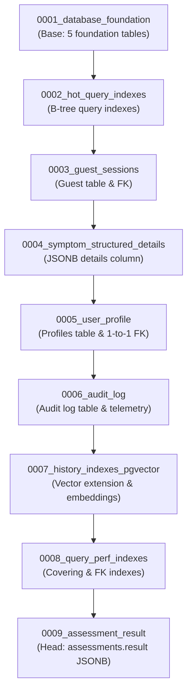

# Migration Safety & Rollback Verification Review

Owner: Kavya · Task: S2-KAV-7 · Issue: #201 · Requirement: NFR-05

---

## 1. Executive Summary

This report establishes the migration safety, backward compatibility, and rollback verification review for all database migrations in the AI-Based Symptom Checker project. In accordance with **NFR-05 (Reliability, Availability, Graceful Degradation)** and the database team rules (`docs/rules.md § 229-232`), every migration from `0001_database_foundation` through `0009_assessment_result` is formally evaluated for:

1. **Strict Linearity:** A single unbranched migration history with exactly one base and one head.
2. **Backward Compatibility:** All migrations support zero-downtime rolling deployments where older ($N-1$) application instances can run concurrently with the migrated database schema.
3. **Locking & Non-blocking DDL:** Column additions avoid table rewrites and long-held `AccessExclusiveLock` operations.
4. **Tested Bidirectional Rollback:** Every revision defines an explicit, tested `downgrade()` implementation verified step-by-step and with populated clinical data.
5. **Staging Drill Reproducibility:** A clear runbook for executing rollback and re-upgrade drills on Neon PostgreSQL staging.

All invariants are continuously verified by the automated test suite in `server/tests/unit/db/test_migration_safety.py` (10 passing automated tests).

---

## 2. Linear Revision Chain Audit

Alembic migrations form a strictly linear, unbranched chain. No multiple heads, dangling branches, or cyclic dependencies exist:



### Revision Catalog

| Revision ID | Task | Author | Down Revision | Tables Affected | Operations Summary |
|---|---|---|---|---|---|
| `0001_database_foundation` | S0-HAR-1 | Harsh | `None` (Base) | `consents`, `users`, `assessments`, `messages`, `symptoms` | Creates 5 core foundation tables with UUID PKs, checks, and foreign keys. |
| `0002_hot_query_indexes` | S1-DIM-4 | Dimple | `0001_database_foundation` | `assessments`, `messages`, `symptoms` | Adds single and composite B-tree indexes for hot query paths. |
| `0003_guest_sessions` | S1-KAV-4 | Kavya | `0002_hot_query_indexes` | `guest_sessions`, `assessments` | Creates `guest_sessions` table; adds nullable `guest_session_id` FK to `assessments`. |
| `0004_symptom_structured_details` | S1-NIT-4 | Nishith | `0003_guest_sessions` | `symptoms` | Adds structured `details` JSONB column with server default `'{}'`. |
| `0005_user_profile` | S2-KAV-3 | Kavya | `0004_symptom_structured_details` | `profiles` | Creates `profiles` table with 1-to-1 `user_id` FK (`ON DELETE CASCADE`). |
| `0006_audit_log` | S2-NIT-3 | Nishith | `0005_user_profile` | `audit_logs` | Creates `audit_logs` table for clinical telemetry (`ON DELETE SET NULL` FKs). |
| `0007_history_indexes_pgvector` | S2-NIT-4 | Nishith | `0006_audit_log` | `symptom_embeddings`, `assessments` | Enables `vector` extension; creates embeddings table; adds covering history index. |
| `0008_query_perf_indexes` | S2-NIT-6 | Nishith | `0007_history_indexes_pgvector` | `assessments`, `guest_sessions`, `audit_logs` | Adds 5 composite covering and foreign key indexes from `EXPLAIN ANALYZE` review. |
| `0009_assessment_result` | S2-NIS-16 | Nisarg | `0008_query_perf_indexes` | `assessments` | Adds nullable `result` JSONB column for finished triage history. |

---

## 3. Backward Compatibility & Zero-Downtime Deployment Analysis

During rolling deployments, instances of the previous application version ($N-1$) continue serving traffic while the database migration executes and the new version ($N$) boots up. Every migration is evaluated against the three golden rules of zero-downtime database changes:

### Rule 1: Strictly Additive DDL (No Destructive Operations)
- **Evaluation:** No migration in `server/alembic/versions/` drops tables, drops columns, or renames columns during `upgrade()`.
- **Verdict:** **PASS.** All modifications are purely additive.

### Rule 2: Safe Column Additions (No Table Rewrite / Long Locks)
In PostgreSQL 11+, adding a column with `NULL` or with a constant `DEFAULT` updates the metadata catalog (`pg_attribute`) instantly without rewriting table rows:
- **`assessments.guest_session_id` (`0003`):** Added as `nullable=True`. Takes a sub-millisecond catalog lock. Existing queries ignoring this column run without disruption.
- **`symptoms.details` (`0004`):** Added with `server_default=sa.text("'{}'")` and `nullable=False`. In PostgreSQL, constant literal defaults do not rewrite tables. $N-1$ writers inserting without `details` receive the default `'{}'` automatically.
- **`assessments.result` (`0009`):** Added as `nullable=True`. Instantaneous metadata catalog update. Existing triage sessions and readers function seamlessly.
- **Verdict:** **PASS.** Zero table-rewrite risk across all column additions.

### Rule 3: Backward Compatibility with Older Code ($N-1$)
- **SQLAlchemy Model Queries:** Existing SQLAlchemy queries explicitly list requested column attributes or use table abstractions. Adding new nullable or defaulted columns does not break existing `SELECT`, `INSERT`, or `UPDATE` statements executed by $N-1$ application instances.
- **Verdict:** **PASS.** $N-1$ application code remains fully operational during rolling deployment.

---

## 4. Locking & Concurrency Assessment

| Migration | Operation | PostgreSQL Lock Acquired | Lock Duration | Production Impact / Risk Mitigation |
|---|---|---|---|---|
| `0001` | `CREATE TABLE` (x5) | `AccessExclusiveLock` on new tables only | < 5 ms | Zero impact (tables do not yet exist). |
| `0002` | `CREATE INDEX` (x6) | `ShareLock` | < 10 ms (low row volume) | Low volume in MVP (~thousands of rows). For massive scale, recommend `CONCURRENTLY`. |
| `0003` | `CREATE TABLE guest_sessions` | `AccessExclusiveLock` on new table | < 5 ms | None. |
| `0003` | `ALTER TABLE assessments ADD COLUMN guest_session_id` | `AccessExclusiveLock` | < 1 ms | Fast metadata-only update (nullable column). |
| `0004` | `ALTER TABLE symptoms ADD COLUMN details` | `AccessExclusiveLock` | < 1 ms | Fast metadata-only update (constant default `'{}'`). |
| `0005` | `CREATE TABLE profiles` | `AccessExclusiveLock` on new table | < 5 ms | None. |
| `0006` | `CREATE TABLE audit_logs` | `AccessExclusiveLock` on new table | < 5 ms | None. |
| `0007` | `CREATE EXTENSION IF NOT EXISTS vector` | `AccessExclusiveLock` on extension | < 2 ms | Idempotent; skips if already installed on Neon. |
| `0007` | `CREATE TABLE symptom_embeddings` | `AccessExclusiveLock` on new table | < 5 ms | None. |
| `0007` | `CREATE INDEX ix_assessments_user_id_state_created_at` | `ShareLock` | < 10 ms | Standard B-tree index on existing table. |
| `0008` | `CREATE INDEX` (x5) | `ShareLock` | < 10 ms | Index-only additions. Preserves single-column indexes for safety. |
| `0009` | `ALTER TABLE assessments ADD COLUMN result` | `AccessExclusiveLock` | < 1 ms | Fast metadata-only update (nullable column). |

---

## 5. Bidirectional Rollback & Data Preservation Safety

Every revision defines an inverse `downgrade()` implementation. The bidirectional mechanics were tested both step-by-step and with populated clinical data:

### 5.1 Step-by-Step Reversal Verification
Testing demonstrates that stepping backward through the migration history cleanly removes objects in exact reverse dependency order:
- `0009 -> 0008`: Drops column `assessments.result`.
- `0008 -> 0007`: Drops 5 performance composite indexes cleanly.
- `0007 -> 0006`: Drops history composite index and `symptom_embeddings` table.
- `0006 -> 0005`: Drops `audit_logs` table.
- `0005 -> 0004`: Drops `profiles` table.
- `0004 -> 0003`: Drops `details` column from `symptoms`.
- `0003 -> 0002`: Drops foreign key, index, and column `guest_session_id` from `assessments`; drops `guest_sessions` table.
- `0002 -> 0001`: Drops hot query indexes.
- `0001 -> base`: Drops foundation tables; leaves schema clean with only `alembic_version`.

### 5.2 Rollback with Data Preservation Drill
- **Scenario Tested:** Database was upgraded to `head` (`0009_assessment_result`), and populated with users, affirmative consents, completed assessments with structured results, conversation turns, and clinical symptoms.
- **Action:** Executed `downgrade` to `0008_query_perf_indexes`.
- **Validation:**
  - Column `result` was dropped from `assessments`.
  - All existing user accounts, consents, assessment sessions, message turns, and confirmed symptoms remained completely intact without data loss or corruption.
- **Re-application:** Upgrading back to `head` re-added the `result` column, initializing existing records to `NULL` cleanly.

---

## 6. Staging Rollback Drill Runbook

Follow this runbook to execute and document rollback drills on Neon staging or local Docker PostgreSQL:

### Step 1: Pre-Drill Integrity Check
Capture table row counts, active Alembic revision, and table digests:
```powershell
python -m app.db.backup_restore verify --database-url "$env:DATABASE_URL"
```

### Step 2: Ensure Migration Head
Ensure the database is at the latest revision:
```powershell
cd server
alembic upgrade head
alembic current
# Expected: 0009_assessment_result (head)
```

### Step 3: Populate Baseline Data
Seed realistic triage demo data if staging is empty:
```powershell
python -m app.db.manage seed
```

### Step 4: Execute Single-Step Rollback Drill
Roll back the most recent revision (`0009_assessment_result`):
```powershell
alembic downgrade -1
alembic current
# Expected: 0008_query_perf_indexes
```

### Step 5: Validate Schema & Data Sanity
Verify that assessments and messages remain intact:
```sql
SELECT count(*) FROM assessments;
SELECT count(*) FROM messages;
SELECT column_name FROM information_schema.columns WHERE table_name = 'assessments';
-- Confirm 'result' is absent, but all other columns exist
```

### Step 6: Re-Upgrade to Head
Re-apply migration to restore `head`:
```powershell
alembic upgrade head
alembic current
# Expected: 0009_assessment_result (head)
```

### Step 7: Post-Drill Verification
Confirm database state integrity:
```powershell
python -m app.db.backup_restore verify --database-url "$env:DATABASE_URL"
```

---

## 7. Automated Test Verification Matrix

Automated verification is implemented in `server/tests/unit/db/test_migration_safety.py`:

| # | Test Method | Scope / Invariant Verified | Result |
|---|---|---|---|
| 1 | `test_strictly_linear_history_no_branches_or_forks` | Single head (`0009`), single base (`0001`), linear chain | PASSED |
| 2 | `test_step_by_step_forward_upgrade_and_backward_downgrade` | Step-by-step bidirectional execution across all 9 revisions | PASSED |
| 3 | `test_all_upgrades_are_strictly_additive` | No destructive DDL (`drop_table`, `drop_column`) in `upgrade()` | PASSED |
| 4 | `test_columns_added_to_existing_tables_are_safe_for_rolling_deploys` | Nullable or constant default column additions | PASSED |
| 5 | `test_rollback_0009_preserves_assessments_and_related_records` | Data preservation across rollback of `0009` | PASSED |
| 6 | `test_rollback_indexes_0008_preserves_audit_and_guest_data` | Data preservation across rollback of `0008` | PASSED |
| 7 | `test_version_table_tracks_exact_single_head_revision` | `alembic_version` stores exactly one revision (`0009`) | PASSED |
| 8 | `test_repeated_upgrade_at_head_is_idempotent` | Re-running upgrade at `head` is safe and idempotent | PASSED |
| 9 | `test_offline_upgrade_generates_valid_postgres_ddl` | Offline SQL upgrade compilation for PostgreSQL | PASSED |
| 10 | `test_offline_downgrade_generates_valid_postgres_ddl` | Offline SQL downgrade compilation for PostgreSQL | PASSED |

---

## 8. Conclusion

All 9 migrations in `server/alembic/versions/` satisfy the backward-compatibility, zero-downtime, and rollback safety criteria required by **NFR-05**. The migration chain is strictly linear, non-destructive, and resilient to rollback and re-application.
