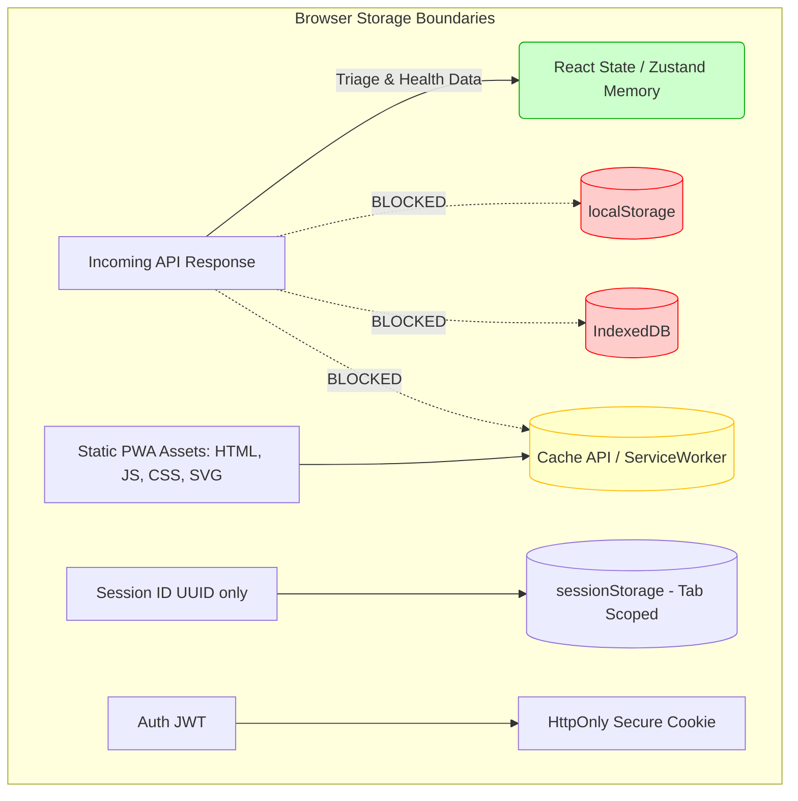

# Privacy, Safety, and Compliance Specification

Owner: Dimple (Frontend + Deployment, Database) · Task: S0-DIM-1 · Issue: #23 · Requirements: DR-01, DR-05, DR-06, DR-08

---

## 1. Executive Summary & Purpose

The **AI-Based Symptom Checker** is designed and operated strictly as an **informational health-triage aid and clinical decision-support tool**, never as a diagnostic or prescribing authority. 

This document defines the binding privacy, regulatory, safety, and client-storage policies in our project. It establishes compliance with:
- India's **Digital Personal Data Protection Act, 2023 (DPDP Act 2023)**.
- Medical safety and non-diagnostic triage boundaries (**DR-01, DR-05, DR-06, DR-08**).
- Progressive Web App (PWA) zero-persistence client caching rules.

Every team member, service, frontend component, and database query must adhere to the rules defined herein.

---

## 2. Comprehensive Data Inventory & Classification (DR-06)

The system enforces strict data minimization. We collect and process only the minimum information necessary to execute the conversational triage flow.

### 2.1 Data Inventory Matrix

| Data Category | Specific Elements | Ingest Method | Processing Mode | Storage Destination | Retention Policy | Sensitivity (DPDP Act) |
|---|---|---|---|---|---|---|
| **Free-Text Messages** | Natural language user descriptions of symptoms | Chat input via `POST /assessments/{id}/messages` | Ephemeral; PII scrubber removes names, phones, emails, and IDs before AI extraction | PostgreSQL `messages` table (text only) | 24 hours (Guest) / Deleted on request (Account) | Sensitive Personal Data |
| **Extracted Symptoms** | Canonical symptom name, severity, duration, body site | Extracted by AI gateway, confirmed by user | Deterministic normalization and state tracking | PostgreSQL `symptoms` table | 24 hours (Guest) / Deleted on request (Account) | Sensitive Personal Data |
| **Assessment Metadata** | `id` (UUID), `state`, `created_at`, `consent_id`, `user_id` | Server generated | State machine orchestration (`START` → `COMPLETED`) | PostgreSQL `assessments` table | 24 hours (Guest) / Deleted on request (Account) | Internal / Operational |
| **Consent Artifacts** | `consent_id` (UUID), `policy_version`, `created_at` | `POST /consents` | Checked prior to assessment persistence | PostgreSQL `consents` table | Retained for auditability | Compliance Record |
| **Optional Account** | `email` (normalized), `password_hash` (Argon2) | Registration via `POST /auth/register` | Identity and authentication | PostgreSQL `users` table | Retained until account deletion | Personal Identifiable Data |
| **Optional Symptom Images** | Visible skin/rash photos (JPEG, PNG, WebP ≤ 5 MB) | `POST /assessments/{id}/images` | **In-memory only** (Pillow + NumPy → ONNX inference); EXIF stripped | **NEVER STORED** (zero disk, zero DB, zero logs, zero cloud bucket) | Discarded immediately after in-memory inference | High (Ephemeral Biometric / Health) |

### 2.2 Prohibited Data Categories (Strictly Excluded)

The following data types are **strictly out of scope** and must never be requested, ingested, or stored by any part of the application:
1. **Government Identifiers:** Aadhaar numbers, PAN cards, passport numbers, driver's license details.
2. **Payment & Financial Details:** Bank accounts, UPI IDs, credit/debit cards (the tool is 100% free; no billing components).
3. **Doctor / Healthcare Provider Data:** Provider directories, doctor credentials, doctor schedules, booking calendars.
4. **Third-Party Health Records:** EHR/EMR files, lab report PDFs, prescription documents.
5. **Persistent Raw Biometric / Image Files:** No image files are ever written to disk, object storage (S3/GCS), or database blobs.

---

## 3. DPDP Act 2023 Compliance Checklist (India)

### Why is this required?
This compliance checklist is an **explicit deliverable required for Issue #23 (`S0-DIM-1`)** in `docs/SPRINT_PLAN.md`. Under Indian law, the **Digital Personal Data Protection Act, 2023 (DPDP Act 2023)** is the primary legal framework protecting individuals from the misuse of personal and health data. 

### Protection Against Data Misuse
This checklist guarantees that user data cannot be exploited:
1. **No Unauthorized Commercialization or Misuse:** The platform is legally and architecturally prohibited from selling health data, sharing it with advertisers, or using personal conversations to train public AI models.
2. **Strict Accountability & Penalties:** Under Section 33 of the DPDP Act 2023, failure to implement reasonable security safeguards or misusing personal data carries statutory penalties of up to ₹250 crore imposed by the Data Protection Board of India.
3. **Data Principal Empowerment:** Users are legally recognized as Data Principals with absolute rights to access, withdraw consent, and demand total erasure of their health data.

As a Data Fiduciary operating in India handling sensitive health data, our platform implements the following statutory obligations:

| Section / Principle | Requirement | Implementation in System | Verification & Enforcement | Status |
|---|---|---|---|---|
| **Section 5 (Notice)** | Clear, plain-language itemized notice before collecting personal data. | Landing page and Consent Step present the exact purpose, data categories, retention terms, and rights before the user enters symptoms. | `ConsentStep.tsx` displays notice before `POST /consents`. | Compliant |
| **Section 6 (Consent)** | Consent must be free, specific, informed, unconditional, and unambiguous with clear affirmative action. | Affirmative checkbox and explicit acceptance button. No pre-ticked checkboxes; no dark patterns; no bundled clauses. | `POST /consents` records `policy_version` and timestamp. | Compliant |
| **Section 6(4) (Withdrawal)** | Right to withdraw consent easily with comparable ease. | "Delete My Data" action in user settings / footer purges the assessment and revokes consent. | `DELETE /api/v1/privacy/data` cascades removal. | Compliant |
| **Section 7 (Purpose Limitation)** | Data used solely for specified triage purposes. | Symptom data is processed strictly to determine triage urgency and condition relevance. Never used for marketing, ad profiling, or model training. | Architectural boundary: LLM API calls are stateless and opt out of training retention. | Compliant |
| **Section 8(1) (Data Minimization)** | Collect only what is strictly necessary. | Guest mode requires zero identity data (no phone, no email). Only symptom text and duration are collected. | Guest flow functions completely without user registration. | Compliant |
| **Section 8(5) (Storage Limitation)** | Data must be erased once the purpose is served. | Unregistered guest assessments are automatically purged after 24 hours via a scheduled TTL cleanup job (`S2-DIM-4`). | Database TTL purge query deletes orphaned records `created_at < NOW() - INTERVAL '24 hours'`. | Compliant |
| **Section 8(6) (Security Safeguards)** | Reasonable technical and organizational security measures. | TLS 1.3 in transit, Argon2id password hashing, HttpOnly secure cookies, PostgreSQL SSL connection to Neon, PII scrubbing before AI transmission. | `app/middleware/security.py`, `app/services/privacy/pii.py`. | Compliant |
| **Section 9 (Processing Child Data)** | Verifiable parental consent; no tracking or behavioral monitoring of minors. | Service is targeted at users 18 years or older (or with parental guidance). No behavioral advertising or tracking scripts are loaded. | Privacy notice explicitly clarifies age threshold; zero third-party analytics trackers. | Compliant |
| **Section 11 (Principal Rights)** | Rights to access, correction, erasure, and grievance redressal. | Self-service data export (`GET /privacy/export`) and deletion (`DELETE /privacy/delete`). Grievance officer contact provided in notice. | Implemented via Privacy API endpoints and published contact details. | Compliant |

---

## 4. Mandatory Medical Disclaimer & Emergency Notice (DR-01, DR-02)

### 4.1 Verbatim Mandatory Medical Disclaimer (DR-01)

The following disclaimer is mandatory, standardized, and must appear verbatim without alteration:

> **"This is not a medical diagnosis. Always consult a qualified healthcare professional."**

#### Mandatory Placement Locations:
1. **Landing Page:** Displayed in a high-contrast banner immediately above the "Start Assessment" action.
2. **Consent Dialog:** Embedded directly in the consent modal before the assessment begins.
3. **Assessment Chat Shell:** Rendered as a persistent, non-dismissible footer banner throughout the conversation.
4. **Assessment Results Page:** Displayed prominently at the very top of the condition assessment report.
5. **PWA Offline Fallback Screen:** Visible whenever network connectivity is lost.

### 4.2 Emergency Care Directive & 112 Priority (DR-02, FR-15)

In any scenario where red-flag symptoms are detected (e.g., severe chest pressure, sudden breathing difficulty, stroke symptoms, uncontrolled bleeding), the deterministic risk engine returns `RiskLevel.URGENT`.

When `RiskLevel.URGENT` is returned:
1. **Emergency Number Hierarchy:** India's national emergency number **112** (Unified Emergency: Police, Fire, Ambulance) must be displayed first, largest, and in primary position. Dedicated medical emergency numbers may be listed alongside:
   - **112:** Unified National Emergency Helpline (Ambulance, Fire, Police) — *Primary / Displayed First*
   - **108:** Emergency Medical Ambulance Service (critical care & emergency response)
   - **102:** Free Ambulance Service (Maternal, Infant & Patient Transport)
2. **Immediate Action Verbatim Directive:**
   > **"Immediate Medical Attention Required: If you or someone with you is experiencing a life-threatening emergency, call 112 immediately or go to the nearest emergency room."**
3. **Full-Screen Takeover:** The urgent alert modal must take over the viewport, inhibiting standard self-care exploration until the emergency notice is acknowledged.

### 4.3 Verbatim Consent Agreement Copy (DR-08)

The consent dialog displayed prior to the first message must present the following exact text:

```text
Title: Health Information & Triage Consent
Version: 2026.1 (DPDP Compliant)

Before we begin:
1. Informational Purpose Only: This tool is an automated triage assistant designed to help you understand your symptoms. It is not a doctor and cannot provide a medical diagnosis or prescribe treatments.
2. Data Handling: We process the symptoms you describe to evaluate urgency and match potential conditions. We do not sell your data. If you continue as a guest, your session data is automatically deleted after 24 hours.
3. Privacy Safeguards: Personal identifiers (such as names and emails) are automatically scrubbed before any AI analysis. Uploaded photos are analyzed in memory and never stored on disk or in any database.
4. Emergency Notice: If you are experiencing severe pain, chest tightness, or trouble breathing, please call 112 immediately.

[ ] I understand and agree to the processing of my symptom information for triage guidance under these terms.
[Continue as Guest]    [Sign In / Create Account]
```

---

## 5. Prohibited Medical Phrases & Safe Wording Framework (DR-05)

To prevent misinterpretation, liability, and regulatory violation, user-facing copy generated by the system—whether authored by developers, served from knowledge bases, or synthesized by AI models—must strictly adhere to the safe wording framework.

### 5.1 Prohibited Phrases vs. Approved Alternatives

| Category | Prohibited Phrasing (BANNED) | Required Safe Phrasing (APPROVED) | Rationale |
|---|---|---|---|
| **Diagnosis** | "You have [Condition]"<br>"Diagnosis: [Condition]"<br>"You are suffering from..."<br>"We diagnosed you with..." | "Your symptoms may be related to [Condition]"<br>"Possible conditions matching your description include..."<br>"Symptoms appear consistent with..." | Prevents unauthorized medical diagnosis; clarifies decision-support nature. |
| **Certainty & Proof** | "This definitely means..."<br>"Conclusive cause is..."<br>"Tests confirm that..." | "One possible explanation is..."<br>"Common causes for these symptoms include..."<br>"A clinical evaluation is needed to confirm..." | Acknowledges clinical uncertainty without clinical testing. |
| **Prescription & Drugs** | "Take 500 mg of [Drug]"<br>"We prescribe..."<br>"You need antibiotic treatment"<br>"Start taking ibuprofen daily" | "Consult a licensed healthcare provider regarding medication options."<br>"Discuss with a doctor whether over-the-counter pain relief is appropriate." | Prescribing medicine is strictly reserved for licensed practitioners. |
| **Cure & Prognosis** | "This will cure your condition"<br>"You will recover in 2 days" | "General self-care measures that may help alleviate discomfort include..."<br>"Symptoms typically evolve over several days; consult a doctor if they worsen." | Avoids giving medical guarantees or false reassurance. |
| **Urgency Downgrading** | "It is probably nothing to worry about"<br>"No need to see a doctor" | "Your current symptoms suggest a lower risk level, but monitor your condition closely."<br>"If symptoms worsen, new symptoms appear, or you feel concerned, seek medical advice." | Uncertainty must never falsely reassure a deteriorating patient. |

### 5.2 Confidence Display Rules (FR-23)

- **NEVER** expose raw probability numbers, decimal scores, or percentages to users (e.g., *"78.4% match"* or *"Confidence: 0.92"*). Raw scores imply a degree of statistical precision that clinical triage tools cannot ethically claim.
- **ALWAYS** map model outputs to the three qualitative categories defined in `AI_RULES.md`:
  1. **Likely:** Primary candidate strongly supported by reported symptom clusters.
  2. **Possible:** Plausible candidate with partial symptom overlap.
  3. **Less likely:** Secondary possibility requiring clinical differential evaluation.

### 5.3 Automated Safety Wording Guard

Harsh's `assert_safe_wording()` service (`server/app/services/privacy/safety_guard.py`) programmatically validates every response text generated by the backend before returning it to the client. Any occurrence of regex patterns matching `\b(you have|diagnosis|diagnosed with|take \d+\s*mg|prescription|cure)\b` triggers an immediate validation error and halts the response.

---

## 6. Progressive Web App (PWA) Storage & Security Rules (DR-06)

To protect patient privacy on shared, family, and mobile devices, the client-side storage architecture enforces a **Zero Health Data Persistence** policy on the client.



### 6.1 Browser Storage Matrix

| Storage Mechanism | Permitted Contents | Prohibited Contents | Justification |
|---|---|---|---|
| `localStorage` | **Strictly None.** Zero health or session data. | Symptoms, messages, conditions, assessment IDs, auth tokens, risk tiers. | `localStorage` persists indefinitely across browser restarts and is vulnerable to XSS and shared-device inspection. |
| `IndexedDB` | **Strictly None.** | Any assessment records, cached conversations, offline drafts. | Health data must not be persisted on device storage. |
| `Cache API` (Service Worker) | App shell only: `index.html`, compiled `.js` bundles, `.css`, icons, Web Manifest. | **All `/api/*` endpoints.** No API responses may ever be cached by Workbox. | Workbox runtime caching must use `NetworkOnly` for all API calls. |
| `sessionStorage` | Ephemeral `assessment_id` (UUID) for the active tab only. | Message content, symptom text, risk levels, user demographic details. | Cleared automatically when the user closes the browser tab or restarts the flow. |
| `Cookies` | First-party `session_token` / JWT (`HttpOnly`, `Secure`, `SameSite=Lax`). | Plaintext health data, medical flags. | Inaccessible to JavaScript; protected against XSS theft. |

### 6.2 Service Worker Caching Architecture

The Vite PWA plugin (`client/vite.config.ts`) must enforce the following Workbox runtime configuration:

```typescript
// Enforced Workbox Rule in vite.config.ts
workbox: {
  runtimeCaching: [
    {
      // All backend API routes MUST bypass client cache
      urlPattern: /^\/api\/.*$/,
      handler: 'NetworkOnly',
      options: {
        backgroundSync: undefined, // No background replay of medical requests
      },
    },
  ],
}
```

### 6.3 PWA Offline Safety Mode

When a user opens the PWA while disconnected from the Internet:
1. The app shell loads from cache.
2. A prominent offline banner appears:
   > **"You are currently offline. Live symptom triage requires an internet connection. If this is an emergency, call 112 immediately."**
3. Input is disabled until connectivity is restored; no unencrypted offline queues of medical queries are retained on the device.

---

## 7. Compliance Verification & Audit Checklist

Before releasing any version or closing pull requests touching privacy or safety:

- [x] **Data Inventory Complete:** All collected fields mapped and authorized.
- [x] **DPDP Act 2023 Aligned:** Notice, explicit consent, purpose limitation, and 24h guest purge documented.
- [x] **Verbatim Medical Disclaimer:** Exact copy placed on Landing, Chat, Result, and Offline views.
- [x] **Emergency 112 Priority:** India's national emergency number 112 displayed first in all urgent contexts.
- [x] **Prohibited Phrases Cataloged:** Safe alternative phrasing codified for all content authors.
- [x] **PWA Storage Guarded:** `localStorage` and `IndexedDB` barred from health data; Service Worker configured to `NetworkOnly` for APIs.
- [x] **Zero Persistent Images:** Image analysis verified as memory-only with zero disk/database writes.
