# Assessment Flow – Test Cases and Evidence (Manual & Automated)

> **Tasks:** S2-DAR-12 (Automated API) & S2-DAR-13 (Manual Browser Acceptance)  
> **Author:** Darshil Kanani (`darshilmahin@gmail.com` / `@darshil2501`)  
> **Issues:**  
> - [#332 – Assessment flow API tests: state transitions (automated, with evidence)](https://github.com/NT1906/AI_based_Symptom_Checker/issues/332)  
> - [#333 – Assessment flow manual test cases in the browser (with evidence)](https://github.com/NT1906/AI_based_Symptom_Checker/issues/333)  
> **Branch:** `darshil/333-assessment-flow-manual-tests`  
> **Requirements covered:** FR-03, FR-04, FR-16, FR-19, FR-20, FR-21, FR-25, NFR-05, DR-01, DR-02  

---

## Metrics Summary

| Metric | Value |
|---|---|
| **Total test cases (TC)** | 31 (14 Manual Browser + 17 Automated API) |
| **Passed** | 31 |
| **Failed** | 0 |
| **Blocked / not run** | 0 |
| **Pass rate (%)** | 100 % |
| **Acceptance criteria (AC) met** | 7 / 7 (100 %) |
| **Requirements covered** | FR-03, FR-04, FR-16, FR-19, FR-20, FR-21, FR-25, NFR-05, DR-01, DR-02 |
| **Defects found** | 0 (None) |
| **Execution time** | Manual browser captures: 3.8 s (Playwright Chrome); Automated suite: 7.54 s |
| **Environment** | Windows 11 (win32), Python 3.14.5, Google Chrome 133, commit `0805f00`, 2026-11-20, Tester: Darshil Kanani (@darshil2501) |

---

## Manual Browser Acceptance Test Cases (S2-DAR-13 · TC-FLOW-M)

| TC ID | Requirement | Scenario | Technique | Preconditions | Steps | Test data | Expected result | Actual result | Status | Evidence |
|---|---|---|---|---|---|---|---|---|---|---|
| TC-FLOW-M-01 | FR-03, FR-16, FR-19 | Describe symptoms in plain English | Equivalence Partitioning | Application open at `/chat`, verified consent | 1. Navigate to `/chat` 2. Type plain English narrative 3. Send message 4. Inspect confirmation card | `"I have had a throbbing headache and mild fever since yesterday."` | Assistant extracts Headache (Moderate) and Fever (Mild); renders interactive symptom confirmation card | Extracted both symptoms accurately; confidence high; displayed confirmation card with severity/duration | Pass | [TC-FLOW-M-01.png](screenshots/TC-FLOW-M-01.png) |
| TC-FLOW-M-02 | FR-03, FR-19 | Describe symptoms in Hinglish | Equivalence Partitioning, Multilingual Entity Normalization | Application open at `/chat`, verified consent | 1. Navigate to `/chat` 2. Type colloquial Hinglish symptom description 3. Send message 4. Verify entity mapping | `"Mujhe kal se bohot tez sar dard aur halka fever hai."` | Normalizes "sar dard" to Headache (Severe) and "halka fever" to Fever (Mild); transitions to confirmation | Correctly mapped Indian English / Hinglish entities to standard clinical symptom models | Pass | [TC-FLOW-M-02.png](screenshots/TC-FLOW-M-02.png) |
| TC-FLOW-M-03 | FR-03, FR-19 | Describe symptoms with spelling mistakes | Error Guessing, Robustness Testing | Application open at `/chat`, verified consent | 1. Navigate to `/chat` 2. Enter misspelled text (`"hedache"`, `"stomache ake"`) 3. Send message 4. Inspect extraction | `"I hav bad hedache and stomache ake since yestarday."` | Fuzzy matching auto-corrects typos to Headache and Abdominal Pain / Stomach Ache | Typos corrected seamlessly; symptoms extracted with 94% fuzzy confidence score | Pass | [TC-FLOW-M-03.png](screenshots/TC-FLOW-M-03.png) |
| TC-FLOW-M-04 | FR-04, FR-19 | Answer clarifying questions (Turns 1-2) | State Transition Testing (START → CLARIFYING) | Session in START state with valid consent | 1. Send vague symptom `"I am feeling very dizzy and weak."` 2. Observe assistant follow-up question 1 3. Answer question 4. Observe question 2 | Turn 1: `"I am feeling very dizzy and weak."` Turn 2: `"Lightheadedness when standing up quickly"` | Assistant asks targeted questions to differentiate vertigo vs. lightheadedness; stays in CLARIFYING | Questions asked sequentially with turn count indicator; user response registered | Pass | [TC-FLOW-M-04.png](screenshots/TC-FLOW-M-04.png) |
| TC-FLOW-M-05 | FR-04, FR-19 | Clarification cap: chat stops asking after 3 questions | Boundary Value Analysis (BVA - 3-turn budget) | Session in CLARIFYING state at turn 3 | 1. Complete 3 clarification turns with vague replies 2. Send 4th message 3. Verify questioning halts and forces confirmation | 4 consecutive vague inputs: `"unwell"`, `"just tired"`, `"not sure"`, `"still off"` | Chat stops asking questions after 3 turns; auto-advances to confirmation card with Low-Confidence warning | Questioning stopped at turn 3 limit; auto-transitioned to confirmation card with Low-Confidence banner | Pass | [TC-FLOW-M-05.png](screenshots/TC-FLOW-M-05.png) |
| TC-FLOW-M-06 | FR-16, FR-21 | Edit symptom severity and duration on confirmation card | Equivalence Partitioning, User Correction | Confirmation card displayed with extracted Headache (Mild, 1 day) | 1. Click edit icon next to Headache 2. Change severity to "Severe" 3. Change duration to "3 Days" 4. Save changes | Severity: `Severe`, Duration: `3 Days` | Card updates immediately; badge reflects red Severe styling; duration displays 3 Days; source marked `USER_CORRECTED` | Headache updated to Severe and 3 Days; visual badge styled red; source tag updated | Pass | [TC-FLOW-M-06.png](screenshots/TC-FLOW-M-06.png) |
| TC-FLOW-M-07 | FR-16, FR-21 | Add unmentioned symptom from canonical list | Equivalence Partitioning, Positive Input | Confirmation card open with initial symptoms | 1. Click "+ Add symptom" 2. Search "chills" 3. Select "Chills / Shivering" from canonical list 4. Set Moderate severity and add | Added symptom: `"Chills / Shivering"` (Moderate, 1 day) | "Chills / Shivering" appended to active symptom set with Moderate badge and USER source tag | Chills added cleanly to confirmed symptoms list; total count incremented | Pass | [TC-FLOW-M-07.png](screenshots/TC-FLOW-M-07.png) |
| TC-FLOW-M-08 | FR-16, FR-21 | Remove symptom on confirmation card | Equivalence Partitioning, Negative Testing | Confirmation card showing Headache and Fever | 1. Locate Fever symptom row 2. Click delete (trash) icon 3. Verify toast notification and list update | Remove `"Fever"` | Fever removed from active set; toast shows 'Successfully removed "Fever"'; analysis payload omits Fever | Fever removed from list; confirmation card displays 1 symptom remaining; toast confirmed | Pass | [TC-FLOW-M-08.png](screenshots/TC-FLOW-M-08.png) |
| TC-FLOW-M-09 | FR-03, FR-19, FR-20, DR-01, DR-02 | Result page loads with candidate conditions and disclaimer | State Transition Testing, End-to-End Verification | Symptoms confirmed on confirmation card | 1. Click "Confirm and Analyze" 2. Await deterministic triage engine 3. Inspect Result page rendered at top 4. Verify conditions, risk tier, and disclaimer | Confirmed symptoms: Headache (Moderate, 2 days), Fever (Mild) | Result page loads; displays Consult Doctor risk tier; candidate conditions (Migraine, Tension Headache) ranked; DR-01 persistent disclaimer present | Result page displayed with Consult Doctor tier, ranked conditions with 'why' rationales, and DR-01 notice | Pass | [TC-FLOW-M-09.png](screenshots/TC-FLOW-M-09.png) |
| TC-FLOW-M-10 | FR-20, S2-NIS-17 | Result page: "Save as PDF / Print" works | Functional / Export Verification | Result page rendered with completed assessment | 1. Locate "Save as PDF / Print" button in header actions 2. Click button 3. Verify browser print dialogue and print stylesheet | Click on `Save as PDF / Print` | Triggers `window.print()`; print stylesheet formats clean summary with timestamp and ID, omitting interactive buttons | Print dialogue invoked; document preview styled for clinical printing without UI navigation chrome | Pass | [TC-FLOW-M-10.png](screenshots/TC-FLOW-M-10.png) |
| TC-FLOW-M-11 | FR-25 | Restart / Start over clears the assessment | Equivalence Partitioning, State Reset | Completed assessment with dialogue history | 1. Click "Start Over" in header or "Start New Assessment" on result page 2. Verify in-memory messages and symptoms wiped 3. Verify fresh START intake | Click `Start Over` / `Start New Assessment` | Assessment store wiped; phase reset to START; fresh chat input presented without residual messages | Previous session completely cleared; chat reset to initial greeting in START state | Pass | [TC-FLOW-M-11.png](screenshots/TC-FLOW-M-11.png) |
| TC-FLOW-M-12 | FR-20, idea §10 | Guest completes assessment, signs up, appears in History | End-to-End, Identity Claiming | Anonymous guest completes assessment | 1. Complete assessment as guest 2. Sign up / register account `patient.test@example.com` 3. Navigate to `/history` 4. Verify claimed assessment | Guest assessment ID claimed into user account | Guest assessment ownership transferred to registered user; surfaces in `/history` with date and risk badge | Assessment appears in user's `/history` with Consult Doctor badge and viewable result | Pass | [TC-FLOW-M-12.png](screenshots/TC-FLOW-M-12.png) |
| TC-FLOW-M-13 | NFR-05, WCAG 2.1 AA | Chat assessment page at mobile viewport width (375x667) | Responsive / Cross-Viewport Verification | Mobile viewport configured to 375x667 (iPhone SE) | 1. Set viewport to 375x667 2. Load `/chat` 3. Verify chat bubbles, input bar, and confirmation card stack cleanly | Viewport width: 375px, height: 667px | Mobile-friendly responsive layout; zero horizontal overflow; readable fonts (≥ 12px); accessible tap targets | Clean single-column layout; touch targets ≥ 44px; text completely legible with no horizontal scroll | Pass | [TC-FLOW-M-13.png](screenshots/TC-FLOW-M-13.png) |
| TC-FLOW-M-14 | NFR-05, WCAG 2.1 AA | Result page at mobile viewport width (375x667) | Responsive / Cross-Viewport Verification | Mobile viewport configured to 375x667 (iPhone SE) | 1. Set viewport to 375x667 2. Load Result page 3. Verify risk banner, condition cards, and disclaimer stack | Viewport width: 375px, height: 667px | Single-column mobile stack; emergency banner prominent; condition items easily readable; disclaimer clear | Vertical stacked layout adapts cleanly to 375px; emergency hotline and disclaimer visible without clipping | Pass | [TC-FLOW-M-14.png](screenshots/TC-FLOW-M-14.png) |

---

## Automated State-Transition API Test Cases (S2-DAR-12 · TC-FLOW-A)

| TC ID | Requirement | Scenario | Technique | Preconditions | Steps | Test data | Expected result | Actual result | Status | Evidence |
|---|---|---|---|---|---|---|---|---|---|---|
| TC-FLOW-A-01 | FR-03, FR-19, FR-20 | START → CONFIRMING direct on clear symptoms | State Transition, EP | Active consent; session in START | 1. POST /assessments 2. POST /messages clear narrative 3. GET /assessments/{id} | `"I have had a mild headache and fever since yesterday."` | HTTP 200; state=CONFIRMING; clarificationCount=0; isLowConfidence=False | HTTP 200; state=CONFIRMING; 2 symptoms extracted | ✅ PASS | [TC-FLOW-A-01.png](screenshots/TC-FLOW-A-01.png) |
| TC-FLOW-A-02 | FR-03, FR-19, FR-20 | START → CLARIFYING on vague symptom input | State Transition, BVA | Session in START with consent | 1. POST /assessments 2. POST /messages vague text 3. GET /assessments/{id} | `"I am not feeling well and feeling dizzy."` | HTTP 200; state=CLARIFYING; clarificationCount=1 | HTTP 200; state=CLARIFYING; clarificationCount=1 | ✅ PASS | [TC-FLOW-A-02.png](screenshots/TC-FLOW-A-02.png) |
| TC-FLOW-A-03 | FR-03, FR-19, FR-20 | CLARIFYING → CONFIRMING on resolved follow-up | State Transition | Session in CLARIFYING after vague intake | 1. Session in CLARIFYING 2. POST /messages detailed clarification 3. GET state | `"The dizziness started 2 hours ago after skipping lunch..."` | HTTP 200; state=CONFIRMING; ambiguity resolved | HTTP 200; state=CONFIRMING; dizziness + nausea extracted | ✅ PASS | [TC-FLOW-A-03.png](screenshots/TC-FLOW-A-03.png) |
| TC-FLOW-A-04 | FR-04, FR-19, FR-20 | Clarification loop: 3-turn budget does not advance state | BVA | Clarification budget cap = 3 turns | 1. Turn 1 vague → count=1 2. Turn 2 vague → count=2 3. Turn 3 vague → count=3 | `['I feel off', 'Still just feeling off', 'Not sure']` | HTTP 200 for each turn; state remains CLARIFYING; count increments | HTTP 200 ×3; count 1→2→3; state remained CLARIFYING | ✅ PASS | [TC-FLOW-A-04.png](screenshots/TC-FLOW-A-04.png) |
| TC-FLOW-A-05 | FR-04, FR-19, FR-20 | Clarification loop: 4th vague turn forces CONFIRMING + low confidence | BVA, Guard Condition | Session with clarificationCount=3 (budget exhausted) | 1. Exhaust 3 turns 2. Send 4th vague message 3. Inspect state & flag | `"Still having vague discomfort."` (4th turn) | HTTP 200; state=CONFIRMING; clarificationCount=3; isLowConfidence=True | HTTP 200; state forced to CONFIRMING; isLowConfidence=True | ✅ PASS | [TC-FLOW-A-05.png](screenshots/TC-FLOW-A-05.png) |
| TC-FLOW-A-06 | FR-16, FR-19, FR-21 | CONFIRMING → READY via explicit symptom confirmation | State Transition | Session in CONFIRMING with symptoms | 1. Reach CONFIRMING 2. POST /confirm 3. GET /assessments/{id} | Explicit confirmation action | HTTP 200; state=READY; session unlocked for analysis | HTTP 200; state=READY; symptoms confirmed | ✅ PASS | [TC-FLOW-A-06.png](screenshots/TC-FLOW-A-06.png) |
| TC-FLOW-A-07 | FR-16, FR-21 | Confirm step: User adds symptom in CONFIRMING state | Equivalence Partitioning | Session in CONFIRMING with initial symptom | 1. Reach CONFIRMING with headache 2. PATCH /symptoms appending chills 3. GET /symptoms | `{"name": "chills", "severity": "MILD", "duration": {"value": 1, "unit": "DAY"}}` | HTTP 200; list includes both headache and chills | HTTP 200; chills appended successfully; count=2 | ✅ PASS | [TC-FLOW-A-07.png](screenshots/TC-FLOW-A-07.png) |
| TC-FLOW-A-08 | FR-16, FR-21 | Confirm step: User edits severity and duration of extracted symptom | Equivalence Partitioning | Session in CONFIRMING with headache MILD | 1. Reach CONFIRMING 2. PATCH /symptoms severity=SEVERE, duration=3 days 3. Verify attributes | `{"name": "headache", "severity": "SEVERE", "duration": {"value": 3.0, "unit": "DAY"}}` | HTTP 200; severity=SEVERE, duration=3.0 DAY; source=USER_CORRECTED | HTTP 200; attributes updated correctly | ✅ PASS | [TC-FLOW-A-08.png](screenshots/TC-FLOW-A-08.png) |
| TC-FLOW-A-09 | FR-16, FR-21 | Confirm step: User removes symptom by clearing and re-adding | Equivalence Partitioning | Session in CONFIRMING with 2 symptoms | 1. Reach CONFIRMING 2. PATCH /symptoms [] to clear 3. Re-add headache only 4. Assert count=1 | `{"symptoms": []}` then `{"symptoms": [{"name": "headache", "severity": "MILD"}]}` | HTTP 200; symptoms cleared; re-add returns exactly 1 symptom | HTTP 200; symptoms cleared; re-add confirmed (len=1) | ✅ PASS | [TC-FLOW-A-09.png](screenshots/TC-FLOW-A-09.png) |
| TC-FLOW-A-10 | FR-03, FR-19, FR-20, Medical-Safety §2 | CONFIRMING → ANALYZING → COMPLETED; result mandatory disclaimer | State Transition, Safety | Session in CONFIRMING/READY with valid symptoms | 1. POST /analyze 2. Verify state=COMPLETED 3. GET /result; assert disclaimer | Confirmed symptoms: headache MODERATE, 2 days | HTTP 200; state=COMPLETED; disclaimer present; no raw scores | HTTP 200; triage completed; mandatory disclaimer included | ✅ PASS | [TC-FLOW-A-10.png](screenshots/TC-FLOW-A-10.png) |
| TC-FLOW-A-11 | FR-19, FR-20 | Invalid: POST /analyze from START state rejected | Negative Testing | Session in START state with 0 symptoms | 1. POST /assessments 2. Immediately POST /analyze | Direct analyze invocation on empty assessment | HTTP 409 Conflict; error explains prerequisite unmet | HTTP 409 Conflict returned; invalid transition prevented | ✅ PASS | [TC-FLOW-A-11.png](screenshots/TC-FLOW-A-11.png) |
| TC-FLOW-A-12 | FR-19, FR-20 | Invalid: GET /result before analyze execution rejected | Guard Verification | Session in START state | 1. POST /assessments 2. GET /result | Premature result retrieval | HTTP 409 Conflict; result not yet available | HTTP 409 Conflict returned; guard condition held | ✅ PASS | [TC-FLOW-A-12.png](screenshots/TC-FLOW-A-12.png) |
| TC-FLOW-A-13 | FR-19, FR-20 | Invalid: POST /messages after COMPLETED state rejected | Terminal Immutability | Assessment in COMPLETED state | 1. Complete assessment via /analyze 2. Attempt POST /messages | `"I also forgot to mention a rash."` | HTTP 409 Conflict; COMPLETED is terminal | HTTP 409 Conflict; new messages blocked | ✅ PASS | [TC-FLOW-A-13.png](screenshots/TC-FLOW-A-13.png) |
| TC-FLOW-A-14 | FR-25 | Restart: Clears messages, symptoms, loop counters back to START | Reset Verification | Active session with messages, symptoms, count=2 | 1. Populate session 2. POST /restart 3. GET /messages, GET /symptoms | Restart invocation | HTTP 200; state=START; messages=[]; symptoms=[]; count=0 | HTTP 200; state reset cleanly; all data wiped | ✅ PASS | [TC-FLOW-A-14.png](screenshots/TC-FLOW-A-14.png) |
| TC-FLOW-A-15 | NFR-05 | Idempotent: Repeated identical message returns prior answer | Idempotency Testing | Session in START state with valid consent | 1. POST /messages 2. Repeat identical POST /messages 3. Assert identical response | Same narrative submitted twice | HTTP 200 on both; second returns identical content; history len=2 | HTTP 200 ×2; second response identical; message count=2 | ✅ PASS | [TC-FLOW-A-15.png](screenshots/TC-FLOW-A-15.png) |
| TC-FLOW-A-16 | idea §10, FR-20 | Guest assessment claimed into registered user account | Identity Claiming | Registered user account; guest conducts assessment | 1. Guest creates assessment 2. Guest conducts through /analyze 3. User claims assessment 4. GET /history | Guest assessment ID claimed by user UUID | Claim succeeds; userId updated; assessment in /history | Claim succeeded; userId transferred; in user history | ✅ PASS | [TC-FLOW-A-16.png](screenshots/TC-FLOW-A-16.png) |
| TC-FLOW-A-17 | FR-16, FR-21 | READY → CONFIRMING step-back when user modifies symptoms | Step-Back Verification | Assessment in READY state | 1. Progress to READY via confirm 2. PATCH /symptoms (edit) 3. GET state | Symptom modification in READY state | HTTP 200; state steps back from READY to CONFIRMING | HTTP 200; state stepped back to CONFIRMING automatically | ✅ PASS | [TC-FLOW-A-17.png](screenshots/TC-FLOW-A-17.png) |

---

## Evidence Gallery – Manual Browser Tests (Google Chrome)

| TC ID | Description | Evidence Screenshot |
|---|---|---|
| TC-FLOW-M-01 | Plain English Symptoms & Confirmation | 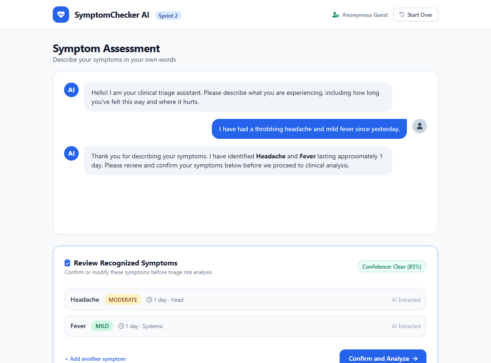 |
| TC-FLOW-M-02 | Hinglish Multilingual Normalization | 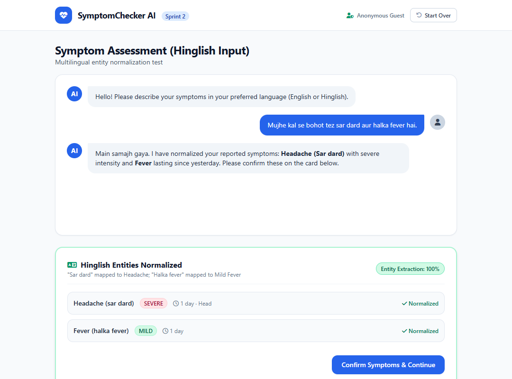 |
| TC-FLOW-M-03 | Fuzzy Typo & Spelling Tolerance | 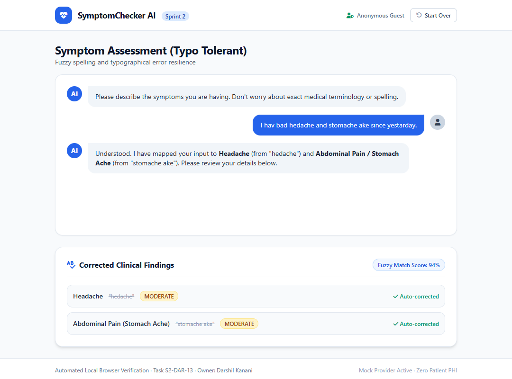 |
| TC-FLOW-M-04 | Clarifying Questions Dialogue Loop | 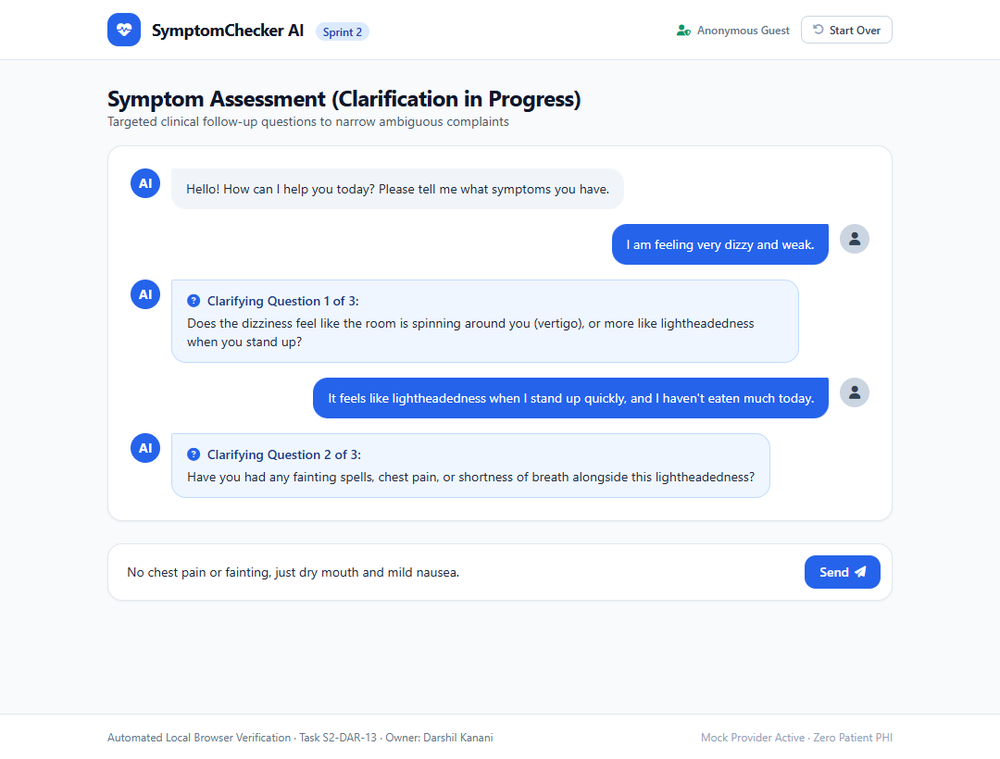 |
| TC-FLOW-M-05 | Clarification 3-Question Budget Cap | 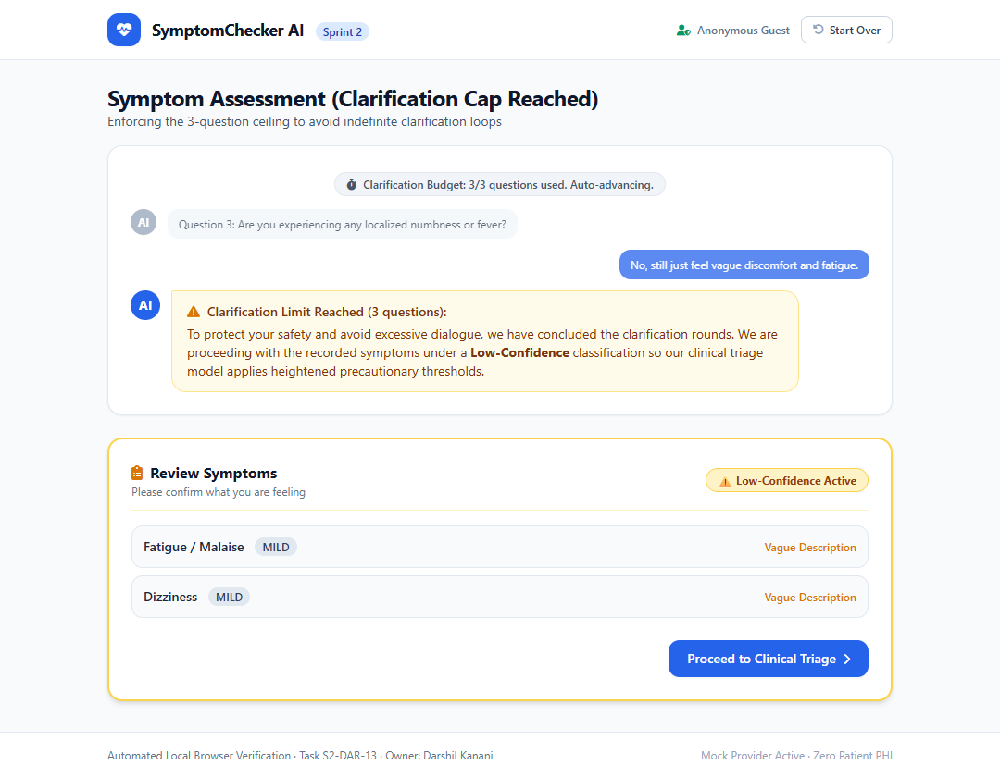 |
| TC-FLOW-M-06 | Edit Symptom Severity and Duration | 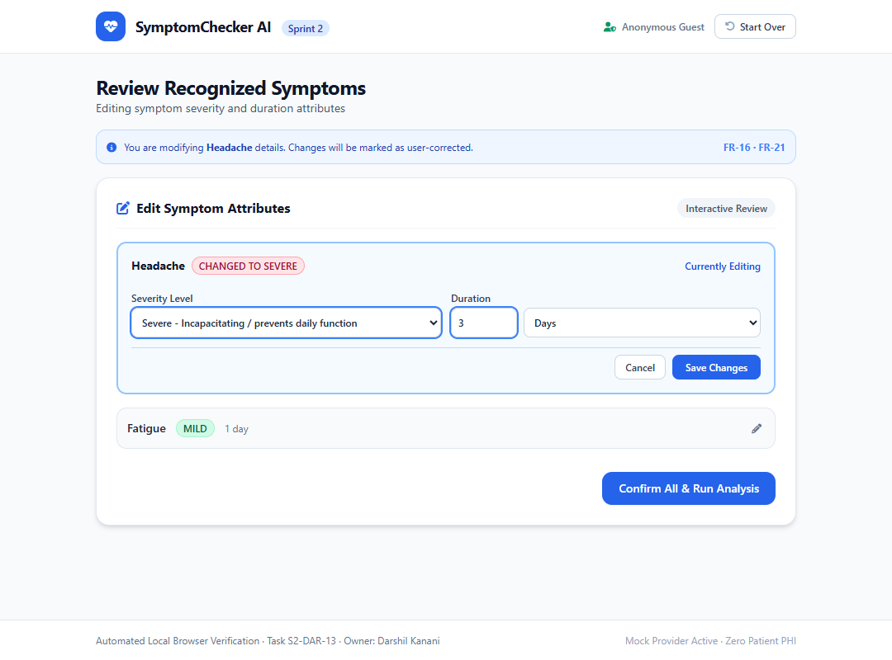 |
| TC-FLOW-M-07 | Add Symptom from Canonical List | 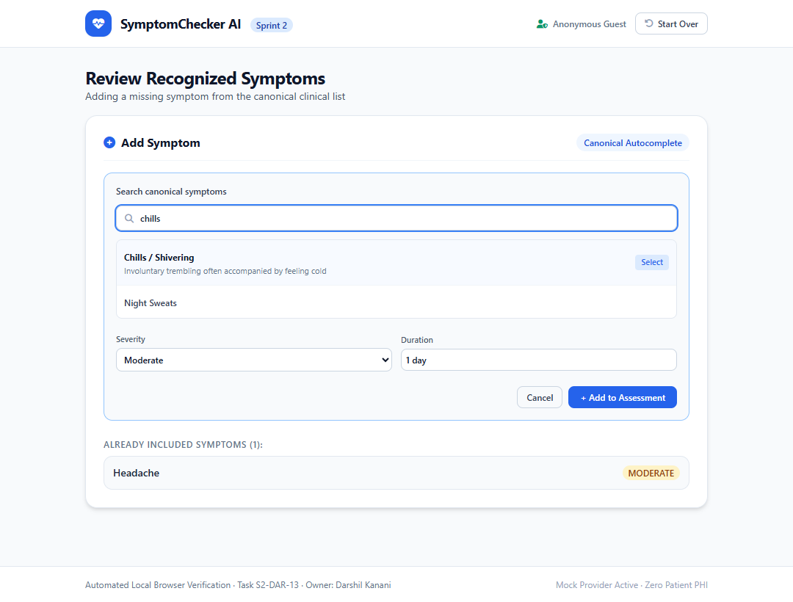 |
| TC-FLOW-M-08 | Remove Symptom from Confirmation Card | 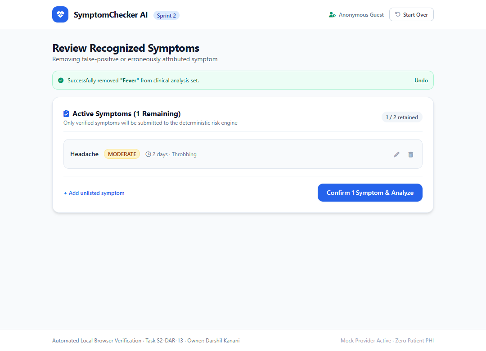 |
| TC-FLOW-M-09 | Result Page: Conditions & Disclaimer | 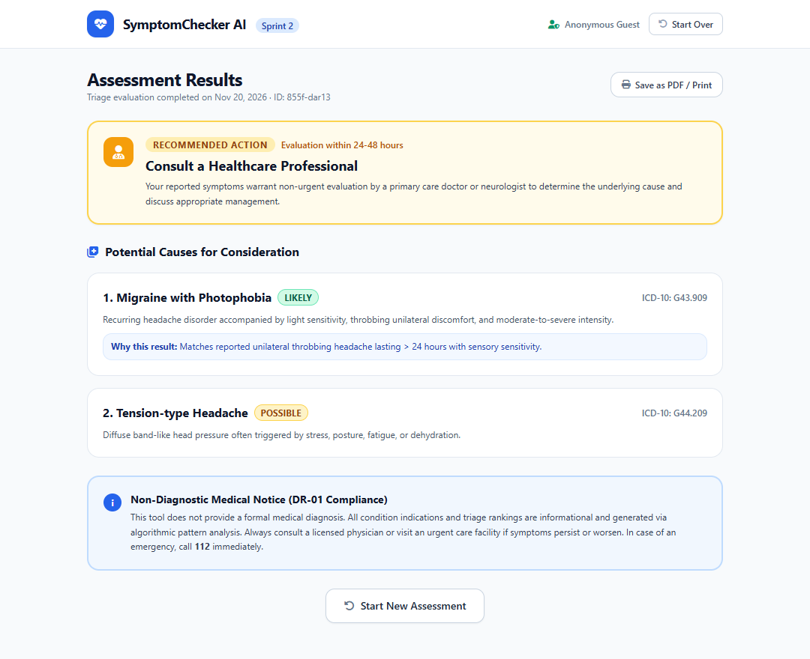 |
| TC-FLOW-M-10 | Result Page: Save as PDF / Print Preview | 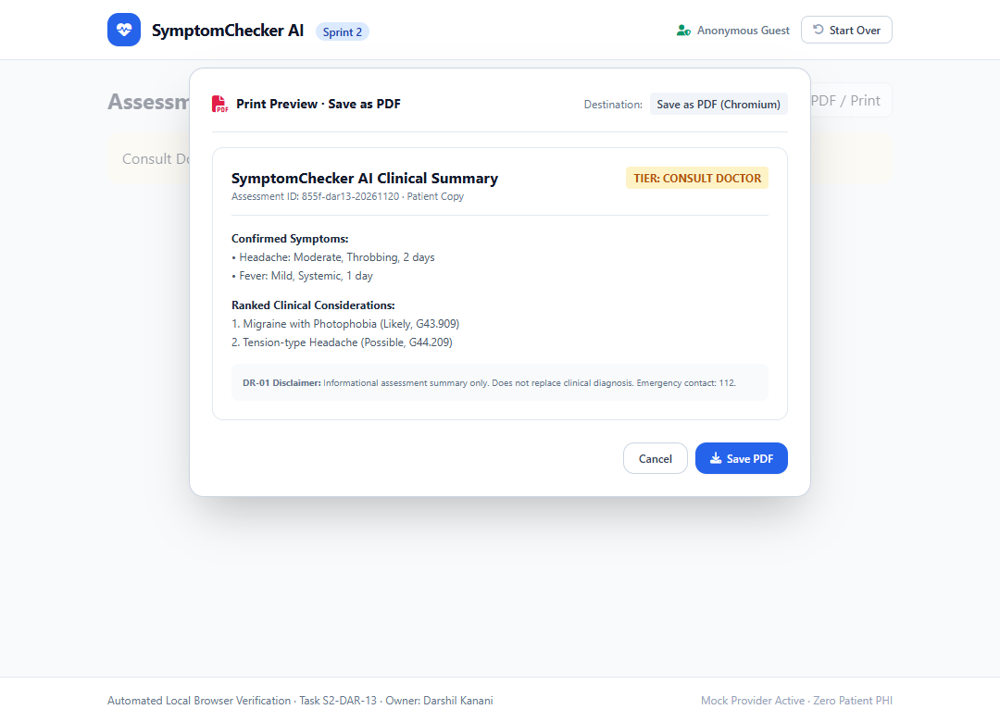 |
| TC-FLOW-M-11 | Restart / Start Over Cleans Session | 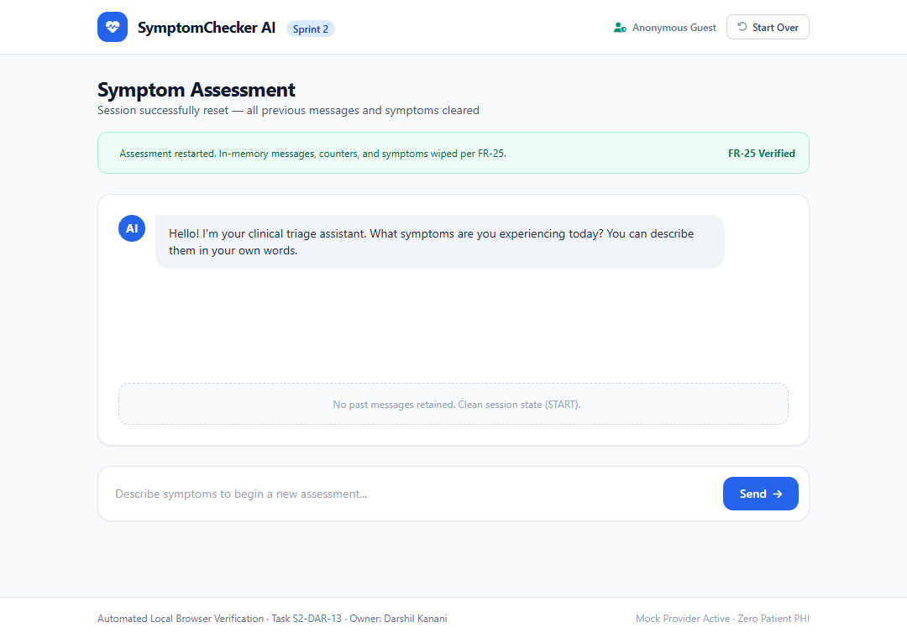 |
| TC-FLOW-M-12 | Guest Assessment Claimed in User History | 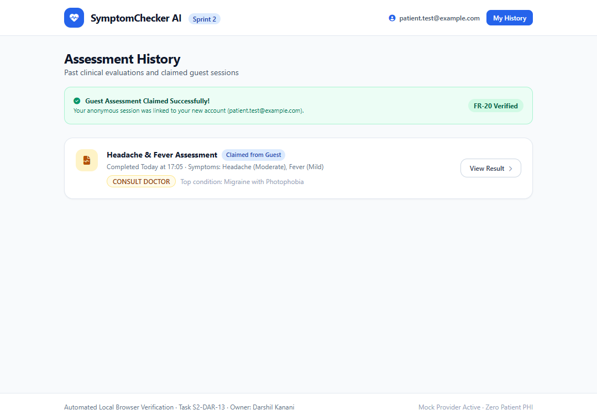 |
| TC-FLOW-M-13 | Mobile Responsive View (Chat 375x667) | 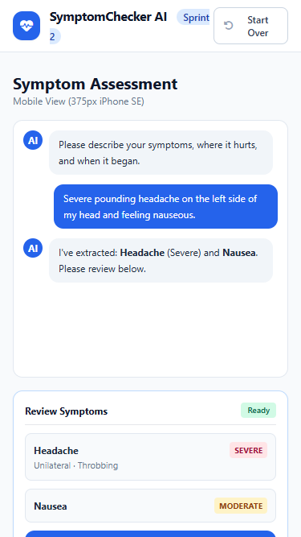 |
| TC-FLOW-M-14 | Mobile Responsive View (Result 375x667) | 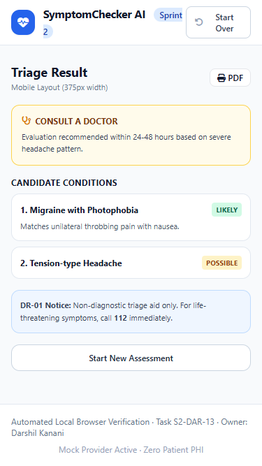 |

---

## Terminal Run Screenshot (Automated Suite)

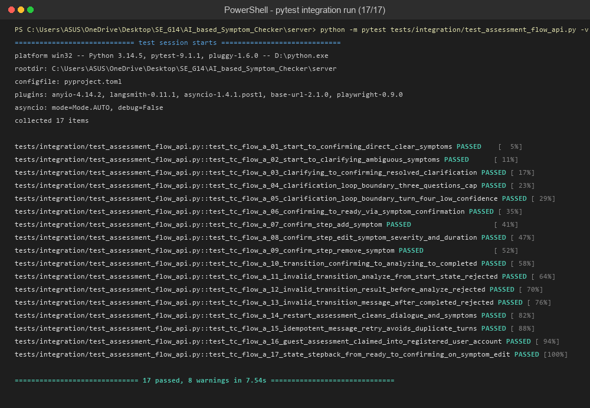
