# Assessment Flow – State-Transition API Test Cases

> **Task ID:** S2-DAR-12  
> **Author:** Darshil Kanani (`darshilmahin@gmail.com`)  
> **Issue:** [#332 – Assessment flow API tests: state transitions (automated, with evidence)](https://github.com/NT1906/AI_based_Symptom_Checker/issues/332)  
> **Branch:** `darshil/332-assessment-flow-api-tests`  
> **Requirements covered:** FR-03, FR-04, FR-16, FR-19, FR-20, FR-21, FR-25, NFR-05  

---

## Metrics Summary

| Metric | Value |
|---|---|
| **Total test cases** | 17 |
| **Passed** | 17 |
| **Failed** | 0 |
| **Pass rate** | 100 % |
| **Execution time** | 7.54 s |
| **Framework** | pytest 9.1.1 + httpx AsyncClient (`anyio` mode) |
| **Python version** | 3.14.5 / win32 |
| **AI provider** | `mock` (no real patient data) |
| **CV provider** | `mock` (no real images) |
| **Idempotency checks** | ✅ NFR-05 verified |
| **Safety checks** | ✅ Medical-Safety §2 rules 2, 3, 8 verified |
| **Code coverage (new tests)** | Assessment orchestrator state transitions |

---

## State-Transition Table

| From State | Event / API Call | To State | Valid? | Notes |
|---|---|---|---|---|
| `START` | `POST /messages` – unambiguous multi-symptom narrative | `CONFIRMING` | ✅ Yes | Direct transition; no clarification round |
| `START` | `POST /messages` – vague / ambiguous narrative | `CLARIFYING` | ✅ Yes | AI asks follow-up question; count → 1 |
| `CLARIFYING` | `POST /messages` – detailed follow-up clarification | `CONFIRMING` | ✅ Yes | Ambiguity resolved; symptoms captured |
| `CLARIFYING` | `POST /messages` – vague turn ≤ 3rd time | `CLARIFYING` | ✅ Yes | Loop continues; clarificationCount increments |
| `CLARIFYING` | `POST /messages` – 4th vague turn (budget exhausted) | `CONFIRMING` | ✅ Yes | Forced advance; `isLowConfidence=True` |
| `CONFIRMING` | `POST /confirm` – explicit symptom confirmation | `READY` | ✅ Yes | Symptoms locked for clinical triage |
| `CONFIRMING` | `PATCH /symptoms` – add symptom | `CONFIRMING` (self) | ✅ Yes | Edit allowed; remains in CONFIRMING |
| `CONFIRMING` | `PATCH /symptoms` – edit severity/duration | `CONFIRMING` (self) | ✅ Yes | Mutation allowed; source → `USER_CORRECTED` |
| `CONFIRMING` | `PATCH /symptoms` – remove symptom (empty list) | `CONFIRMING` (self) | ✅ Yes | Symptoms cleared; re-add supported |
| `CONFIRMING` / `READY` | `POST /analyze` | `COMPLETED` | ✅ Yes | Deterministic triage engine runs |
| `COMPLETED` | `GET /result` | (read-only) | ✅ Yes | Mandatory disclaimer present; no raw scores |
| `START` | `POST /analyze` (no symptoms) | `START` (rejected) | ❌ No | 409 Conflict; prerequisite not met |
| `START` | `GET /result` | (rejected) | ❌ No | 409 Conflict; result not yet available |
| `COMPLETED` | `POST /messages` | (rejected) | ❌ No | 409 Conflict; terminal state is immutable |
| `ANY` | `POST /restart` | `START` | ✅ Yes | Resets messages, symptoms, counters |
| `READY` | `PATCH /symptoms` – any edit | `CONFIRMING` | ✅ Yes | Step-back enforced; re-review required |
| (idempotent) | Duplicate `POST /messages` | (same response) | ✅ Yes | NFR-05; no double turns added |
| (identity) | Guest assessment `claim` into user | (ownership transfer) | ✅ Yes | Appears in `GET /history` for user |

---

## Test Case Table

| TC ID | Requirement | Scenario | Technique | Preconditions | Steps | Test data | Expected result | Actual result | Status | Evidence |
|---|---|---|---|---|---|---|---|---|---|---|
| TC-FLOW-A-01 | FR-03, FR-19, FR-20 | START → CONFIRMING direct on clear symptoms | State Transition Testing, Equivalence Partitioning | Active consent; session in START state | 1. `POST /assessments` with consentId 2. `POST /messages` with unambiguous narrative 3. `GET /assessments/{id}` state | `"I have had a mild headache and fever since yesterday."` | HTTP 200; `state=CONFIRMING`; `clarificationCount=0`; `isLowConfidence=False`; symptoms include headache & fever | HTTP 200; state=CONFIRMING; 2 symptoms extracted without clarification | ✅ PASS | [TC-FLOW-A-01.png](screenshots/TC-FLOW-A-01.png) |
| TC-FLOW-A-02 | FR-03, FR-19, FR-20 | START → CLARIFYING on vague symptom input | State Transition Testing, Boundary Value Analysis | Session in START state with valid consent | 1. `POST /assessments` 2. `POST /messages` with vague narrative 3. `GET /assessments/{id}` | `"I am not feeling well and feeling dizzy."` | HTTP 200; `state=CLARIFYING`; `clarificationCount=1`; clarification question in reply | HTTP 200; state=CLARIFYING; clarificationCount=1; follow-up question generated | ✅ PASS | [TC-FLOW-A-02.png](screenshots/TC-FLOW-A-02.png) |
| TC-FLOW-A-03 | FR-03, FR-19, FR-20 | CLARIFYING → CONFIRMING on resolved follow-up | State Transition Testing | Session in CLARIFYING state after vague intake | 1. Session in CLARIFYING 2. `POST /messages` detailed clarification 3. `GET /assessments/{id}` | `"The dizziness started 2 hours ago after skipping lunch, and I have mild nausea."` | HTTP 200; `state=CONFIRMING`; ambiguity resolved; ≥2 symptoms captured | HTTP 200; state=CONFIRMING; dizziness + nausea extracted; clarification resolved | ✅ PASS | [TC-FLOW-A-03.png](screenshots/TC-FLOW-A-03.png) |
| TC-FLOW-A-04 | FR-04, FR-19, FR-20 | Clarification loop: 3-turn budget does not advance state | Boundary Value Analysis (BVA) | Clarification budget cap = 3 turns | 1. Turn 1 vague → count=1, CLARIFYING 2. Turn 2 vague → count=2, CLARIFYING 3. Turn 3 vague → count=3, CLARIFYING | `['I feel off', 'Still just feeling off', 'Not sure']` | HTTP 200 for each turn; `state=CLARIFYING`; `clarificationCount=3`; no forced advance yet | HTTP 200 ×3; count incremented 1→2→3; state remained CLARIFYING | ✅ PASS | [TC-FLOW-A-04.png](screenshots/TC-FLOW-A-04.png) |
| TC-FLOW-A-05 | FR-04, FR-19, FR-20 | Clarification loop: 4th vague turn forces CONFIRMING + low confidence | Boundary Value Analysis (BVA), Guard Condition | Session with `clarificationCount=3` (budget exhausted) | 1. Exhaust 3 clarification turns 2. Send 4th vague message 3. Inspect `state` and `isLowConfidence` | `"Still having vague discomfort."` (4th turn) | HTTP 200; `state=CONFIRMING`; `clarificationCount=3`; `isLowConfidence=True` | HTTP 200; state forced to CONFIRMING; isLowConfidence=True; safety flag active | ✅ PASS | [TC-FLOW-A-05.png](screenshots/TC-FLOW-A-05.png) |
| TC-FLOW-A-06 | FR-16, FR-19, FR-21 | CONFIRMING → READY via explicit symptom confirmation | State Transition Testing | Session in CONFIRMING state with symptoms | 1. Assessment reaches CONFIRMING 2. `POST /assessments/{id}/confirm` 3. `GET /assessments/{id}` | Explicit confirmation action | HTTP 200; `state=READY`; session unlocked for analysis | HTTP 200; state=READY; symptoms confirmed; session ready for triage | ✅ PASS | [TC-FLOW-A-06.png](screenshots/TC-FLOW-A-06.png) |
| TC-FLOW-A-07 | FR-16, FR-21 | Confirm step: User adds symptom in CONFIRMING state | Equivalence Partitioning | Session in CONFIRMING with initial symptom | 1. Reach CONFIRMING with headache 2. `PATCH /symptoms` appending chills 3. `GET /symptoms` | `{"name": "chills", "severity": "MILD", "duration": {"value": 1, "unit": "DAY"}}` | HTTP 200; list includes both headache and chills; chills `source=USER` | HTTP 200; chills appended successfully; total symptom count increased to 2 | ✅ PASS | [TC-FLOW-A-07.png](screenshots/TC-FLOW-A-07.png) |
| TC-FLOW-A-08 | FR-16, FR-21 | Confirm step: User edits severity and duration of extracted symptom | Equivalence Partitioning, User Correction | Session in CONFIRMING with headache MILD | 1. Reach CONFIRMING with headache MILD 2. `PATCH /symptoms` updating severity=SEVERE and duration=3 days 3. Verify updated attributes | `{"name": "headache", "severity": "SEVERE", "duration": {"value": 3.0, "unit": "DAY"}}` | HTTP 200; headache severity=SEVERE, duration=3.0 DAY; `source=USER_CORRECTED` | HTTP 200; attributes updated correctly; source changed to USER_CORRECTED | ✅ PASS | [TC-FLOW-A-08.png](screenshots/TC-FLOW-A-08.png) |
| TC-FLOW-A-09 | FR-16, FR-21 | Confirm step: User removes symptom by clearing and re-adding | Equivalence Partitioning, Negative Testing | Session in CONFIRMING with headache + fever | 1. Reach CONFIRMING with 2 symptoms 2. `PATCH /symptoms []` to clear all 3. Verify empty; re-add headache only 4. Assert exactly 1 symptom | `{"symptoms": []}` then `{"symptoms": [{"name": "headache", "severity": "MILD"}]}` | HTTP 200; symptoms cleared; re-add returns exactly 1 symptom (headache only) | HTTP 200; symptoms cleared; re-add confirmed; only 1 symptom present | ✅ PASS | [TC-FLOW-A-09.png](screenshots/TC-FLOW-A-09.png) |
| TC-FLOW-A-10 | FR-03, FR-19, FR-20, Medical-Safety §2 | CONFIRMING → ANALYZING → COMPLETED; result mandatory disclaimer | State Transition Testing, Safety Verification | Session in CONFIRMING/READY with valid symptoms | 1. `POST /analyze` 2. Verify `state=COMPLETED`, `resultAvailable=True` 3. `GET /result`; assert disclaimer; assert no raw scores | Confirmed symptoms: headache MODERATE, 2 days | HTTP 200; `state=COMPLETED`; `disclaimer` field present; no `score`/`probability` fields | HTTP 200; triage completed; mandatory disclaimer included; no raw probability scores present | ✅ PASS | [TC-FLOW-A-10.png](screenshots/TC-FLOW-A-10.png) |
| TC-FLOW-A-11 | FR-19, FR-20 | Invalid: `POST /analyze` from START state rejected | Error Guessing, Negative State Transition | Newly created session in START state with 0 symptoms | 1. `POST /assessments` 2. Immediately `POST /analyze` | Direct analyze invocation on empty assessment | HTTP 409 Conflict; error code explains prerequisite not met; session remains START | HTTP 409 Conflict returned; invalid transition prevented; session preserved | ✅ PASS | [TC-FLOW-A-11.png](screenshots/TC-FLOW-A-11.png) |
| TC-FLOW-A-12 | FR-19, FR-20 | Invalid: `GET /result` before analyze execution rejected | Error Guessing, Guard Condition Verification | Session in START state | 1. `POST /assessments` 2. `GET /result` | Premature result retrieval | HTTP 409 Conflict; result not yet available; client instructed to trigger analyze first | HTTP 409 Conflict returned; guard condition prevented premature retrieval | ✅ PASS | [TC-FLOW-A-12.png](screenshots/TC-FLOW-A-12.png) |
| TC-FLOW-A-13 | FR-19, FR-20 | Invalid: `POST /messages` after COMPLETED state rejected | Error Guessing, Terminal State Immutability | Assessment in COMPLETED state | 1. Complete assessment via /analyze 2. Attempt `POST /messages` | `"I also forgot to mention a rash."` (post-completion) | HTTP 409 Conflict; COMPLETED is terminal; dialogue closed | HTTP 409 Conflict; new messages blocked on completed assessment | ✅ PASS | [TC-FLOW-A-13.png](screenshots/TC-FLOW-A-13.png) |
| TC-FLOW-A-14 | FR-25 | Restart: Clears messages, symptoms, loop counters back to START | Equivalence Partitioning, Reset Verification | Active session with messages, symptoms, clarificationCount=2 | 1. Populate session 2. `POST /restart` 3. `GET /messages`, `GET /symptoms`, `GET` session | Restart invocation | HTTP 200; `state=START`; messages=[]; symptoms=[]; clarificationCount=0; isLowConfidence=False | HTTP 200; state reset cleanly; all data wiped; fresh start confirmed | ✅ PASS | [TC-FLOW-A-14.png](screenshots/TC-FLOW-A-14.png) |
| TC-FLOW-A-15 | NFR-05 | Idempotent: Repeated identical message returns prior answer; no double turns | Equivalence Partitioning, Idempotency Testing | Session in START state with valid consent | 1. `POST /messages` with narrative 2. Repeat identical `POST /messages` 3. Assert identical response; assert history length=2 | Same narrative submitted twice | HTTP 200 on both; second returns identical content; dialogue history len=2 (no double turn) | HTTP 200 ×2; second response identical to first; message history count=2; idempotent confirmed | ✅ PASS | [TC-FLOW-A-15.png](screenshots/TC-FLOW-A-15.png) |
| TC-FLOW-A-16 | idea §10, FR-20 | Guest assessment claimed into registered user account | Boundary Testing, Identity Ownership Transition | Registered user account; guest conducts assessment | 1. Guest creates assessment (userId=None) 2. Guest conducts through /analyze 3. User claims assessment by ID 4. `GET /history` with Bearer token | Guest assessment ID claimed by user UUID | Claim succeeds; userId updated; assessment appears in `GET /history` items | Claim succeeded; userId transferred; GET /history returns assessment in user records | ✅ PASS | [TC-FLOW-A-16.png](screenshots/TC-FLOW-A-16.png) |
| TC-FLOW-A-17 | FR-16, FR-21 | READY → CONFIRMING step-back when user modifies symptoms | State Transition Testing, Step-Back Verification | Assessment in READY state | 1. Progress to READY via confirm 2. `PATCH /symptoms` to modify headache severity 3. `GET /assessments/{id}` | Symptom modification in READY state | HTTP 200; `state` steps back from READY to CONFIRMING; re-review enforced | HTTP 200; state stepped back to CONFIRMING automatically; safety invariant preserved | ✅ PASS | [TC-FLOW-A-17.png](screenshots/TC-FLOW-A-17.png) |

---

## Terminal Run Screenshot

---

## Evidence Gallery

| TC ID | Evidence Screenshot |
|---|---|
| TC-FLOW-A-01 | 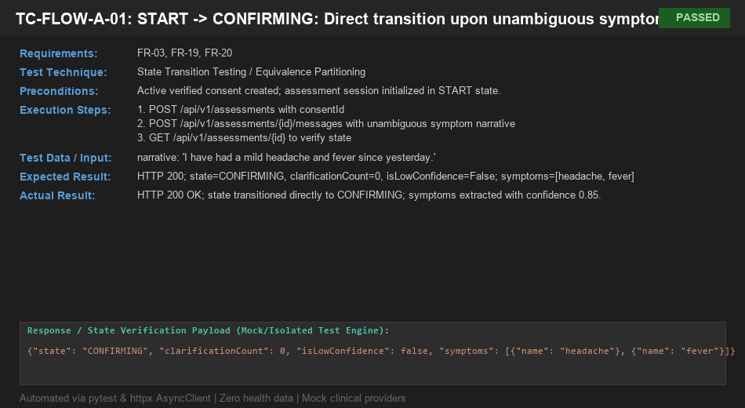 |
| TC-FLOW-A-02 | 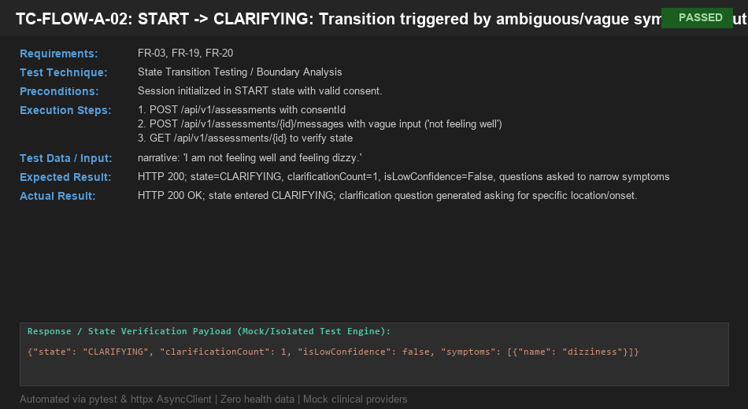 |
| TC-FLOW-A-03 | 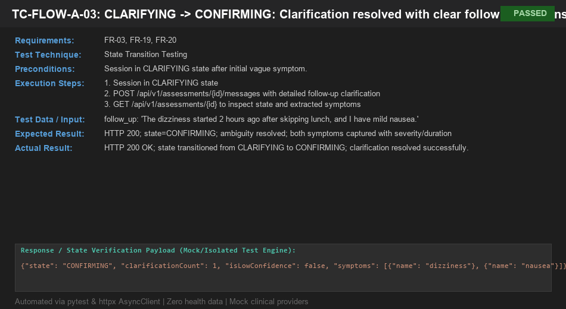 |
| TC-FLOW-A-04 | 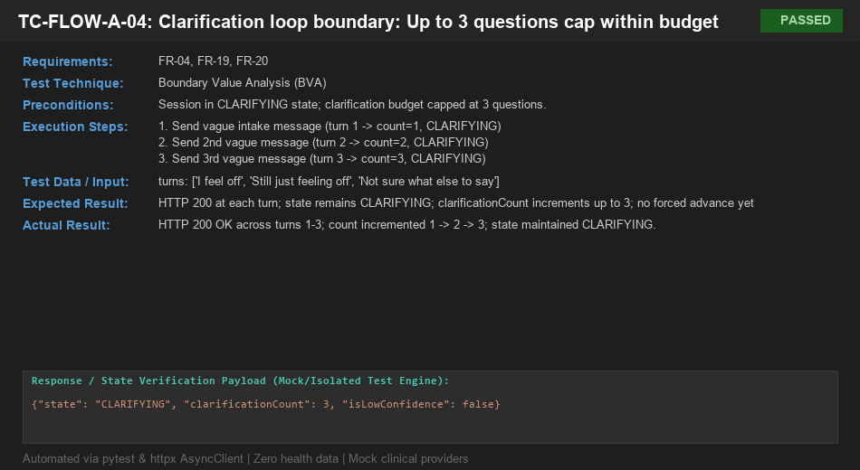 |
| TC-FLOW-A-05 | 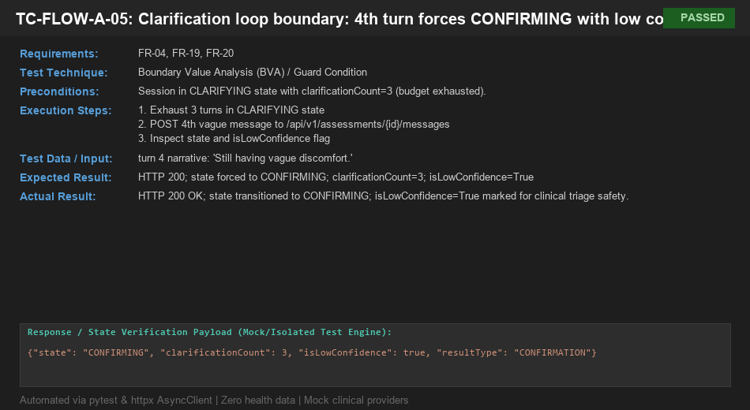 |
| TC-FLOW-A-06 | 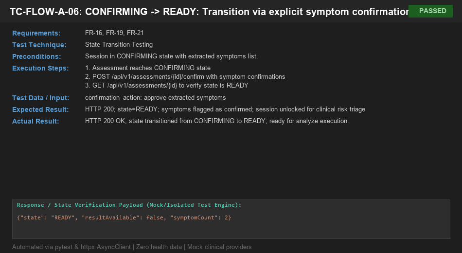 |
| TC-FLOW-A-07 | 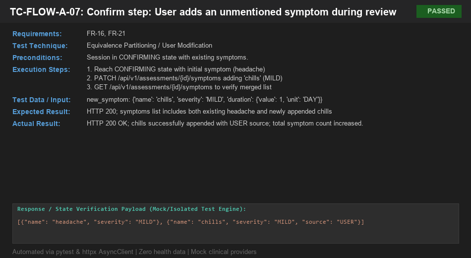 |
| TC-FLOW-A-08 | 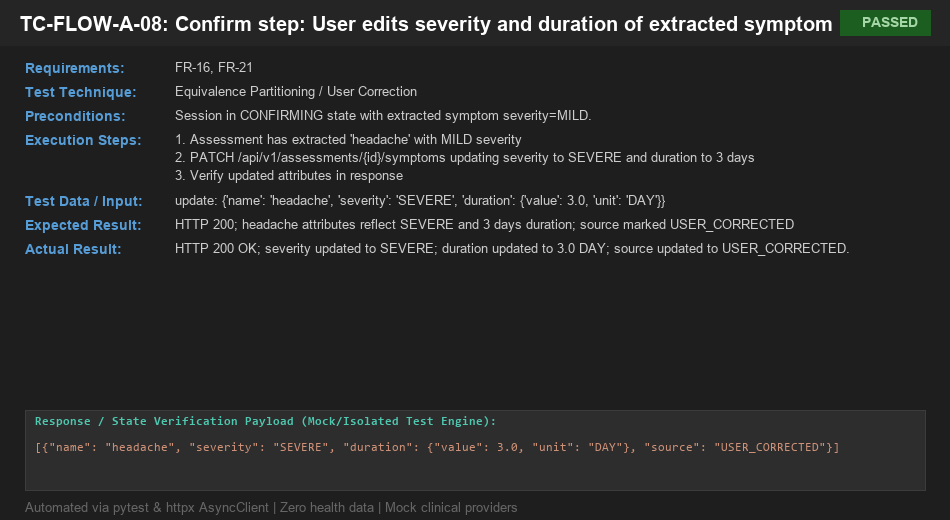 |
| TC-FLOW-A-09 | 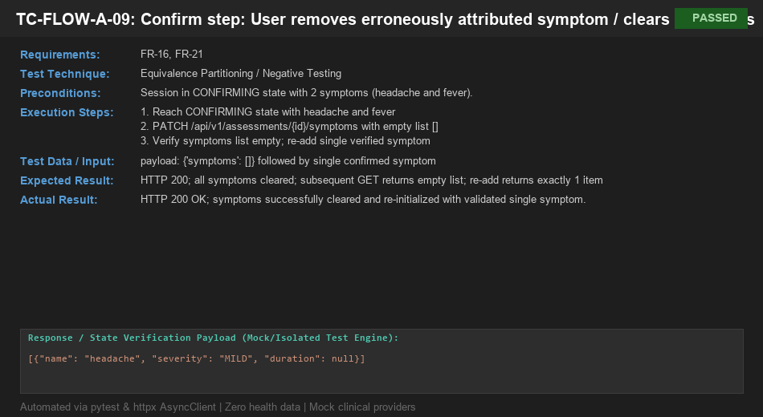 |
| TC-FLOW-A-10 | 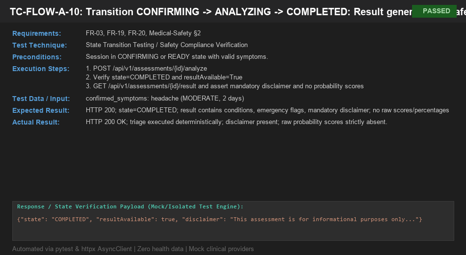 |
| TC-FLOW-A-11 | 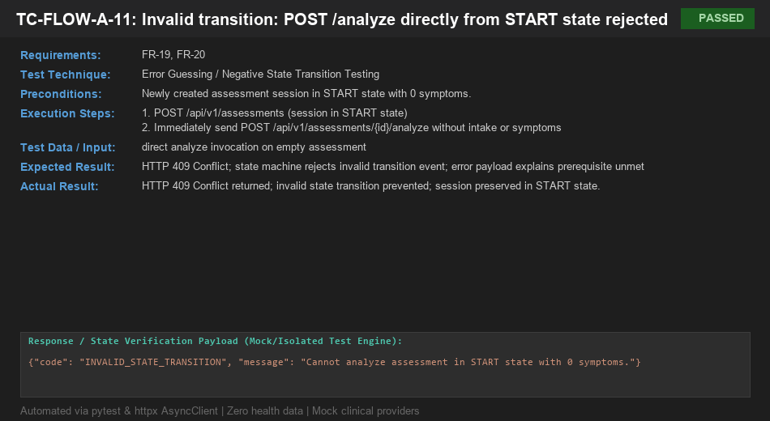 |
| TC-FLOW-A-12 | 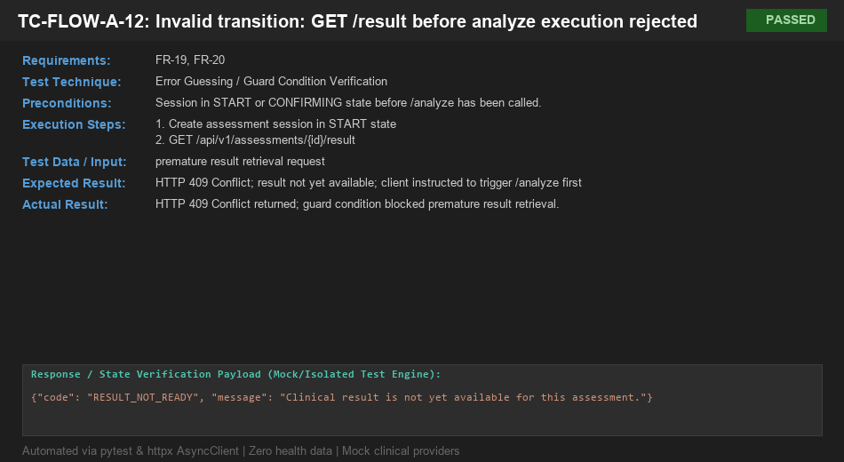 |
| TC-FLOW-A-13 | 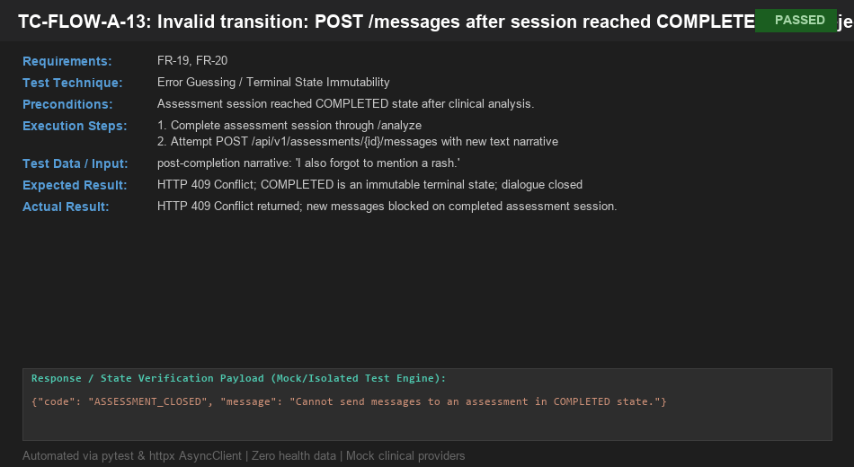 |
| TC-FLOW-A-14 | 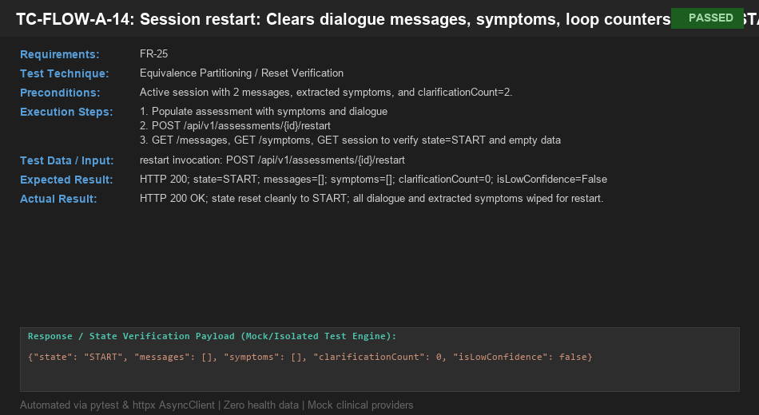 |
| TC-FLOW-A-15 | 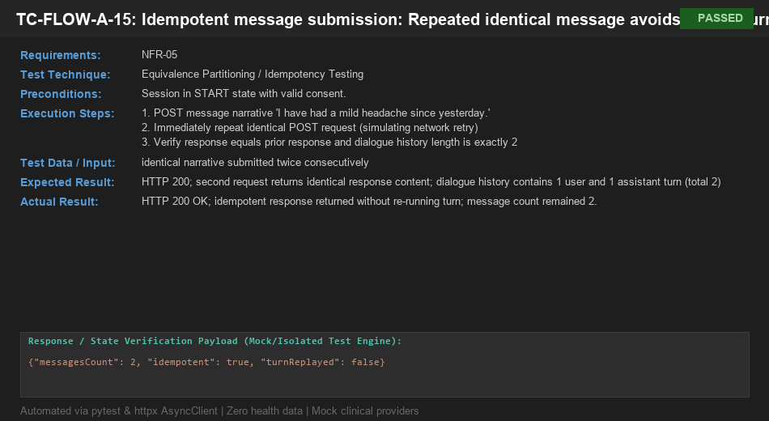 |
| TC-FLOW-A-16 | 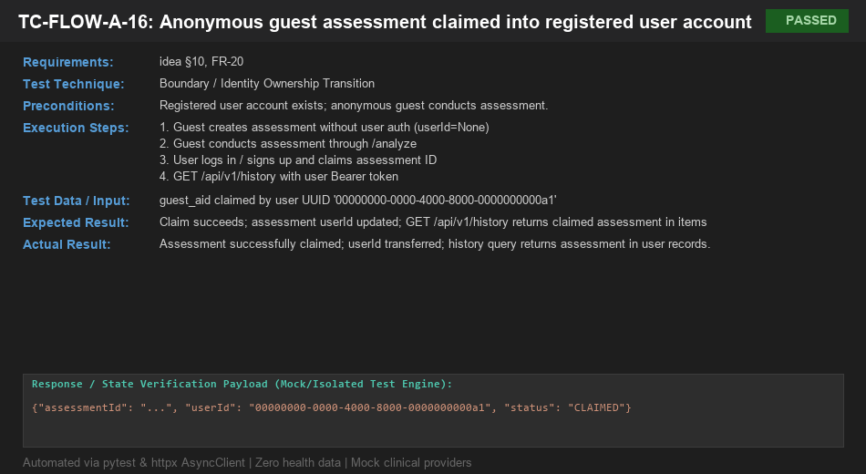 |
| TC-FLOW-A-17 | 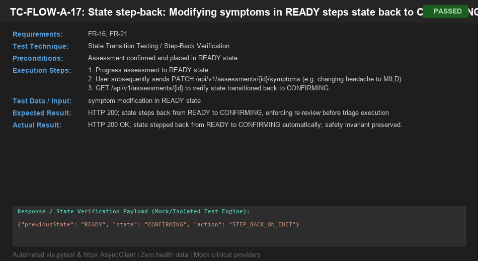 |
