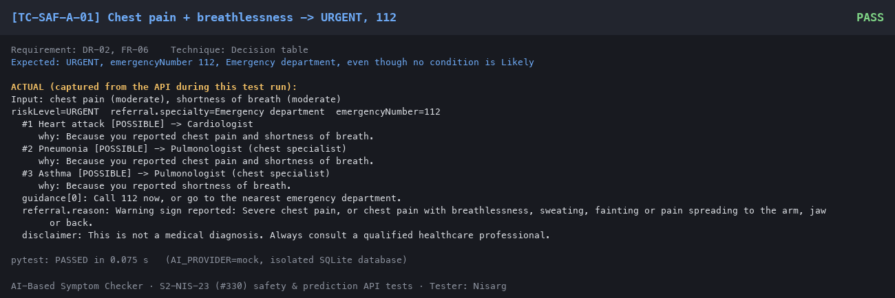
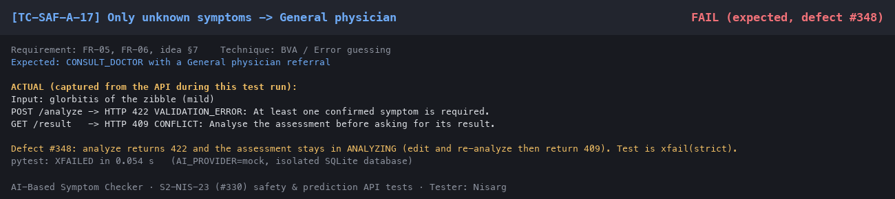
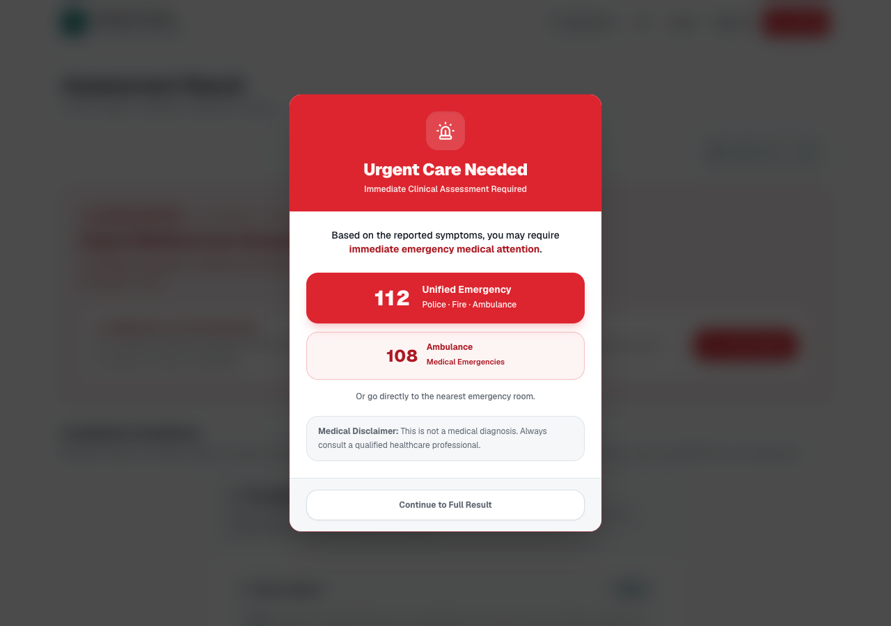
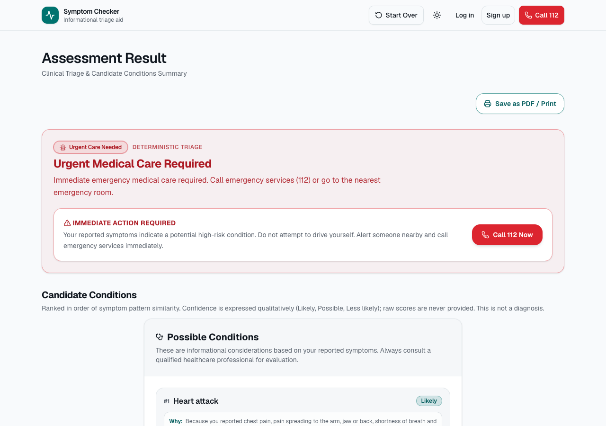
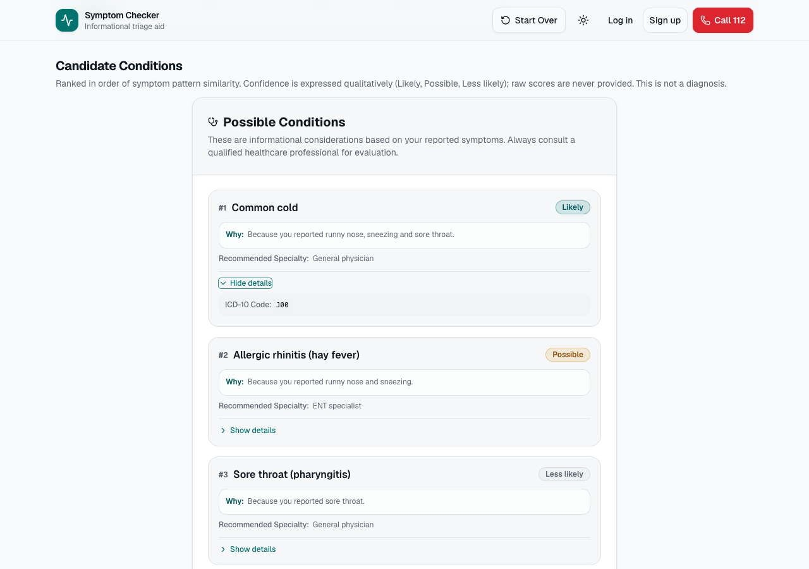
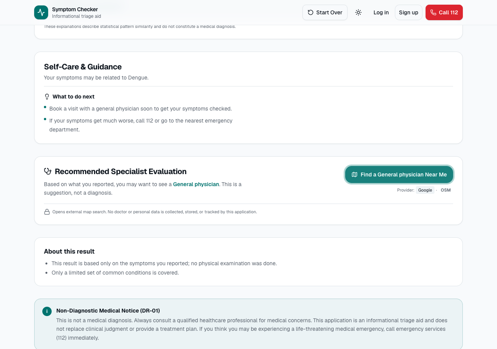
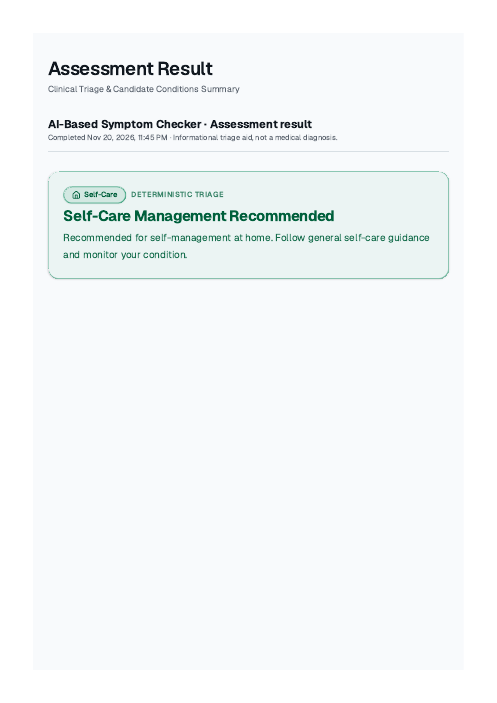
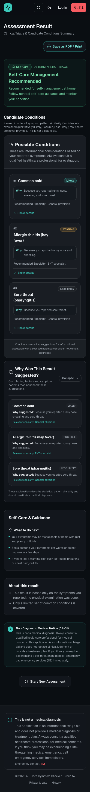

# Safety and Condition-Prediction Result: Test Cases (Automated API + Manual Browser)

> **Tasks:** S2-NIS-23 automated API tests ([#330](https://github.com/NT1906/AI_based_Symptom_Checker/issues/330)) · S2-NIS-24 manual browser tests ([#331](https://github.com/NT1906/AI_based_Symptom_Checker/issues/331)) · **Owner / tester:** Nisarg (@NT1906)
> **Methods:** black-box API integration testing with pytest + httpx (TC-SAF-A) · manual system / acceptance testing in the browser (TC-SAF-M). No new software.
> **Test files:** [`server/tests/integration/test_safety_api.py`](../../../server/tests/integration/test_safety_api.py) (TC-SAF-A-01 to 11), [`server/tests/integration/test_prediction_result_api.py`](../../../server/tests/integration/test_prediction_result_api.py) (TC-SAF-A-12 to 20)
> **Requirements:** DR-01, DR-02, FR-05, FR-06, FR-07, FR-08, FR-22, FR-23, NFR-07

## Combined metrics (both parts)

| Metric | Value |
|---|---|
| Total test cases (TC) | **32** (20 automated API + 12 manual browser) |
| Passed | **31** |
| Failed | **1** (TC-SAF-A-17 → [#348](https://github.com/NT1906/AI_based_Symptom_Checker/issues/348)) |
| Blocked / not run | 0 |
| Pass rate (%) | **96.9 %** (31 / 32) |
| Requirements covered | DR-01, DR-02, FR-05, FR-06, FR-07, FR-08, FR-22, FR-23, NFR-07 |
| Defects found | **1**: [#348](https://github.com/NT1906/AI_based_Symptom_Checker/issues/348) |

The manual part is [below](#manual-browser-test-cases-tc-saf-m-s2-nis-24-331).

# Part 1: automated API test cases (TC-SAF-A, S2-NIS-23, #330)

Every test drives a real assessment through the public HTTP API, the same way the web app does:
`POST /assessments` → `POST /messages` → `PATCH /symptoms` (the confirmed list) → `POST /analyze` → `GET /result`.
The app runs in-process against a temporary SQLite database. Only the mock AI provider is used (`AI_PROVIDER=mock`, `CV_PROVIDER=mock`), so no Groq or OpenAI key is read or needed.
The risk engine, condition model, specialty mapper and result composer are the real ones.

## Metrics summary (automated)

| Metric | Value |
|---|---|
| Total test cases (TC) | **20** (automated API) |
| Passed | **19** |
| Failed | **1** (TC-SAF-A-17, defect [#348](https://github.com/NT1906/AI_based_Symptom_Checker/issues/348); kept as `xfail(strict=True)` so CI stays green and the test turns red once the bug is fixed) |
| Blocked / not run | 0 |
| Pass rate (%) | **95 %** (19 / 20) |
| Acceptance criteria (AC) met | 7 / 7 (CI and PR policy green on [#349](https://github.com/NT1906/AI_based_Symptom_Checker/pull/349)) |
| Requirements covered | DR-01, DR-02, FR-05, FR-06, FR-07, FR-08, FR-22, FR-23 |
| Defects found | **1**: [#348](https://github.com/NT1906/AI_based_Symptom_Checker/issues/348) analysis fails (422) and the assessment is stuck in `ANALYZING` when no confirmed symptom is known |
| API runs per test session | 44 complete assessments (create → result), 264 HTTP requests |
| Execution time | 4.0 s for the 20 tests; full server suite 38 s (1872 passed, 1 skipped, 1 xfailed) |
| Environment | macOS 26.0.1 (Apple silicon), Python 3.12.12, pytest 9.1.1, httpx `ASGITransport`, SQLite (temporary), branch `nisarg/330-safety-prediction-api-tests` from `develop` @ `1e71b1d`, 2026-11-20, tester Nisarg |

Techniques used: **decision table** (red-flag rules × expected risk tier), **boundary value analysis** (severity threshold; 1 and 12 symptoms; unknown symptoms), **equivalence partitioning** (confidence labels; one run per risk tier), **error guessing** (unstated severity, unknown symptoms, personal data in the result) and **repeatability** (same input three times).

## Decision table: conditions × expected risk tier

Rules from the risk engine (`server/app/services/prediction/risk_engine.py`, catalog `conditions.json`).
**Y** = the symptom is confirmed, **–** = not present. "Likely condition" means at least one predicted condition is labelled `LIKELY`.

| # | Red-flag rule fires | Severity | Likely condition | Expected tier | Expected referral | Emergency no. | TC | Actual |
|---|---|---|---|---|---|---|---|---|
| R1 | chest pain + shortness of breath (`rf_cardiac_chest_pain`) | moderate | – | URGENT | Emergency department | 112 | TC-SAF-A-01 | URGENT, 112 ✅ |
| R2 | face drooping (`rf_stroke_signs`) | moderate | – | URGENT | Emergency department | 112 | TC-SAF-A-02 | URGENT, 112 ✅ |
| R3 | vomiting blood (`rf_serious_bleeding`), no condition matches | mild | – | URGENT | Emergency department | 112 | TC-SAF-A-03 | URGENT, 112, conditions `[]` ✅ |
| R4 | fever + stiff neck (`rf_meningitis_signs`) | mild | – | URGENT | Emergency department | 112 | TC-SAF-A-04 | URGENT, 112 ✅ |
| R5 | fever alone (no rule fires) | mild | – | not URGENT | – | none | TC-SAF-A-04 | not URGENT ✅ |
| R6 | thoughts of self-harm (`rf_self_harm`) | moderate | – | URGENT + Tele-MANAS 14416 | Emergency department | 112 | TC-SAF-A-05 | URGENT, 112, 14416 ✅ |
| R7 | chest pain alone, below threshold | mild / moderate | – | CONSULT_DOCTOR | Cardiologist | none | TC-SAF-A-06 | CONSULT_DOCTOR ✅ |
| R8 | chest pain alone, at threshold | severe | – | URGENT | Emergency department | 112 | TC-SAF-A-06 | URGENT ✅ |
| R9 | chest pain alone, severity not stated | unknown → treated as severe | – | URGENT + "treated as urgent" note | Emergency department | 112 | TC-SAF-A-07 | URGENT ✅ |
| R10 | none (runny nose, sneezing, sore throat) | mild | Y (Common cold) | SELF_CARE | none | none | TC-SAF-A-08 | SELF_CARE ✅ |
| R11 | none (sneezing alone) | mild | – | CONSULT_DOCTOR (raised by uncertainty) | ENT specialist | none | TC-SAF-A-09 | CONSULT_DOCTOR ✅ |
| R12 | chest pain, severe (red flag) | severe | – | stays URGENT (uncertainty never lowers) | Emergency department | 112 | TC-SAF-A-10 | URGENT ✅ |
| R13 | none (chest pain, mild) | mild | – | stays CONSULT_DOCTOR | Cardiologist | none | TC-SAF-A-10 | CONSULT_DOCTOR ✅ |
| R14 | none (fever, pain behind the eyes, joint pain) | moderate | Y (Dengue) | CONSULT_DOCTOR | General physician | none | TC-SAF-A-11, 20 | CONSULT_DOCTOR ✅ |

## Repeatability table: same input, three runs

The condition model is deterministic, so the same confirmed symptoms must give the same result every time (TC-SAF-A-18).
Compared field by field: risk tier, every condition (name, rank, label, why, specialty), guidance, referral and limitations. Only the assessment ID and timestamp differ.

| Input (confirmed symptoms) | Run 1 | Run 2 | Run 3 | Same? |
|---|---|---|---|---|
| runny nose, sneezing, sore throat (mild) | SELF_CARE · 1 Common cold [Likely] · 2 Allergic rhinitis [Possible] · 3 Sore throat (pharyngitis) [Less likely] | identical | identical | ✅ |
| fever, pain behind the eyes, joint pain (moderate) | CONSULT_DOCTOR · General physician · 1 Dengue [Likely] · 2 Chikungunya [Possible] · 3 Typhoid fever [Less likely] | identical | identical | ✅ |
| chest pain, shortness of breath (moderate) | URGENT · 112 · Emergency department · 1 Heart attack [Possible] · 2 Pneumonia [Possible] · 3 Asthma [Possible] | identical | identical | ✅ |

## Test cases

| TC ID | Requirement | Scenario | Technique | Preconditions | Steps | Test data | Expected result | Actual result | Status | Evidence |
|---|---|---|---|---|---|---|---|---|---|---|
| TC-SAF-A-01 | DR-02, FR-06 | Chest pain with breathlessness is urgent | Decision table | Verified consent; mock AI; assessment in CONFIRMING | 1. Create assessment 2. Send a chat message 3. PATCH the confirmed symptoms 4. POST /analyze 5. GET /result | chest pain (moderate), shortness of breath (moderate) | URGENT; referral required; `emergencyNumber` 112; specialty "Emergency department"; guidance starts "Call 112 now"; no condition needs to be Likely | URGENT, 112, Emergency department, reason "Warning sign reported: Severe chest pain, or chest pain with breathlessness…"; all 3 conditions Possible | Pass | `screenshots/TC-SAF-A-01.png` |
| TC-SAF-A-02 | DR-02, FR-06 | One stroke sign is urgent | Decision table | as TC-01 | as TC-01 | facial droop (moderate) | URGENT with 112; reason names face drooping | URGENT, 112; reason "Face drooping, one-sided weakness, slurred speech or sudden vision loss." | Pass | `screenshots/TC-SAF-A-02.png` |
| TC-SAF-A-03 | DR-02, FR-06 | Serious bleeding is urgent even with no matching condition | Decision table | as TC-01 | as TC-01 | vomiting blood (mild) | URGENT with 112; condition list may be empty | URGENT, 112; `conditions: []` | Pass | `screenshots/TC-SAF-A-03.png` |
| TC-SAF-A-04 | DR-02, FR-06 | Meningitis signs: only the combination is urgent | Decision table | as TC-01 | 1. Run with fever + stiff neck 2. Run with fever alone | fever (mild) + stiff neck (mild); fever (mild) | combination URGENT with 112; fever alone not URGENT | combination URGENT, 112; fever alone not URGENT | Pass | `screenshots/TC-SAF-A-04.png` |
| TC-SAF-A-05 | DR-02, FR-06 | Thoughts of self-harm are urgent and show the helpline | Decision table | as TC-01 | as TC-01 | thoughts of self harm (moderate) | URGENT with 112 and a Tele-MANAS 14416 guidance step | URGENT, 112; guidance includes "Tele-MANAS helpline on 14416" | Pass | `screenshots/TC-SAF-A-05.png` |
| TC-SAF-A-06 | DR-02, FR-06 | Red-flag severity threshold for chest pain alone | BVA | as TC-01 | Run three assessments, one per severity | chest pain at MILD, MODERATE (just below), SEVERE (at threshold) | MILD and MODERATE: CONSULT_DOCTOR with no 112; SEVERE: URGENT | MILD and MODERATE: CONSULT_DOCTOR, Cardiologist, `emergencyNumber` null; SEVERE: URGENT, 112 | Pass | `screenshots/TC-SAF-A-06.png` |
| TC-SAF-A-07 | DR-02, FR-06 | Unstated severity never lowers the risk | Error guessing | as TC-01 | as TC-01 | chest pain (UNKNOWN severity) | URGENT, with the note "You did not say how severe a symptom is, so to be safe this is treated as urgent." | URGENT, 112, note present | Pass | `screenshots/TC-SAF-A-07.png` |
| TC-SAF-A-08 | FR-06 | Mild cold symptoms are not urgent | Decision table | as TC-01 | as TC-01 | runny nose, sneezing, sore throat (all mild) | SELF_CARE; referral not required; no emergency number; top condition Likely | SELF_CARE; `required: false`; `emergencyNumber` null; 1 Common cold [Likely] | Pass | `screenshots/TC-SAF-A-08.png` |
| TC-SAF-A-09 | FR-06, DR-02 | Low confidence raises the tier | Decision table | as TC-01 | as TC-01 | sneezing (mild) | No Likely condition, so SELF_CARE is raised to CONSULT_DOCTOR; limitation says it was raised | CONSULT_DOCTOR, ENT specialist; limitation "Because the match was uncertain, this result was raised to the safer level." | Pass | `screenshots/TC-SAF-A-09.png` |
| TC-SAF-A-10 | FR-06, DR-02 | Low confidence never lowers a tier | Decision table | as TC-01 | Run two assessments with no Likely condition | chest pain (severe); chest pain (mild) | stays URGENT; stays CONSULT_DOCTOR | URGENT; CONSULT_DOCTOR | Pass | `screenshots/TC-SAF-A-10.png` |
| TC-SAF-A-11 | DR-01, FR-22 | Disclaimer on every result; no percentage or probability anywhere in the flow | EP (one run per tier) + regex scan | as TC-01 | 1. Run one SELF_CARE, one CONSULT_DOCTOR and one URGENT assessment 2. Scan all 6 responses of each run 3. Walk the result JSON for decimal numbers | cold symptoms; dengue symptoms; chest pain + breathlessness | `disclaimer` equals "This is not a medical diagnosis. Always consult a qualified healthcare professional." on all 3; 0 matches for `\d+%` and `probabilit\|percent\|score`; 0 decimal numbers in the result | Disclaimer present on all 3 tiers; 18 responses scanned, 0 matches; 0 decimals | Pass | `screenshots/TC-SAF-A-11.png` |
| TC-SAF-A-12 | FR-22 | Confidence labels have only three partitions | EP | as TC-01 | Run 5 assessments with different inputs; collect every label | cold; dengue; headache; chest pain + breathlessness; itchy skin | every label is LIKELY, POSSIBLE or LESS_LIKELY; all three occur | 15 conditions, all labels valid; all three partitions seen | Pass | `screenshots/TC-SAF-A-12.png` |
| TC-SAF-A-13 | FR-05, FR-23 | Conditions are ranked, with a "why" and a specialty | EP | as TC-01 | as TC-12, check each condition | same 5 inputs | ranks 1, 2, 3 in order (at most 3); each "why" starts "Because you reported"; each has a specialty | all ranks consecutive from 1; every condition has a why line and a specialty | Pass | `screenshots/TC-SAF-A-13.png` |
| TC-SAF-A-14 | FR-05 | One symptom (lower boundary) | BVA | as TC-01 | as TC-01 | headache (mild) | complete result; rank 1 condition; why names the symptom | SELF_CARE; 1 Tension-type headache [Likely]; why "Because you reported headache." | Pass | `screenshots/TC-SAF-A-14.png` |
| TC-SAF-A-15 | FR-05, FR-23 | Twelve symptoms (upper boundary) | BVA | as TC-01 | as TC-01 | fever, cough, headache, fatigue, sore throat, runny nose, body ache, sneezing, nausea, diarrhea, rash, itchy skin | at most 3 conditions; why line shortened | 3 conditions (Common cold, Influenza, COVID-19); why "… and 4 other symptoms." | Pass | `screenshots/TC-SAF-A-15.png` |
| TC-SAF-A-16 | FR-05, FR-07 | Unknown symptoms next to a known one | Error guessing | as TC-01 | as TC-01 | "glorbitis of the zibble", "tingling in my left little toe", fatigue | unknown ones ignored; safe CONSULT_DOCTOR with General physician | CONSULT_DOCTOR, General physician; why lines mention only "tiredness or weakness" | Pass | `screenshots/TC-SAF-A-16.png` |
| TC-SAF-A-17 | FR-05, FR-06, idea §7 | Only symptoms the model does not know | BVA / Error guessing | as TC-01 | as TC-01 | "glorbitis of the zibble" (mild) | CONSULT_DOCTOR with a General physician referral ("not knowing is never probably nothing") | `POST /analyze` → **422** "At least one confirmed symptom is required."; the assessment stays in `ANALYZING`, so edit and re-analyze both return 409 | **Fail** → [#348](https://github.com/NT1906/AI_based_Symptom_Checker/issues/348) | `screenshots/TC-SAF-A-17.png`, `screenshots/TC-SAF-A-17-failure.png` |
| TC-SAF-A-18 | FR-05, FR-06 | Same input three times gives the same output | Repeatability | as TC-01 | Run each of 3 inputs 3 times; compare | cold; dengue; chest pain + breathlessness | identical tier, conditions, guidance, referral, limitations | all 9 runs identical within each input (table above) | Pass | `screenshots/TC-SAF-A-18.png` |
| TC-SAF-A-19 | FR-08, DR-04 | Referral gives a map-search specialty; no personal or doctor data | Error guessing | Signed-in test user (`safety_tester@example.com`, test account) | 1. Run as the signed-in user 2. Check referral and result keys 3. Search the body for the email, user ID, consent ID and doctor details | fever, pain behind the eyes, joint pain | specialty "General physician" → the app searches "General physician near me"; only the 9 published result keys; no email, user ID, consent ID, phone, address or clinic | specialty "General physician"; map query "General physician near me"; keys exactly the published ones; 0 matches for personal or doctor data | Pass | `screenshots/TC-SAF-A-19.png` |
| TC-SAF-A-20 | FR-06, DR-02 | Guidance matches the risk tier | EP (one run per tier) | as TC-01 | Run SELF_CARE, CONSULT_DOCTOR and URGENT assessments | cold; dengue; chest pain + breathlessness | SELF_CARE: home-care steps; CONSULT_DOCTOR: "Book a visit with…"; URGENT: "Call 112 now…" and no home-care step | as expected on all three | Pass | `screenshots/TC-SAF-A-20.png` |

## Defect log

| Defect | Found by | Summary | Severity | Status |
|---|---|---|---|---|
| [#348](https://github.com/NT1906/AI_based_Symptom_Checker/issues/348) | TC-SAF-A-17 | When every confirmed symptom is unknown to the model, `POST /analyze` returns 422 and leaves the assessment in `ANALYZING`, so it can be neither edited nor analysed again; expected a safe CONSULT_DOCTOR / General physician result. | High | Open (not fixed in this PR: one task per PR) |

## Evidence

- Full terminal output: [`pytest-output.txt`](pytest-output.txt) · terminal screenshot: [`screenshots/terminal-run.png`](screenshots/terminal-run.png)
- One card per test case in [`screenshots/`](screenshots/). Each card shows the input and the **actual** result captured from the API during the test run (not typed by hand).
- To regenerate everything from a fresh run: `server/.venv/bin/python docs/testing/safety/generate_evidence.py` (from the repository root).

| TC | Card |
|---|---|
| TC-SAF-A-01 |  |
| TC-SAF-A-06 |  |
| TC-SAF-A-09 |  |
| TC-SAF-A-17 |  |
| TC-SAF-A-17 (failure output) |  |
| TC-SAF-A-18 |  |

# Part 2: manual browser test cases (TC-SAF-M, S2-NIS-24, #331)

The result page was tested end to end on the **local app as a user sees it**: the React client (Vite, port 5173) talking to the FastAPI server (port 8000) with the local PostgreSQL database and the **real AI provider** (Groq, `openai/gpt-oss-120b`), as a **guest** (no account, so no personal data).
Each case was run in Chrome for Testing 151 driven by a Playwright session that clicks through the same steps a person would, and every screenshot is of the real page at that moment.
The risk tier and conditions come from the deterministic risk engine and condition model, not from the AI.

## Metrics summary (manual)

| Metric | Value |
|---|---|
| Total test cases (TC) | **12** (manual browser) |
| Passed | **12** |
| Failed | 0 |
| Blocked / not run | 0 |
| Pass rate (%) | **100 %** (12 / 12) |
| Acceptance criteria (AC) met | 7 / 7 (CI and PR policy green on the PR) |
| Requirements covered | DR-01, DR-02, FR-07, FR-08, FR-22, FR-23, NFR-07 |
| Defects found | 0 new (the manual run did not hit #348) |
| Assessments run | 5 complete guest assessments (urgent ×2, self-care ×2, consult-a-doctor ×1); 0 browser console errors and 0 failed HTTP requests (4xx/5xx, except expected 401 for the signed-out session check) |
| Execution time | about 4 minutes wall clock, mostly AI replies and a 20–25 s pause between assessments for the Groq rate limit; checks themselves 0.0–5.0 s each |
| Environment | macOS 26.0.1 (Apple silicon), Chrome for Testing 151.0.7922.34, Node 22.20.0, Python 3.12, PostgreSQL (local), AI_PROVIDER=groq, CV_PROVIDER=mock, app code = `develop` @ `c56bfa0`, viewport 1280×900 (390×844 for mobile), 2026-11-20, tester Nisarg |

Techniques: **use-case / acceptance testing** (urgent, self-care and consult-a-doctor journeys), **equivalence partitioning** (one result per risk tier), **repeatability** (same input twice), **compatibility** (light / dark theme, desktop / mobile width, print to PDF).

## Manual test cases

| TC ID | Requirement | Scenario | Technique | Preconditions | Steps | Test data | Expected result | Actual result | Status | Evidence |
|---|---|---|---|---|---|---|---|---|---|---|
| TC-SAF-M-01 | DR-02, FR-06 | Urgent symptoms show the urgent alert and emergency number on the result page | Use case / EP (URGENT) | Local app running; guest; consent accepted | 1. Home → Start Symptom Check → accept terms 2. Type the message 3. Answer the follow-up questions 4. Confirm & Analyze 5. Read the pop-up 6. Click "Continue to Full Result" | "I have crushing chest pain spreading to my left arm and I am sweating and short of breath"; "It started 30 minutes ago and it is severe" | "Urgent Care Needed" pop-up with 112 first and 108; result heading "Urgent Medical Care Required"; "Call 112 Now" button | Pop-up "Urgent Care Needed" with 112 (Unified Emergency) above 108 (Ambulance); after Continue: "Urgent Medical Care Required", "Immediate Action Required", 4 `tel:112` call links on the page (including "Call 112 Now") | Pass | `screenshots/TC-SAF-M-01.png`, `screenshots/TC-SAF-M-01-result.png` |
| TC-SAF-M-02 | DR-01 | Disclaimer on the landing page | Use case | Fresh browser | 1. Open `/` 2. Scroll the page | – | "This is not a medical diagnosis" notice visible | Notice shown (disclaimer card and footer) | Pass | `screenshots/TC-SAF-M-02.png` |
| TC-SAF-M-03 | DR-01 | Disclaimer on the chat page | Use case | Consent accepted | 1. Start Symptom Check 2. Accept terms 3. Look at the chat page | – | disclaimer visible while chatting | Footer notice "This is not a medical diagnosis." visible under the chat | Pass | `screenshots/TC-SAF-M-03.png` |
| TC-SAF-M-04 | DR-01 | Disclaimer on the result page and in the saved PDF | Use case / compatibility (print) | Self-care result open | 1. Scroll to the bottom of the result 2. Save as PDF / Print (print layout) 3. Open the PDF | cold symptoms (see M-08) | "Non-Diagnostic Medical Notice" card on the page; the PDF contains "not a medical diagnosis" | Card shown on the page; 4-page PDF; `pdftotext` finds "not a medical diagnosis" in it | Pass | `screenshots/TC-SAF-M-04.png`, `screenshots/TC-SAF-M-04-pdf.png` |
| TC-SAF-M-05 | FR-22, AI_RULES §2.3 | No percentages anywhere on the result page | Error guessing | Urgent and self-care results | 1. Read the whole result page 2. Search the page text for a number followed by % | urgent result (M-01), self-care result (M-08) | no "%" value anywhere; confidence only as words | 0 matches for `\d+%` on both pages; page states "raw scores are never provided" | Pass | `screenshots/TC-SAF-M-05.png` |
| TC-SAF-M-06 | FR-05, FR-22, FR-23 | Conditions are ranked with a badge and a "why" line; "Show details" expands and collapses | Use case | Self-care result open | 1. Read the "Possible Conditions" list 2. Click "Show details" on #1 3. Click "Hide details" | cold symptoms | #1, #2, #3 in order; badges only Likely / Possible / Less likely; each has "Why:"; details open and close | #1 Common cold [Likely], #2 Allergic rhinitis [Possible], #3 Sore throat [Less likely], each with "Why: Because you reported…"; Show details shows the ICD-10 code (`aria-expanded` true), Hide details closes it (false) | Pass | `screenshots/TC-SAF-M-06.png` |
| TC-SAF-M-07 | FR-07, FR-08 | Doctor referral: "Find a … Near Me" opens Google Maps; OSM switch; privacy notice | Use case / EP (CONSULT_DOCTOR) | Consult-a-doctor result open | 1. Click "Find a General physician Near Me" 2. Check the new tab 3. Click "OSM" 4. Read the notice | "I have had a fever, pain behind my eyes and joint pain for 3 days. It is moderate." | Google Maps search for the specialty in a new tab; OSM link after switching; notice that no doctor or personal data is stored | New tab opened `https://www.google.com/maps/search/?api=1&query=General%20physician%20near%20me`; after OSM: `https://www.openstreetmap.org/search?query=General%20physician%20near%20me`; notice "Opens external map search. No doctor or personal data is collected, stored, or tracked by this application." | Pass | `screenshots/TC-SAF-M-07.png` |
| TC-SAF-M-08 | FR-06 | Self-care guidance for a non-urgent result | Use case / EP (SELF_CARE) | Guest; consent accepted | 1. Start a check 2. Type the message, answer follow-ups 3. Confirm & Analyze 4. Read "Self-Care & Guidance" | "I have a runny nose, sneezing and a sore throat for 2 days. It is mild." | "Self-Care Management Recommended" with home-care steps and when to see a doctor | "Self-Care Management Recommended"; "Your symptoms may be manageable at home with rest and plenty of fluids.", "See a doctor if…", "…call 112." | Pass | `screenshots/TC-SAF-M-08.png` |
| TC-SAF-M-09 | FR-05, FR-06 | Same symptoms twice give the same result | Repeatability | Two separate guest assessments | 1. Run M-08 2. Run it again in a new tab with the same message and answers 3. Compare confirmed symptoms and results | same as M-08 | same confirmed symptoms → same tier and ranked conditions | Confirmed [runny nose, sneezing, sore throat] both times; both "Self-Care Management Recommended" with #1 Common cold Likely, #2 Allergic rhinitis Possible, #3 Sore throat Less likely | Pass | `screenshots/TC-SAF-M-09.png` |
| TC-SAF-M-10 | NFR-07 | Result page in light mode (desktop) | Compatibility | Self-care result; light theme | 1. View the full result page at 1280 px | – | readable layout, all sections visible | All sections render; no overlap | Pass | `screenshots/TC-SAF-M-10.png` |
| TC-SAF-M-11 | NFR-07 | Result page in dark mode | Compatibility | Self-care result | 1. Header theme menu → Dark 2. View the full page | – | dark theme applied; text readable | `dark` theme applied to the page; text and badges readable | Pass | `screenshots/TC-SAF-M-11.png` |
| TC-SAF-M-12 | NFR-07 | Result page at mobile width | Compatibility | Self-care result (dark theme from M-11) | 1. Resize to 390 × 844 2. View the full page | – | single column, no sideways scrolling | Single column; horizontal overflow 0 px | Pass | `screenshots/TC-SAF-M-12.png` |

### Manual evidence (key screenshots)

| TC | Screenshot |
|---|---|
| TC-SAF-M-01 (pop-up) |  |
| TC-SAF-M-01 (result) |  |
| TC-SAF-M-06 |  |
| TC-SAF-M-07 |  |
| TC-SAF-M-04 (PDF page 1) |  |
| TC-SAF-M-12 |  |
