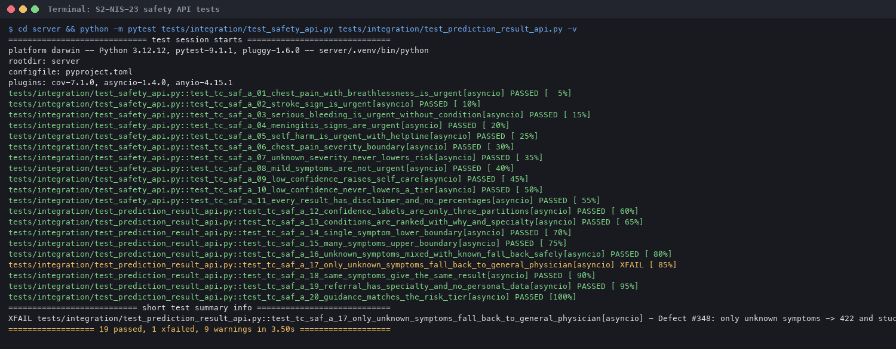
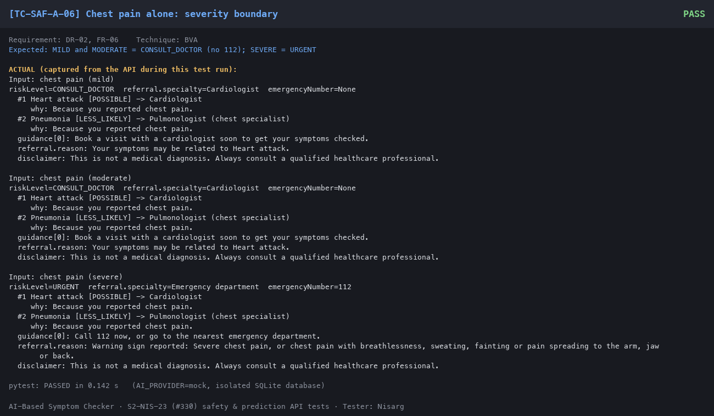
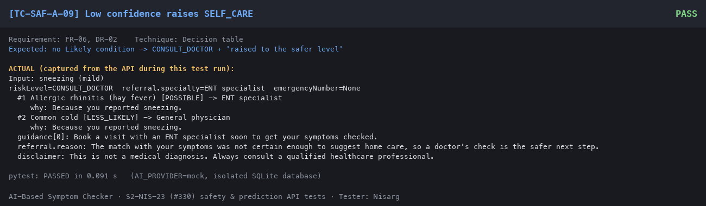
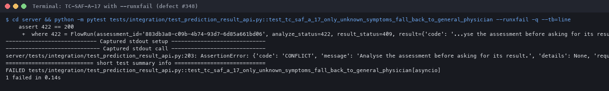
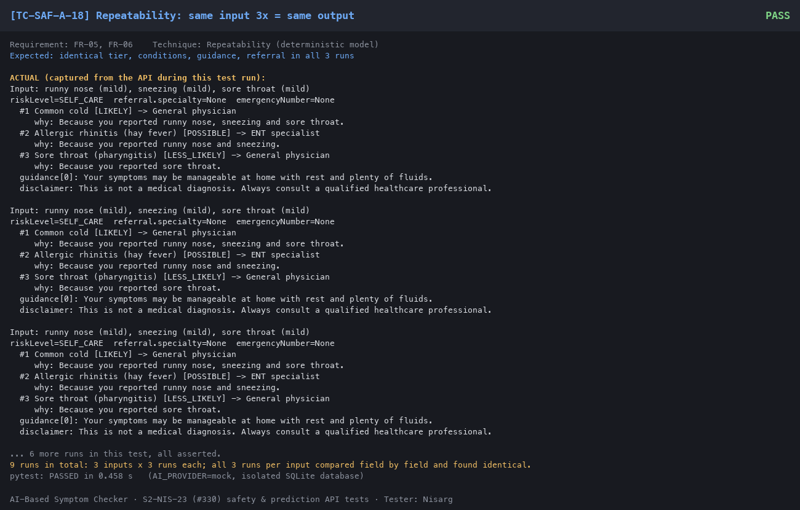

# Safety and Condition-Prediction Result: API Test Cases (Automated)

> **Task:** S2-NIS-23 · **Issue:** [#330](https://github.com/NT1906/AI_based_Symptom_Checker/issues/330) · **Owner / tester:** Nisarg (@NT1906)
> **Method:** black-box API integration testing with pytest + httpx (already installed; no new software)
> **Test files:** [`server/tests/integration/test_safety_api.py`](../../../server/tests/integration/test_safety_api.py) (TC-SAF-A-01 to 11), [`server/tests/integration/test_prediction_result_api.py`](../../../server/tests/integration/test_prediction_result_api.py) (TC-SAF-A-12 to 20)
> **Requirements:** DR-01, DR-02, FR-05, FR-06, FR-08, FR-22, FR-23

Every test drives a real assessment through the public HTTP API, the same way the web app does:
`POST /assessments` → `POST /messages` → `PATCH /symptoms` (the confirmed list) → `POST /analyze` → `GET /result`.
The app runs in-process against a temporary SQLite database. Only the mock AI provider is used (`AI_PROVIDER=mock`, `CV_PROVIDER=mock`), so no Groq or OpenAI key is read or needed.
The risk engine, condition model, specialty mapper and result composer are the real ones.

## Metrics summary

| Metric | Value |
|---|---|
| Total test cases (TC) | **20** (automated API) |
| Passed | **19** |
| Failed | **1** (TC-SAF-A-17, defect [#348](https://github.com/NT1906/AI_based_Symptom_Checker/issues/348); kept as `xfail(strict=True)` so CI stays green and the test turns red once the bug is fixed) |
| Blocked / not run | 0 |
| Pass rate (%) | **95 %** (19 / 20) |
| Acceptance criteria (AC) met | 6 / 7 checked locally; the 7th ("CI passed" and "PR policy" green) is shown on the PR |
| Requirements covered | DR-01, DR-02, FR-05, FR-06, FR-07, FR-08, FR-22, FR-23 |
| Defects found | **1**: [#348](https://github.com/NT1906/AI_based_Symptom_Checker/issues/348) analysis fails (422) and the assessment is stuck in `ANALYZING` when no confirmed symptom is known |
| API runs per test session | 44 complete assessments (create → result), 264 HTTP requests |
| Execution time | 4.0 s for the 20 tests; full server suite 38 s (1872 passed, 1 skipped, 1 xfailed) |
| Environment | macOS 26.0.1 (Apple silicon), Python 3.12.12, pytest 9.1.1, httpx `ASGITransport`, SQLite (temporary), branch `nisarg/330-safety-prediction-api-tests` from `develop` @ `1e71b1d`, 2026-11-20, tester Nisarg |

Techniques used: **decision table** (red-flag rules × expected risk tier), **boundary value analysis** (severity threshold; 1 and 12 symptoms; unknown symptoms), **equivalence partitioning** (confidence labels; one run per risk tier), **error guessing** (unstated severity, unknown symptoms, personal data in the result) and **repeatability** (same input three times).

## Decision table: conditions × expected risk tier

Rules from the risk engine (`server/app/services/prediction/risk_engine.py`, catalog `conditions.json`).
**Y** = the symptom is confirmed, **–** = not present. "Likely condition" means at least one predicted condition is labelled `LIKELY`.

| # | Red-flag rule fires | Severity | Likely condition | Expected tier | Expected referral | Emergency no. | TC | Actual |
|---|---|---|---|---|---|---|---|---|
| R1 | chest pain + shortness of breath (`rf_cardiac_chest_pain`) | moderate | – | URGENT | Emergency department | 112 | TC-SAF-A-01 | URGENT, 112 ✅ |
| R2 | face drooping (`rf_stroke_signs`) | moderate | – | URGENT | Emergency department | 112 | TC-SAF-A-02 | URGENT, 112 ✅ |
| R3 | vomiting blood (`rf_serious_bleeding`), no condition matches | mild | – | URGENT | Emergency department | 112 | TC-SAF-A-03 | URGENT, 112, conditions `[]` ✅ |
| R4 | fever + stiff neck (`rf_meningitis_signs`) | mild | – | URGENT | Emergency department | 112 | TC-SAF-A-04 | URGENT, 112 ✅ |
| R5 | fever alone (no rule fires) | mild | – | not URGENT | – | none | TC-SAF-A-04 | not URGENT ✅ |
| R6 | thoughts of self-harm (`rf_self_harm`) | moderate | – | URGENT + Tele-MANAS 14416 | Emergency department | 112 | TC-SAF-A-05 | URGENT, 112, 14416 ✅ |
| R7 | chest pain alone, below threshold | mild / moderate | – | CONSULT_DOCTOR | Cardiologist | none | TC-SAF-A-06 | CONSULT_DOCTOR ✅ |
| R8 | chest pain alone, at threshold | severe | – | URGENT | Emergency department | 112 | TC-SAF-A-06 | URGENT ✅ |
| R9 | chest pain alone, severity not stated | unknown → treated as severe | – | URGENT + "treated as urgent" note | Emergency department | 112 | TC-SAF-A-07 | URGENT ✅ |
| R10 | none (runny nose, sneezing, sore throat) | mild | Y (Common cold) | SELF_CARE | none | none | TC-SAF-A-08 | SELF_CARE ✅ |
| R11 | none (sneezing alone) | mild | – | CONSULT_DOCTOR (raised by uncertainty) | ENT specialist | none | TC-SAF-A-09 | CONSULT_DOCTOR ✅ |
| R12 | chest pain, severe (red flag) | severe | – | stays URGENT (uncertainty never lowers) | Emergency department | 112 | TC-SAF-A-10 | URGENT ✅ |
| R13 | none (chest pain, mild) | mild | – | stays CONSULT_DOCTOR | Cardiologist | none | TC-SAF-A-10 | CONSULT_DOCTOR ✅ |
| R14 | none (fever, pain behind the eyes, joint pain) | moderate | Y (Dengue) | CONSULT_DOCTOR | General physician | none | TC-SAF-A-11, 20 | CONSULT_DOCTOR ✅ |

## Repeatability table: same input, three runs

The condition model is deterministic, so the same confirmed symptoms must give the same result every time (TC-SAF-A-18).
Compared field by field: risk tier, every condition (name, rank, label, why, specialty), guidance, referral and limitations. Only the assessment ID and timestamp differ.

| Input (confirmed symptoms) | Run 1 | Run 2 | Run 3 | Same? |
|---|---|---|---|---|
| runny nose, sneezing, sore throat (mild) | SELF_CARE · 1 Common cold [Likely] · 2 Allergic rhinitis [Possible] · 3 Sore throat (pharyngitis) [Less likely] | identical | identical | ✅ |
| fever, pain behind the eyes, joint pain (moderate) | CONSULT_DOCTOR · General physician · 1 Dengue [Likely] · 2 Chikungunya [Possible] · 3 Typhoid fever [Less likely] | identical | identical | ✅ |
| chest pain, shortness of breath (moderate) | URGENT · 112 · Emergency department · 1 Heart attack [Possible] · 2 Pneumonia [Possible] · 3 Asthma [Possible] | identical | identical | ✅ |

## Test cases

| TC ID | Requirement | Scenario | Technique | Preconditions | Steps | Test data | Expected result | Actual result | Status | Evidence |
|---|---|---|---|---|---|---|---|---|---|---|
| TC-SAF-A-01 | DR-02, FR-06 | Chest pain with breathlessness is urgent | Decision table | Verified consent; mock AI; assessment in CONFIRMING | 1. Create assessment 2. Send a chat message 3. PATCH the confirmed symptoms 4. POST /analyze 5. GET /result | chest pain (moderate), shortness of breath (moderate) | URGENT; referral required; `emergencyNumber` 112; specialty "Emergency department"; guidance starts "Call 112 now"; no condition needs to be Likely | URGENT, 112, Emergency department, reason "Warning sign reported: Severe chest pain, or chest pain with breathlessness…"; all 3 conditions Possible | Pass | `screenshots/TC-SAF-A-01.png` |
| TC-SAF-A-02 | DR-02, FR-06 | One stroke sign is urgent | Decision table | as TC-01 | as TC-01 | facial droop (moderate) | URGENT with 112; reason names face drooping | URGENT, 112; reason "Face drooping, one-sided weakness, slurred speech or sudden vision loss." | Pass | `screenshots/TC-SAF-A-02.png` |
| TC-SAF-A-03 | DR-02, FR-06 | Serious bleeding is urgent even with no matching condition | Decision table | as TC-01 | as TC-01 | vomiting blood (mild) | URGENT with 112; condition list may be empty | URGENT, 112; `conditions: []` | Pass | `screenshots/TC-SAF-A-03.png` |
| TC-SAF-A-04 | DR-02, FR-06 | Meningitis signs: only the combination is urgent | Decision table | as TC-01 | 1. Run with fever + stiff neck 2. Run with fever alone | fever (mild) + stiff neck (mild); fever (mild) | combination URGENT with 112; fever alone not URGENT | combination URGENT, 112; fever alone not URGENT | Pass | `screenshots/TC-SAF-A-04.png` |
| TC-SAF-A-05 | DR-02, FR-06 | Thoughts of self-harm are urgent and show the helpline | Decision table | as TC-01 | as TC-01 | thoughts of self harm (moderate) | URGENT with 112 and a Tele-MANAS 14416 guidance step | URGENT, 112; guidance includes "Tele-MANAS helpline on 14416" | Pass | `screenshots/TC-SAF-A-05.png` |
| TC-SAF-A-06 | DR-02, FR-06 | Red-flag severity threshold for chest pain alone | BVA | as TC-01 | Run three assessments, one per severity | chest pain at MILD, MODERATE (just below), SEVERE (at threshold) | MILD and MODERATE: CONSULT_DOCTOR with no 112; SEVERE: URGENT | MILD and MODERATE: CONSULT_DOCTOR, Cardiologist, `emergencyNumber` null; SEVERE: URGENT, 112 | Pass | `screenshots/TC-SAF-A-06.png` |
| TC-SAF-A-07 | DR-02, FR-06 | Unstated severity never lowers the risk | Error guessing | as TC-01 | as TC-01 | chest pain (UNKNOWN severity) | URGENT, with the note "You did not say how severe a symptom is, so to be safe this is treated as urgent." | URGENT, 112, note present | Pass | `screenshots/TC-SAF-A-07.png` |
| TC-SAF-A-08 | FR-06 | Mild cold symptoms are not urgent | Decision table | as TC-01 | as TC-01 | runny nose, sneezing, sore throat (all mild) | SELF_CARE; referral not required; no emergency number; top condition Likely | SELF_CARE; `required: false`; `emergencyNumber` null; 1 Common cold [Likely] | Pass | `screenshots/TC-SAF-A-08.png` |
| TC-SAF-A-09 | FR-06, DR-02 | Low confidence raises the tier | Decision table | as TC-01 | as TC-01 | sneezing (mild) | No Likely condition, so SELF_CARE is raised to CONSULT_DOCTOR; limitation says it was raised | CONSULT_DOCTOR, ENT specialist; limitation "Because the match was uncertain, this result was raised to the safer level." | Pass | `screenshots/TC-SAF-A-09.png` |
| TC-SAF-A-10 | FR-06, DR-02 | Low confidence never lowers a tier | Decision table | as TC-01 | Run two assessments with no Likely condition | chest pain (severe); chest pain (mild) | stays URGENT; stays CONSULT_DOCTOR | URGENT; CONSULT_DOCTOR | Pass | `screenshots/TC-SAF-A-10.png` |
| TC-SAF-A-11 | DR-01, FR-22 | Disclaimer on every result; no percentage or probability anywhere in the flow | EP (one run per tier) + regex scan | as TC-01 | 1. Run one SELF_CARE, one CONSULT_DOCTOR and one URGENT assessment 2. Scan all 6 responses of each run 3. Walk the result JSON for decimal numbers | cold symptoms; dengue symptoms; chest pain + breathlessness | `disclaimer` equals "This is not a medical diagnosis. Always consult a qualified healthcare professional." on all 3; 0 matches for `\d+%` and `probabilit\|percent\|score`; 0 decimal numbers in the result | Disclaimer present on all 3 tiers; 18 responses scanned, 0 matches; 0 decimals | Pass | `screenshots/TC-SAF-A-11.png` |
| TC-SAF-A-12 | FR-22 | Confidence labels have only three partitions | EP | as TC-01 | Run 5 assessments with different inputs; collect every label | cold; dengue; headache; chest pain + breathlessness; itchy skin | every label is LIKELY, POSSIBLE or LESS_LIKELY; all three occur | 15 conditions, all labels valid; all three partitions seen | Pass | `screenshots/TC-SAF-A-12.png` |
| TC-SAF-A-13 | FR-05, FR-23 | Conditions are ranked, with a "why" and a specialty | EP | as TC-01 | as TC-12, check each condition | same 5 inputs | ranks 1, 2, 3 in order (at most 3); each "why" starts "Because you reported"; each has a specialty | all ranks consecutive from 1; every condition has a why line and a specialty | Pass | `screenshots/TC-SAF-A-13.png` |
| TC-SAF-A-14 | FR-05 | One symptom (lower boundary) | BVA | as TC-01 | as TC-01 | headache (mild) | complete result; rank 1 condition; why names the symptom | SELF_CARE; 1 Tension-type headache [Likely]; why "Because you reported headache." | Pass | `screenshots/TC-SAF-A-14.png` |
| TC-SAF-A-15 | FR-05, FR-23 | Twelve symptoms (upper boundary) | BVA | as TC-01 | as TC-01 | fever, cough, headache, fatigue, sore throat, runny nose, body ache, sneezing, nausea, diarrhea, rash, itchy skin | at most 3 conditions; why line shortened | 3 conditions (Common cold, Influenza, COVID-19); why "… and 4 other symptoms." | Pass | `screenshots/TC-SAF-A-15.png` |
| TC-SAF-A-16 | FR-05, FR-07 | Unknown symptoms next to a known one | Error guessing | as TC-01 | as TC-01 | "glorbitis of the zibble", "tingling in my left little toe", fatigue | unknown ones ignored; safe CONSULT_DOCTOR with General physician | CONSULT_DOCTOR, General physician; why lines mention only "tiredness or weakness" | Pass | `screenshots/TC-SAF-A-16.png` |
| TC-SAF-A-17 | FR-05, FR-06, idea §7 | Only symptoms the model does not know | BVA / Error guessing | as TC-01 | as TC-01 | "glorbitis of the zibble" (mild) | CONSULT_DOCTOR with a General physician referral ("not knowing is never probably nothing") | `POST /analyze` → **422** "At least one confirmed symptom is required."; the assessment stays in `ANALYZING`, so edit and re-analyze both return 409 | **Fail** → [#348](https://github.com/NT1906/AI_based_Symptom_Checker/issues/348) | `screenshots/TC-SAF-A-17.png`, `screenshots/TC-SAF-A-17-failure.png` |
| TC-SAF-A-18 | FR-05, FR-06 | Same input three times gives the same output | Repeatability | as TC-01 | Run each of 3 inputs 3 times; compare | cold; dengue; chest pain + breathlessness | identical tier, conditions, guidance, referral, limitations | all 9 runs identical within each input (table above) | Pass | `screenshots/TC-SAF-A-18.png` |
| TC-SAF-A-19 | FR-08, DR-04 | Referral gives a map-search specialty; no personal or doctor data | Error guessing | Signed-in test user (`safety_tester@example.com`, test account) | 1. Run as the signed-in user 2. Check referral and result keys 3. Search the body for the email, user ID, consent ID and doctor details | fever, pain behind the eyes, joint pain | specialty "General physician" → the app searches "General physician near me"; only the 9 published result keys; no email, user ID, consent ID, phone, address or clinic | specialty "General physician"; map query "General physician near me"; keys exactly the published ones; 0 matches for personal or doctor data | Pass | `screenshots/TC-SAF-A-19.png` |
| TC-SAF-A-20 | FR-06, DR-02 | Guidance matches the risk tier | EP (one run per tier) | as TC-01 | Run SELF_CARE, CONSULT_DOCTOR and URGENT assessments | cold; dengue; chest pain + breathlessness | SELF_CARE: home-care steps; CONSULT_DOCTOR: "Book a visit with…"; URGENT: "Call 112 now…" and no home-care step | as expected on all three | Pass | `screenshots/TC-SAF-A-20.png` |

## Defect log

| Defect | Found by | Summary | Severity | Status |
|---|---|---|---|---|
| [#348](https://github.com/NT1906/AI_based_Symptom_Checker/issues/348) | TC-SAF-A-17 | When every confirmed symptom is unknown to the model, `POST /analyze` returns 422 and leaves the assessment in `ANALYZING`, so it can be neither edited nor analysed again; expected a safe CONSULT_DOCTOR / General physician result. | High | Open (not fixed in this PR: one task per PR) |

## Evidence

- Full terminal output: [`pytest-output.txt`](pytest-output.txt) · terminal screenshot: [`screenshots/terminal-run.png`](screenshots/terminal-run.png)
- One card per test case in [`screenshots/`](screenshots/). Each card shows the input and the **actual** result captured from the API during the test run (not typed by hand).
- To regenerate everything from a fresh run: `server/.venv/bin/python docs/testing/safety/generate_evidence.py` (from the repository root).

| TC | Card |
|---|---|
| TC-SAF-A-01 |  |
| TC-SAF-A-06 |  |
| TC-SAF-A-09 |  |
| TC-SAF-A-17 |  |
| TC-SAF-A-17 (failure output) |  |
| TC-SAF-A-18 |  |
