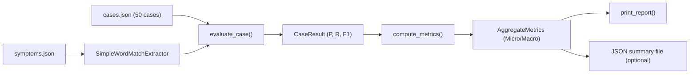

# NLP extraction evaluation cases & harness

**Owner:** Kavya (AI/ML, Database) · **Task:** S1-KAV-2 · **Requirements:** NFR-07, FR-03

Benchmark cases and evaluation harness for measuring symptom-extraction precision, recall, and F1. Each case pairs a realistic user input with the expected canonical symptoms the extractor should produce.

| Read by | For |
|---|---|
| NLP eval harness (`evaluate.py`) | Computing precision, recall and F1 reports across test cases |
| Prompt engineering (S2-NIT-1, Nishith) | Regression testing when LLM prompts change |
| Eval set v2 (S2-KAV-2) | Expanding to 100 cases with Hinglish and colloquial variants |

## Case format

`cases.json` (schema version `1.0`):

```json
{
  "id": "case_001",
  "input": "I've had a really bad headache and feel like throwing up since yesterday",
  "expected": {
    "symptoms": [
      { "id": "headache", "severity": "SEVERE" },
      { "id": "nausea" }
    ],
    "duration": "1 day"
  },
  "notes": "Tests 'bad headache' → severity SEVERE, 'throwing up' → nausea"
}
```

### Fields

| Field | Type | Required | Description |
|---|---|---|---|
| `id` | string | yes | Unique case identifier (`case_NNN`) |
| `input` | string | yes | Raw user text as entered (English or Hinglish) |
| `expected.symptoms` | object[] | yes | Canonical symptoms the extractor should find |
| `expected.symptoms[].id` | string | yes | Canonical symptom ID from `ml/datasets/symptoms/symptoms.json` |
| `expected.symptoms[].severity` | string | no | `MILD`, `MODERATE` or `SEVERE` — omit if not inferable |
| `expected.duration` | string | no | Normalized duration (e.g., `"3 days"`, `"1 week"`) |
| `notes` | string | no | Specific extraction challenge tested |

### Severity rules

- `SEVERE`: "really bad", "worst ever", "extreme", "unbearable", "severe", "tez", "bahut"
- `MODERATE`: "quite", "noticeable", "moderate", "significant"
- `MILD`: "slight", "mild", "a little", "minor", "thoda", "halka"
- Omit severity when the user does not indicate intensity.

## Dataset coverage (v1, 50 cases)

The benchmark includes 50 diverse cases spanning common presentations, emergencies, and language styles:

| Dimension | Count | Details |
|---|---|---|
| Total cases | 50 | `case_001` through `case_050` |
| Multi-symptom (3+ symptoms) | 23 | Complex presentations spanning multiple body systems |
| With duration | 16 | Temporal mentions ("2 days", "3 weeks", "1 month") |
| With explicit severity | 12 | Mild, moderate, and severe markers |
| Hinglish queries | 12 | Transliterated Hindi expressions ("tez bukhar", "pet me dard", "kamzori") |
| Red flags / emergencies | 8 | Meningitis, stroke, cardiac ischemia, GI bleed, respiratory failure |
| Misspellings / colloquialisms | 4 | "headack", "stomake", "diarrhoea", "vomting" |

## Evaluation harness (`evaluate.py`)

The evaluation script `evaluate.py` is standalone ML code (no server dependencies) that runs test cases through any implementation satisfying the `Extractor` protocol and produces precision, recall, and F1 reports.

### Architecture



### Running the evaluation

Default run (evaluates all 50 cases with baseline word-match extractor):

```bash
python ml/nlp_eval/evaluate.py
```

Verbose mode (prints per-case breakdown table):

```bash
python ml/nlp_eval/evaluate.py --verbose
```

Export results to JSON:

```bash
python ml/nlp_eval/evaluate.py --json ml/nlp_eval/results.json
```

Custom case and vocabulary paths:

```bash
python ml/nlp_eval/evaluate.py --cases path/to/cases.json --vocab path/to/symptoms.json
```

### Metrics definition

For each case, predictions are compared against ground truth at the canonical symptom-ID level:

- **True Positives ($TP$):** Predicted symptoms matching expected symptoms.
- **False Positives ($FP$):** Predicted symptoms not present in expected set.
- **False Negatives ($FN$):** Expected symptoms missed by the extractor.
- **Precision ($P$):** $\frac{TP}{TP + FP}$ (defined as 1.0 if $TP+FP=0$ and no expected symptoms).
- **Recall ($R$):** $\frac{TP}{TP + FN}$ (defined as 1.0 if $TP+FN=0$).
- **F1 Score:** $\frac{2 \times P \times R}{P + R}$ (0.0 when $P+R=0$).

Both **micro-averaged** (summing $TP, FP, FN$ globally) and **macro-averaged** (unweighted mean of per-case scores) metrics are computed and reported.

## Testing

The evaluation harness and dataset are verified by unit and integration tests:

```bash
python -m pytest ml/nlp_eval/
```

- `test_cases.py`: Schema validation, ID format, non-empty text, vocabulary alignment.
- `test_evaluate.py`: Metric correctness, edge cases (zero overlap, empty predictions), protocol compliance, CLI options, and end-to-end dataset evaluation.
